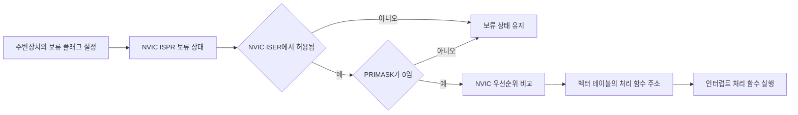
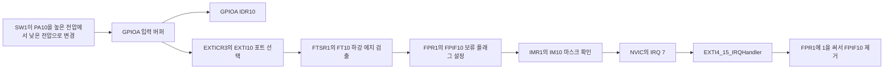
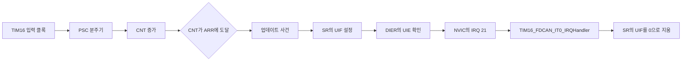
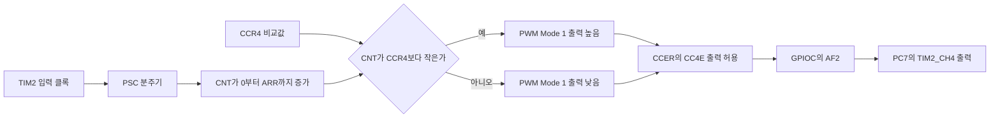
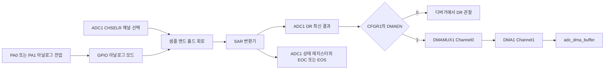

# STM32G0 주변장치 레지스터 관찰과 직접 제어

대상 장치는 Cortex-M0+ 기반 STM32G0B1RE와 NUCLEO-G0B1RE 보드이다. 이 문서의 목적은 주변장치 제어 함수를 익히는 일이 아니라, 최소 실행 프로그램을 멈춘 뒤 디버거에서 레지스터를 직접 변경하고 결과를 관찰하여 MCU 내부 동작을 이해하는 일이다.

## 학습 목표

- 주변장치 클록 게이트, 설정 레지스터, 상태 레지스터, 데이터 레지스터의 역할을 구분하는 것이다.
- GPIO, NVIC, EXTI, 타이머, PWM, ADC의 데이터와 사건 전달 경로를 설명하는 것이다.
- 디버거의 Device Registers 창에서 비트를 직접 바꾸고 핀, 상태 플래그, 메모리 값의 변화를 확인하는 것이다.
- 인터럽트 처리 함수가 벡터 테이블과 NVIC를 통해 호출되는 구조를 이해하는 것이다.
- 쓰기 1로 지우기, 쓰기 0으로 지우기, 쓰기 전용 명령 레지스터의 차이를 구분하는 것이다.

## 학습 방법

각 절의 구성은 레지스터 구조, 하드웨어 내부 동작 흐름, 실전 레지스터 제어, 디버거 관찰 포인트의 순서이다. GPIO, PWM, ADC는 디버거의 Device Registers 창에서 레지스터 필드를 직접 바꾸어 동작을 확인하는 방식이다. 인터럽트는 벡터 테이블이 호출할 처리 함수가 필요하므로 EXTI와 TIM16에 대해서만 최소한의 C 처리 함수를 사용한다.

### 최소 실행 코드

다음 코드는 장치 헤더, 두 개의 인터럽트 처리 함수, 관찰용 전역 변수만 포함한다. 주변장치의 설정은 코드가 아니라 디버거에서 수행하는 방식이다. adc_dma_buffer는 DMA 관찰에서 메모리 목적지 주소를 확인하기 위한 전역 버퍼이다.

```c
#include "stm32g0b1xx.h"

volatile uint32_t exti10_falling_count;
volatile uint32_t tim16_update_count;
volatile uint16_t adc_dma_buffer[2];

void EXTI4_15_IRQHandler(void)
{
  if ((EXTI->FPR1 & EXTI_FPR1_FPIF10) != 0U)
  {
    EXTI->FPR1 = EXTI_FPR1_FPIF10;
    ++exti10_falling_count;
  }
}

void TIM16_FDCAN_IT0_IRQHandler(void)
{
  if ((TIM16->SR & TIM_SR_UIF) != 0U)
  {
    TIM16->SR = (uint32_t)~TIM_SR_UIF;
    ++tim16_update_count;
  }
}

int main(void)
{
  for (;;)
  {
    __NOP();
  }
}
```

시작 코드의 벡터 테이블에는 EXTI4_15_IRQHandler와 TIM16_FDCAN_IT0_IRQHandler의 약한 기본 처리 함수가 포함되어 있다. 같은 이름의 C 함수를 작성하면 기본 처리 함수 대신 위의 처리 함수가 호출되는 구조이다.

프로젝트에는 STM32G0B1xx 장치 정의, CMSIS 시작 코드, 벡터 테이블이 포함되어 있어야 한다. 시스템 클록을 별도로 설정하지 않은 최소 프로젝트는 16 MHz HSI 클록으로 시작한다. 따라서 64 MHz를 전제로 한 타이머와 PWM 값은 64 MHz 클록 설정을 적용한 경우에만 사용해야 하는 값이다.

### 공통 진행 절차

1. 최소 실행 코드를 빌드하고 디버그 모드로 실행한다.
2. main 함수의 __NOP 줄에 중단점을 설정하여 CPU를 반복문 안에서 멈춘다.
3. Device Registers 창과 변수 창을 열어 레지스터 필드와 전역 변수 값을 함께 관찰한다.
4. 각 절의 실전 레지스터 제어 순서대로 값을 변경한다.
5. 인터럽트 실습에서는 처리 함수의 첫 줄에도 중단점을 설정하여 사건 발생 시점을 확인한다.
6. 실습을 마친 뒤에는 디버그 세션을 다시 시작하여 다음 주변장치를 초기 상태에서 관찰한다.

CPU가 중단된 상태에서도 GPIO 출력, 타이머 계수, ADC 변환과 같은 주변장치는 계속 동작할 수 있다. 짧게 나타났다 사라지는 플래그는 인터럽트 처리 함수의 중단점에서 관찰하는 방식이 적합하다.

### 레지스터 쓰기 규칙

| 접근 방식 | 대표 레지스터 | 동작 | 관찰 방법 |
| :--- | :--- | :--- | :--- |
| 일반 읽기와 쓰기 | GPIO MODER, TIM PSC, ADC CFGR1 | 필드에 쓴 값이 유지되는 방식이다. | 레지스터를 다시 읽어 설정값을 확인한다. |
| 쓰기 1로 설정 | GPIO BSRR, NVIC ISER, NVIC ISPR | 1을 쓴 비트만 설정하는 명령 방식이다. | 결과 상태는 ODR, ISER, ISPR에서 확인한다. |
| 쓰기 1로 지우기 | EXTI FPR1, EXTI RPR1, ADC 상태 레지스터 | 1을 쓴 플래그만 지우는 방식이다. | 플래그 비트가 0으로 바뀌는지 확인한다. |
| 쓰기 0으로 지우기 | TIM SR의 UIF | 0을 쓴 플래그를 지우는 방식이다. | UIF를 0으로 만든 뒤 다음 업데이트 사건을 기다린다. |
| 쓰기 전용 명령 | TIM EGR의 UG, GPIO BSRR와 BRR | 명령 자체는 저장되지 않는 방식이다. | 명령 결과를 CNT, SR, ODR에서 확인한다. |

---

## 1. GPIO 출력과 입력

GPIO 제어의 핵심은 ODR 레지스터의 읽기-수정-쓰기 방식을 피하고, 원자적 제어가 가능한 BSRR과 BRR 레지스터를 사용하는 것이다.

### 레지스터 구조

| 레지스터 | 관련 비트 | 역할 | 관찰할 점 |
| :--- | :--- | :--- | :--- |
| MODER | MODE5, MODE10 | 핀을 출력, 입력, 대체 기능, 아날로그 모드로 선택하는 레지스터이다. | PA5 출력 모드는 01, PA10 입력 모드는 00이다. |
| PUPDR | PUPD10 | 입력 핀의 내부 풀업과 풀다운을 선택하는 레지스터이다. | 액티브 로우 SW1에는 01인 풀업을 사용한다. |
| BSRR | BS5, BR5 | 하위 16비트는 출력 설정, 상위 16비트는 출력 해제 명령이다. | 쓰기 전용 명령 레지스터이다. |
| BRR | BR5 | 선택한 출력 비트를 0으로 만드는 명령 레지스터이다. | BSRR의 상위 16비트와 같은 목적에 사용할 수 있다. |
| ODR | OD5 | 최종 출력 래치의 상태를 보관하는 레지스터이다. | BSRR과 BRR의 결과는 ODR에서 확인한다. |
| IDR | ID10 | 외부 핀의 현재 입력 전압 상태를 읽는 레지스터이다. | SW1을 누르면 PA10의 ID10은 0이 된다. |

### 하드웨어 내부 동작 흐름
출력 제어 흐름은 다음과 같다.


입력 제어 흐름은 다음과 같다.


### 실전 레지스터 제어

최소 실행 코드가 반복문에서 멈춘 상태에서 다음 값을 Device Registers 창에 입력한다.

| 순서 | 레지스터 필드 | 입력값 | 기대 결과 |
| :--- | :--- | :--- | :--- |
| 1 | RCC > IOPENR > GPIOAEN | 1 | GPIOA 레지스터 접근이 가능해진다. |
| 2 | GPIOA > MODER > MODE5 | 01 | PA5가 일반 출력 모드가 된다. |
| 3 | GPIOA > BSRR > BS5 | 1 | PA5 출력 래치가 1이 되고 LED 상태가 바뀐다. |
| 4 | GPIOA > BRR > BR5 | 1 | PA5 출력 래치가 0이 된다. |
| 5 | GPIOA > MODER > MODE10 | 00 | PA10이 입력 모드가 된다. |
| 6 | GPIOA > PUPDR > PUPD10 | 01 | PA10 내부 풀업이 선택된다. |
| 7 | GPIOA > IDR > ID10 | 읽기 | SW1을 누르지 않으면 1, 누르면 0이 보인다. |

BSRR에서 BS5에 1을 쓰는 동작은 PA5의 ODR5만 1로 만든다. 여러 핀을 함께 바꿀 때에는 BSRR의 하위와 상위 비트에 필요한 값을 한 번에 써서 원자적으로 처리한다.

### 디버거 관찰 포인트

디버거의 Device Registers 창에서 확인할 항목은 다음과 같다.
- BSRR/BRR에 값을 입력해도 바로 0으로 돌아가는 이유
  - BSRR과 BRR은 상태를 저장하지 않는 쓰기 전용 명령 창구이다. 따라서 쓰기 직후 디버거가 레지스터를 읽으면 0으로 표시될 수 있다.
- 최종 상태 확인은 ODR / IDR에서
  - BSRR과 BRR에 명령을 쓴 뒤 실제 출력 상태는 ODR 비트로 확인하는 방식이다. 버튼에 따른 입력 변화는 IDR 비트에서 관찰하는 방식이다.

---

## 2. NVIC와 인터럽트 벡터

NVIC는 주변장치가 만든 인터럽트 요청을 CPU 예외 처리기로 전달하고, 여러 요청의 허용 상태와 우선순위를 관리하는 Cortex-M0+ 코어 내부 장치이다. 주변장치의 보류 플래그가 설정되어도 NVIC와 전역 인터럽트가 허용되지 않으면 처리 함수는 실행되지 않는다.

### 레지스터 구조

| 레지스터 | 역할 | 관찰할 점 |
| :--- | :--- | :--- |
| ISER[0] | 인터럽트 허용 비트를 1로 설정하는 레지스터이다. | 1을 쓴 비트만 허용된다. 0을 써도 허용 상태는 바뀌지 않는다. |
| ICER[0] | 인터럽트 허용 비트를 0으로 지우는 레지스터이다. | 1을 쓴 비트만 비활성화된다. |
| ISPR[0] | 인터럽트 보류 비트를 설정하는 레지스터이다. | 주변장치 사건 없이 벡터와 처리 함수를 시험할 때 사용할 수 있다. |
| ICPR[0] | 인터럽트 보류 비트를 지우는 레지스터이다. | 이전에 남은 보류 요청을 제거할 때 사용한다. |
| IP[0]부터 IP[7] | 외부 인터럽트의 우선순위를 저장하는 레지스터이다. | STM32G0의 우선순위는 각 바이트의 상위 2비트만 사용한다. |
| PRIMASK | 모든 일반 인터럽트의 전역 허용 상태를 나타내는 코어 레지스터이다. | 1이면 NVIC 설정과 관계없이 일반 인터럽트가 막힌다. |

### 하드웨어 내부 동작 흐름



시작 코드의 벡터 테이블에는 EXTI4_15_IRQHandler와 TIM16_FDCAN_IT0_IRQHandler 같은 약한 기본 처리 함수가 들어 있다. 같은 이름의 C 함수를 작성하면 기본 처리 함수 대신 사용자가 작성한 함수가 호출되는 구조이다.

### 실전 레지스터 제어

| 대상 인터럽트 | IRQ 번호 | ISER[0]에 쓸 값 | ICPR[0]에 쓸 값 | 용도 |
| :--- | :--- | :--- | :--- | :--- |
| EXTI4_15_IRQn | 7 | 0x00000080 | 0x00000080 | PA10의 EXTI10 인터럽트를 허용하거나 이전 보류 상태를 지운다. |
| TIM16_FDCAN_IT0_IRQn | 21 | 0x00200000 | 0x00200000 | TIM16 업데이트 인터럽트를 허용하거나 이전 보류 상태를 지운다. |

ISER과 ICPR은 한 비트에 1을 쓰는 명령 방식이다. Device Registers 창에서 다른 비트가 이미 설정되어 있어도 대상 비트만 1로 바꾸는 방식이 안전하다.

### 디버거 관찰 포인트

- EXTI4_15_IRQn은 7번이므로 NVIC > ISER[0]의 bit 7을 관찰하는 구조이다.
- TIM16_FDCAN_IT0_IRQn은 21번이므로 NVIC > ISER[0]의 bit 21을 관찰하는 구조이다.
- ISPR[0]의 대상 비트가 1인데 ISR이 실행되지 않으면 ISER[0], PRIMASK, 처리 함수 이름을 차례로 확인하는 방식이다.
- ICER[0]에 1을 쓰면 ISER[0]의 해당 비트가 0이 된다. ISER[0]에 직접 0을 쓰는 방식으로 인터럽트를 끄는 것은 올바른 방법이 아니다.

---

## 3. EXTI 외부 인터럽트

EXTI는 GPIO 핀의 상승 또는 하강 에지를 검출하고 보류 플래그를 설정하는 주변장치이다. SW1은 PA10에 연결되어 있으므로 EXTI10을 사용한다. 액티브 로우 입력에서는 버튼을 누를 때 높은 전압에서 낮은 전압으로 바뀌므로 하강 에지를 사용하는 구조이다.

### 레지스터 구조

| 레지스터 | 관련 비트 | 역할 | 관찰할 점 |
| :--- | :--- | :--- | :--- |
| RCC APBENR2 | SYSCFGEN | 외부 인터럽트 입력 원본 선택 회로의 클록 게이트이다. | EXTICR 필드를 바꾸기 전에 1로 설정하는 항목이다. |
| EXTI EXTICR3 | EXTI10[18:16] | EXTI10에 연결할 GPIO 포트를 선택하는 필드이다. | 포트 A 선택값은 000이다. |
| EXTI RTSR1 | RT10 | 상승 에지 감지를 허용하는 비트이다. | 액티브 로우 SW1 실습에서는 0으로 둔다. |
| EXTI FTSR1 | FT10 | 하강 에지 감지를 허용하는 비트이다. | 버튼이 눌릴 때 1로 설정한다. |
| EXTI IMR1 | IM10 | EXTI10 보류 사건을 NVIC에 전달하는 마스크 비트이다. | 1이어야 인터럽트 요청이 전달된다. |
| EXTI RPR1 | RPIF10 | 상승 에지 보류 플래그이다. | 1을 써서 지우는 방식이다. |
| EXTI FPR1 | FPIF10 | 하강 에지 보류 플래그이다. | 처리 함수에서 1을 써서 지우는 방식이다. |

### 하드웨어 내부 동작 흐름



IDR10은 PA10의 현재 전압 상태를 나타내고, FPR1의 FPIF10은 하강 에지가 발생했다는 사건을 나타낸다. 버튼을 누른 상태가 계속되어도 하강 에지 사건은 한 번만 기록되는 구조이다.

### 실전 레지스터 제어

최소 실행 코드를 사용하여 다음 필드를 디버거에서 설정한다.

1. GPIO 절의 방법으로 GPIOAEN을 1로, PA10의 MODE10을 00으로, PUPD10을 01로 설정한다.
2. RCC > APBENR2의 SYSCFGEN을 1로 설정한다.
3. EXTI > EXTICR3의 EXTI10을 000으로 설정하여 PA10을 선택한다.
4. EXTI > RTSR1의 RT10을 0으로, FTSR1의 FT10을 1로 설정한다.
5. EXTI > RPR1의 RPIF10과 FPR1의 FPIF10에 각각 1을 써서 이전 사건을 지운다.
6. EXTI > IMR1의 IM10을 1로 설정한다.
7. NVIC 절의 방법으로 ICPR[0]의 bit 7을 지운 뒤 ISER[0]의 bit 7을 허용한다.
8. EXTI4_15_IRQHandler의 첫 줄에 중단점을 설정하고 SW1을 누른다.

FPR1과 RPR1은 쓰기 1로 지우기 방식이다. FPR1의 FPIF10을 지우려면 해당 비트에 1을 써야 하며, 0을 쓰면 플래그가 유지되는 구조이다.

### 디버거 관찰 포인트

- SW1을 누르기 전에는 GPIOA > IDR의 ID10이 1이고, 누르는 동안에는 0인 상태이다.
- 버튼을 누른 순간 EXTI > FPR1의 FPIF10이 1이 되고, 처리 함수에서 해당 비트에 1을 쓰면 0으로 돌아간다.
- 변수 창의 exti10_falling_count는 유효한 하강 에지마다 하나씩 증가하는 값이다.
- FPR1이 1인데 처리 함수가 실행되지 않으면 IMR1의 IM10, NVIC ISER[0]의 bit 7, PRIMASK를 확인할 대상이다.
- 상승 에지도 함께 관찰하려면 RTSR1의 RT10을 1로 설정하고 RPR1의 RPIF10을 관찰한다.

---

## 4. 범용 타이머

타이머는 주변장치 클록을 세어 정해진 주기의 업데이트 사건을 만드는 주변장치이다. 이 절에서는 TIM16을 사용하여 주기 설정, 상태 플래그, NVIC 인터럽트 전달 과정을 관찰한다.

### 레지스터 구조

| 레지스터 | 관련 비트 또는 값 | 역할 | 관찰할 점 |
| :--- | :--- | :--- | :--- |
| RCC APBENR2 | TIM16EN | TIM16 주변장치 클록 게이트이다. | TIM16EN이 1이어야 타이머 레지스터가 동작한다. |
| TIM16 CR1 | CEN, ARPE | 계수 시작과 자동 재장전 사전 적재를 제어하는 레지스터이다. | CEN은 설정 마지막에 1로 만드는 비트이다. |
| TIM16 PSC | 분주값 | 입력 클록을 PSC+1로 나누는 레지스터이다. | 기본 16 MHz에서 PSC=15999이면 계수 클록은 1 kHz이다. |
| TIM16 ARR | 자동 재장전값 | CNT가 셀 최대값을 정하는 레지스터이다. | ARR=99이면 1 kHz에서 100 ms 주기이다. |
| TIM16 CNT | 현재 계수값 | 현재 진행 중인 카운터 값을 보관하는 레지스터이다. | CPU가 중단된 상태에서도 변할 수 있는 값이다. |
| TIM16 EGR | UG | PSC와 ARR을 즉시 반영하고 업데이트 사건을 만드는 명령 비트이다. | UG를 쓴 뒤 UIF를 지우는 순서가 필요하다. |
| TIM16 DIER | UIE | 업데이트 인터럽트 허용 비트이다. | UIF가 1이어도 UIE가 0이면 처리 함수가 실행되지 않는다. |
| TIM16 SR | UIF | 업데이트 사건 보류 플래그이다. | UIF는 0을 써서 지우는 방식이다. |

업데이트 주기 $T$는 다음 식으로 계산한다.

$$
T = \frac{(PSC + 1) \times (ARR + 1)}{f_{TIM}}
$$

기본 HSI 16 MHz 조건에서 PSC=15999, ARR=99이면 $T=100\,\mathrm{ms}$이다. 시스템 클록과 타이머 클록을 64 MHz로 설정한 조건에서는 같은 주기를 위해 PSC=63999를 사용한다.

### 하드웨어 내부 동작 흐름



EGR의 UG는 새로운 PSC와 ARR 값을 즉시 반영한다. UG 쓰기는 업데이트 사건도 만들 수 있으므로, NVIC를 허용하기 전에 SR의 UIF를 0으로 지워 이전 사건을 제거해야 하는 구조이다.

### 실전 레지스터 제어

다음 순서는 기본 HSI 16 MHz 조건에서 100 ms마다 TIM16 인터럽트가 발생하도록 만드는 절차이다.

1. RCC > APBENR2의 TIM16EN을 1로 설정한다.
2. TIM16 > CR1의 CEN을 0으로 설정한다.
3. TIM16 > PSC를 15999, ARR을 99, CNT를 0으로 설정한다.
4. TIM16 > EGR의 UG에 1을 쓴다.
5. TIM16 > SR의 UIF를 0으로 설정한다.
6. TIM16 > DIER의 UIE를 1로 설정한다.
7. NVIC > ICPR[0]의 bit 21에 1을 쓴 뒤 ISER[0]의 bit 21에 1을 쓴다.
8. TIM16_FDCAN_IT0_IRQHandler의 첫 줄에 중단점을 설정하고 TIM16 > CR1의 CEN을 1로 설정한다.

TIM16_FDCAN_IT0_IRQHandler는 최소 실행 코드에 포함되어 있다. 이 처리 함수는 UIF를 지운 뒤 tim16_update_count만 증가시키므로, 타이머의 내부 사건이 CPU 인터럽트로 전달되었는지 확인하는 데 필요한 최소한의 코드이다.

### 디버거 관찰 포인트

- TIM16EN=1, PSC=15999, ARR=99, DIER.UIE=1, CR1.CEN=1이 기본 확인 항목이다.
- EGR.UG에 1을 쓴 직후 SR.UIF가 1이 될 수 있다. 이는 설정값 반영 과정에서 발생한 업데이트 사건이다.
- TIM16_FDCAN_IT0_IRQHandler의 중단점에서 SR.UIF=1과 tim16_update_count의 증가를 함께 확인하는 방식이다.
- SR.UIF는 쓰기 0으로 지우는 플래그이다. EXTI와 ADC의 쓰기 1로 지우기 플래그와 구분해야 하는 항목이다.
- 타이머가 동작하는 동안 CNT는 계속 변한다. 일정한 값을 관찰하려면 처리 함수 중단점에서 확인하는 방법이 적합하다.

---

## 5. PWM 출력

PWM은 타이머가 일정한 주기로 출력 핀을 켜고 끄되, 켜진 시간의 비율을 바꾸어 LED 밝기와 부저의 평균 에너지를 조절하는 방식이다. 이 절에서는 PC7의 TIM2_CH4를 사용하여 PWM 신호가 타이머에서 핀까지 전달되는 구조를 관찰한다.

### 레지스터 구조

| 레지스터 | 관련 비트 또는 값 | 역할 | 관찰할 점 |
| :--- | :--- | :--- | :--- |
| RCC IOPENR | GPIOCEN | GPIOC 주변장치 클록 게이트이다. | GPIOCEN이 1이어야 PC7의 대체 기능을 설정할 수 있다. |
| GPIOC MODER | MODE7=10 | PC7을 대체 기능 모드로 선택하는 필드이다. | 일반 출력 모드 01에서는 TIM2 출력이 핀에 전달되지 않는다. |
| GPIOC AFRL | AFSEL7=2 | PC7을 TIM2_CH4에 연결하는 대체 기능 선택 필드이다. | STM32G0B1RE에서 TIM2_CH4의 선택값은 AF2이다. |
| RCC APBENR1 | TIM2EN | TIM2 주변장치 클록 게이트이다. | TIM2EN을 먼저 허용하는 순서이다. |
| TIM2 PSC, ARR | 분주값, 자동 재장전값 | PWM 전체 주파수를 결정하는 레지스터이다. | 기본 16 MHz에서 PSC=15, ARR=999이면 1 kHz이다. |
| TIM2 CCR4 | 비교값 | TIM2 채널 4의 듀티비를 결정하는 레지스터이다. | 0은 계속 낮은 전압, ARR+1은 계속 높은 전압에 가까운 상태이다. |
| TIM2 CCMR2 | CC4S, OC4M, OC4PE | 채널 4의 출력 비교와 PWM Mode 1을 설정하는 레지스터이다. | OC4M=0110은 PWM Mode 1이다. |
| TIM2 CCER | CC4E, CC4P | 채널 4 출력 허용과 극성을 설정하는 레지스터이다. | CC4E=1, CC4P=0이 높은 전압이 활성인 출력 조건이다. |
| TIM2 CR1, EGR | CEN, ARPE, UG | 타이머 시작과 사전 적재값 반영을 제어하는 레지스터이다. | UG를 쓴 뒤 CEN을 1로 설정하는 순서이다. |

PWM 주파수와 듀티비는 다음 식으로 계산한다.

$$
f_{PWM} = \frac{f_{TIM}}{(PSC + 1) \times (ARR + 1)}
\qquad
D = \frac{CCR4}{ARR + 1} \times 100\%
$$

기본 HSI 16 MHz 조건에서 PSC=15, ARR=999이면 $f_{PWM}=1\,\mathrm{kHz}$이다. CCR4=250이면 듀티비는 약 25%이다. 64 MHz 타이머 클록에서는 같은 1 kHz를 위해 PSC=63을 사용한다.

### 하드웨어 내부 동작 흐름



PSC와 ARR은 파형의 전체 주기를 정하고, CCR4는 그 주기 안에서 높은 전압이 유지되는 시간을 정한다. 따라서 밝기 조절에서는 PSC와 ARR을 유지한 채 CCR4만 바꾸는 방식이 적합하다.

### 실전 레지스터 제어

최소 실행 코드가 중단된 상태에서 기본 HSI 16 MHz 기준 1 kHz PWM을 다음 순서로 설정한다.

1. RCC > IOPENR의 GPIOCEN과 RCC > APBENR1의 TIM2EN을 1로 설정한다.
2. GPIOC > MODER의 MODE7을 10으로 설정한다.
3. GPIOC > AFRL의 AFSEL7을 0010으로 설정한다.
4. TIM2 > CR1의 CEN을 0으로 설정한다.
5. TIM2 > PSC를 15, ARR을 999, CCR4를 0으로 설정한다.
6. TIM2 > CCMR2에서 CC4S=00, OC4M=0110, OC4PE=1로 설정한다.
7. TIM2 > CCER에서 CC4P=0, CC4E=1로 설정한다.
8. TIM2 > EGR의 UG에 1을 쓴 뒤 CR1의 ARPE=1, CEN=1로 설정한다.
9. TIM2 > CCR4를 0, 250, 500, 750, 1000 순서로 바꾸며 PC7 출력 변화를 관찰한다.

GPIOC의 ODR을 바꾸어 PWM 파형을 제어하지 않는다. PC7이 대체 기능 모드인 동안 출력 신호의 원본은 TIM2의 비교 회로이다.

### 디버거 관찰 포인트

- GPIOCEN과 TIM2EN이 모두 1인지 확인하는 항목이다.
- MODE7=10과 AFSEL7=0010이 아니라면 타이머 내부 파형은 PC7으로 전달되지 않는 상태이다.
- PSC=15, ARR=999, CCR4의 값은 각각 주파수와 듀티비를 결정하는 값이다.
- CCMR2의 CC4S=00, OC4M=0110, OC4PE=1과 CCER의 CC4E=1을 확인하는 순서이다.
- PC7의 실제 LED 밝기 방향은 실드 회로의 극성에 따라 달라질 수 있다. 먼저 CCR4=0과 CCR4=1000의 결과를 비교하는 방법이 적합하다.
- PB0의 TIM1_CH2N은 보완 PWM 출력이다. 이 출력은 TIM1의 CC2NE와 BDTR의 MOE도 1이어야 하므로 TIM2_CH4와 다른 조건을 가진다.

---

## 6. ADC 변환과 DMA

ADC는 PA0과 PA1 같은 아날로그 핀의 전압을 디지털 값으로 변환하는 주변장치이다. 12비트 해상도에서는 0 V부터 VDDA까지의 전압이 0부터 4095까지의 값으로 표현된다. 먼저 PA0 단일 채널 변환을 직접 관찰하고, 이후 PA0과 PA1의 다채널 결과가 DMA를 통해 메모리 버퍼로 이동하는 구조를 관찰한다.

### 레지스터 구조

| 레지스터 | 관련 비트 또는 값 | 역할 | 관찰할 점 |
| :--- | :--- | :--- | :--- |
| RCC APBENR2 | ADCEN | ADC1 주변장치 클록 게이트이다. | ADCEN이 0이면 보정과 변환이 시작되지 않는다. |
| GPIOA MODER | MODE0=11, MODE1=11 | PA0과 PA1을 아날로그 모드로 선택하는 필드이다. | 아날로그 입력 전압은 VDDA를 넘으면 안 된다. |
| ADC1 CFGR2 | CKMODE=01 | 동기 AHB 클록을 2로 나눈 ADC 클록 선택 필드이다. | 기본 16 MHz에서는 8 MHz, 64 MHz에서는 32 MHz ADC 클록이다. |
| ADC1 SMPR | SMP1=111 | 공통 샘플링 시간을 160.5사이클로 설정하는 필드이다. | 높은 임피던스의 가변저항과 CdS 회로에는 긴 샘플링 시간이 적합하다. |
| ADC1 CHSELR | CHSEL0, CHSEL1 | 정규 변환에 사용할 채널을 선택하는 레지스터이다. | 단일 변환은 CHSEL0, 스캔은 CHSEL0과 CHSEL1을 사용한다. |
| ADC1 CR | ADCAL, ADEN, ADSTART, ADDIS | 보정, 활성화, 변환 시작, 비활성화를 제어하는 레지스터이다. | 보정과 설정은 ADC가 비활성화된 상태에서 수행한다. |
| ADC1 상태 레지스터 | ADRDY, EOC, EOS, OVR | 준비 완료, 변환 완료, 시퀀스 완료, 오버런 플래그이다. | 각 플래그는 1을 써서 지우는 방식이다. |
| ADC1 DR | 변환 결과 | 가장 최근 정규 변환 결과를 보관하는 레지스터이다. | 스캔 중에는 새 변환 결과로 계속 갱신된다. |
| ADC1 CFGR1 | CONT, DMAEN, DMACFG, SCANDIR | 연속 변환, DMA 전송, 스캔 방향을 정하는 레지스터이다. | 다채널 최신값은 DMA 버퍼에서 관찰하는 방식이다. |
| DMA1 Channel1 | CCR, CNDTR, CPAR, CMAR | ADC1의 DR에서 메모리로 데이터를 옮기는 DMA 채널이다. | DMA 채널은 설정을 마친 뒤 EN을 1로 설정한다. |
| DMAMUX1 Channel0 | DMAREQ_ID | DMA1 Channel1에 전달할 요청 원본을 선택하는 레지스터이다. | ADC1 요청 식별값은 5이다. |

12비트 변환 시간은 다음 식으로 근사할 수 있다.

$$
t_{conv} = \frac{t_{sample} + 12.5\ \text{cycles}}{f_{ADC}}
$$

기본 16 MHz 조건에서 동기 분주 2와 160.5사이클 샘플링을 사용하면 한 채널 변환 시간은 약 $21.6\,\mu\text{s}$이다. 64 MHz 조건에서는 ADC 클록이 32 MHz가 되어 같은 변환 시간이 약 $5.4\,\mu\text{s}$이다.

### 하드웨어 내부 동작 흐름



단일 채널 변환에서는 EOC가 설정된 뒤 DR을 읽는 구조이다. 두 채널 이상을 스캔하면 DR은 변환마다 덮어써지므로, 채널별 결과를 유지하려면 DMA가 결과를 메모리 버퍼로 복사해야 한다.

### 실전 레지스터 제어

아날로그 입력에는 3.3 V를 넘는 전압을 인가하면 안 된다. Easy Module Shield의 아날로그 전원 레일이 3.3 V로 구성되어 있거나 PA0과 PA1 앞에 분압 회로가 있는 상태가 전제이다.

단일 채널 변환 관찰은 PA0의 ADC1_IN0을 사용한다.

1. 새 디버그 세션을 시작하여 ADC가 비활성화된 초기 상태로 만든다.
2. RCC > IOPENR의 GPIOAEN과 RCC > APBENR2의 ADCEN을 1로 설정한다.
3. GPIOA > MODER의 MODE0을 11로, PUPDR의 PUPD0을 00으로 설정한다.
4. ADC1 > CFGR1에서 CONT=0, DMAEN=0, DMACFG=0으로 설정한다.
5. ADC1 > CFGR2의 CKMODE를 01로, SMPR의 SMP1을 111로, CHSELR의 CHSEL0을 1로 설정한다.
6. ADC1 > CR의 ADCAL에 1을 쓰고 이 비트가 자동으로 0이 될 때까지 기다린다.
7. ADC1 > ISR의 ADRDY에 1을 써서 이전 상태를 지운 뒤 CR의 ADEN을 1로 설정한다.
8. ISR의 ADRDY가 1이 되면 EOC, EOS, OVR에 각각 1을 써서 이전 플래그를 지운다.
9. CR의 ADSTART를 1로 설정하고 ISR의 EOC가 1이 되는지 확인한 뒤 DR 값을 관찰한다.

다채널 스캔과 원형 DMA 관찰은 단일 채널 실습을 마친 뒤 새 디버그 세션에서 수행하는 방식이다.

1. 최소 실행 코드의 adc_dma_buffer 주소를 변수 창에서 확인한다.
2. RCC > AHBENR의 DMA1EN을 1로 설정한다.
3. DMA1 Channel1 > CCR의 EN을 0으로 둔 상태에서 CNDTR=2, CPAR=0x40012440, CMAR=adc_dma_buffer의 시작 주소로 설정한다.
4. DMA1 Channel1 > CCR에서 DIR=0, CIRC=1, PINC=0, MINC=1, PSIZE=01, MSIZE=01로 설정한다.
5. DMAMUX1 Channel0 > CCR의 DMAREQ_ID를 5로 설정한다.
6. ADC1 > CHSELR에서 CHSEL0과 CHSEL1을 1로, CFGR1에서 SCANDIR=0, CONT=1, DMAEN=1, DMACFG=1로 설정한다.
7. ADC 보정과 활성화 과정을 단일 채널 실습의 6번과 7번 순서로 다시 수행한다.
8. DMA1 Channel1 > CCR의 EN을 1로 설정한 뒤 ADC1 > CR의 ADSTART를 1로 설정한다.

CPAR의 0x40012440은 STM32G0B1RE에서 ADC1 DR 레지스터의 주소이다. DMA가 활성화된 상태에서는 CNDTR, CPAR, CMAR, CCR의 전송 형식 비트를 바꾸지 않는 것이 원칙이다.

### 디버거 관찰 포인트

- ADCEN=1, MODE0=11, PUPD0=00은 PA0 단일 변환의 기본 확인 항목이다.
- ADCAL은 보정이 진행되는 동안 1이고 완료되면 자동으로 0이 된다.
- ADEN을 1로 설정한 뒤 ADRDY가 1이 되어야 변환을 시작할 수 있는 상태이다.
- ADSTART를 1로 설정한 뒤 EOC가 1이 되고 DR에 0부터 4095 사이의 값이 나타나는 순서이다.
- ADC1 상태 레지스터의 ADRDY, EOC, EOS, OVR은 쓰기 1로 지우는 플래그이다.
- 다채널 원형 DMA에서는 DMA1 Channel1의 CNDTR이 2와 1 사이에서 변하고, adc_dma_buffer의 두 원소가 PA0과 PA1의 최신값으로 갱신되는 구조이다.
- 두 원소를 읽는 순간 DMA가 다음 변환 순서를 시작하면 두 값의 시점이 완전히 같지 않을 수 있다. 같은 시점의 두 채널 값이 필요하면 DMA 완료 시점에 별도 버퍼로 복사하는 구조가 필요하다.

## 마무리

주변장치 제어는 설정 레지스터에 값을 쓰는 일만으로 끝나지 않는다. 클록 게이트, 핀 연결, 주변장치 내부 설정, 상태 플래그, NVIC, 벡터 테이블이 하나의 경로로 연결되어야 실제 핀 동작과 인터럽트 처리가 나타나는 구조이다.

이 문서의 최소 실행 코드는 직접 레지스터 실습을 위한 관찰 지점이다. 각 절에서 레지스터 하나를 바꾼 뒤 핀 전압, ODR과 IDR, 상태 플래그, 인터럽트 계수, DMA 버퍼 중 어떤 값이 바뀌었는지 확인하는 과정이 MCU 내부 구조를 이해하는 핵심이다.