# 임베디드 시스템 인터페이스 회로

## 개요

이 교재는 자동차의 바디 제어 모듈, 즉 BCM(Body Control Module)이 처리하는 스위치 입력과 램프 출력을 NUCLEO-64 보드와 Easy Module Shield로 축소 재현하는 실습 교재로 임베디드 인터페이스의 기초 개념부터 디지털 입출력 회로, 디바운싱, 폴링, 외부 인터럽트까지 순서대로 학습한다. 학습 대상은 STM32 계열 MCU를 처음 접하는 입문자이며, 모든 실습은 STM32CubeMX로 프로젝트 초기 설정을 하고 STM32CubeIDE에서 코드를 작성하는 순서로 진행한다.

실습 장비는 NUCLEO-64 보드(NUCLEO-G0B1RE), Easy Module Shield, USB Mini-B 케이블이다. 개발 환경은 STM32CubeMX, STM32CubeIDE, PC 시리얼 모니터이다.

## 1장. 실습 환경

### 실습 장비 이해 

**NUCLEO 보드와 ST-LINK**

이번 실습에서 사용하는 NUCLEO-G0B1RE는 ST마이크로일렉트로닉스가 만든 NUCLEO 시리즈 개발 보드 중 하나이다. NUCLEO 시리즈는 보드 크기에 따라 Nucleo-32, Nucleo-64, Nucleo-144 세 가지 폼팩터로 나뉘며, 이름의 숫자는 MCU 패키지의 핀 개수를 뜻한다. NUCLEO-G0B1RE라는 이름에서 G0는 저비용/범용 용도에 특화된 STM32G0 시리즈를 가리키고, B1은 그 시리즈 안에서 듀얼뱅크 플래시를 갖춘 세부 제품군을, R은 64핀 패키지를, E는 512kB 플래시 용량을 나타낸다. 즉 보드 이름 자체가 이 보드에 어떤 MCU가 실장되어 있는지를 그대로 알려주는 표기 방식이다. NUCLEO-G0B1RE는 Nucleo-64 폼팩터에 속하며, 보드 위에는 Arduino Uno R3 규격과 동일한 위치에 헤더가 배치되어 있어 Easy Module Shield 같은 아두이노용 실드를 그대로 꽂아 사용할 수 있다.

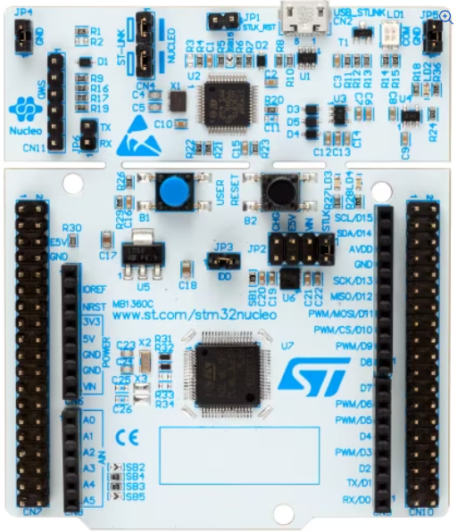</br>


NUCLEO 보드에서 실제 실습 코드가 올라가는 대상은 보드 중앙에 실장된 STM32G0B1RE MCU 한 칩뿐이며, 이 칩은 ARM Cortex-M0+ 코어를 3.3V 전압, 최대 64MHz로 동작시키는 범용 MCU이다. 그런데 이 MCU 칩 하나만으로는 PC와 통신하거나 프로그램을 다운로드할 방법이 없다. 이 역할을 담당하는 부분이 보드 상단에 함께 실장된 ST-LINK이다. ST-LINK는 별도의 작은 MCU와 USB 컨트롤러로 구성된 온보드 프로그래머 겸 디버거로, PC의 USB 포트와 STM32G0B1RE의 SWD(Serial Wire Debug) 핀 사이를 중계하여 코드를 다운로드하고, 중단점을 걸어 실행을 멈추고, 변수 값을 실시간으로 확인하는 디버깅 기능까지 제공한다. NUCLEO 보드는 이 ST-LINK 부분과 실제 실습 대상인 STM32 MCU 부분이 하나의 기판 위에 함께 있지만 전기적으로는 분리되어 있으며, 두 부분 모두 하나의 USB Mini-B 케이블을 통해 PC와 연결된다.


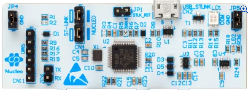</br>

ST-LINK는 프로그램 다운로드와 디버깅 외에 한 가지 기능을 더 제공하는데, 바로 USB-시리얼 변환 기능이다. STM32G0B1RE의 `USART2` 핀은 보드 내부에서 ST-LINK와 배선되어 있어서, MCU가 `USART2`로 내보내는 데이터가 ST-LINK를 거쳐 PC에서는 가상 COM 포트, 즉 Virtual COM Port로 나타난다. 그 덕분에 별도의 USB-시리얼 변환 모듈을 추가로 연결하지 않고도 USB Mini-B 케이블 한 개만으로 전원 공급, 코드 다운로드, 디버깅, 시리얼 통신까지 네 가지 역할을 모두 수행할 수 있다. 뒤이은 '개발 환경 구성' 절에서 STM32CubeIDE에 ST-LINK 드라이버를 함께 설치하는 이유도 이 때문이며, '차량용 아날로그 센서 회로 구조 분석' 절에서 `USART2`를 PC 시리얼 모니터와 연결하는 과정 역시 지금 설명한 ST-LINK의 가상 COM 포트 기능을 그대로 이용하는 것이다.

**Easy Module Shield**

Easy Module Shield는 Arduino Uno R3 규격에 맞춰 제작된 확장 보드로, 가변저항, CdS 조도센서, LED 2개, RGB LED, 버튼(SW) 2개, 피에조 부저까지 흔히 쓰이는 입출력 부품 여섯 종류를 하나의 기판 위에 모아 놓은 학습용 실드이다. 각 부품은 이미 정해진 핀에 배선이 끝난 상태로 기판에 실장되어 있으므로, 별도의 점퍼선 연결 없이 NUCLEO 보드의 Arduino 헤더에 그대로 꽂기만 하면 모든 부품을 곧바로 사용할 수 있다.

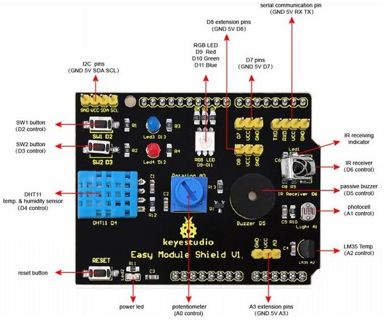</br>

Easy Module Shield는 원래 5V로 동작하는 Arduino UNO를 기준으로 설계되었으므로, 보드에 실장된 각 부품의 입출력 신호도 0V에서 5V 범위를 기준으로 한다. NUCLEO 보드는 Arduino Uno R3와 동일한 헤더 규격을 제공하므로 실드를 물리적으로 그대로 꽂을 수 있지만, MCU 자체는 3.3V로 동작하므로 두 보드 사이에는 전압 체계의 차이가 존재한다. 이 차이를 어떻게 다루어야 하는지는 '디지털 및 아날로그 신호의 전기적 특성' 절의 FT(5V Tolerant) 구조와 '차량용 아날로그 센서 회로 구조 분석' 절의 전압분배 회로에서 각각 디지털 신호와 아날로그 신호 관점으로 나누어 자세히 다룬다.

이번 실습에서는 Easy Module Shield에 실장된 여섯 종류의 부품을 있는 그대로 다루지 않고, 아래 자동차 전장 부품 매핑표에 따라 실제 차량의 전장 부품 역할로 재해석하여 사용한다. 예를 들어 가변저항은 운전자가 조작하는 조명 조절 스위치로, CdS 조도센서는 오토라이트 기능을 위한 차량 외장 조도 센서로 대응시키는 방식이다. 이렇게 부품 하나하나에 실제 차량 부품의 역할을 부여함으로써, 이후 이어지는 모든 실습을 자동차 BCM이 처리하는 스위치 입력과 램프 출력을 다루는 과정으로 자연스럽게 연결한다.

**자동차 전장 부품 매핑표**

Easy Module Shield의 각 부품은 아래와 같이 자동차 전장 부품 역할로 매핑되어 실습을 진행한다.

| 실제 차량 부품 | 대응하는 실드 부품 | STM32 핀 |
|---|---|---|
| 차량 조도 센서(Auto Light Sensor) | CdS 조도센서 | `PA1` |
| 운전자 조명 조절 스위치(Dimmer Switch) | 가변저항 | `PA0` |
| 헤드램프, 주간주행등(DRL) | RGB LED | `PC7`, `PB0`, `PA7` |
| 비상등, 좌측 방향지시등 | LED2 | `PA6` |
| 비상등, 우측 방향지시등 | LED1 | `PA5` |
| 비상등 버튼 | SW1 | `PA10` |
| 도어 스위치 | SW2 | `PB3` |
| 안전벨트 미착용 및 후방 경고음(Chime Bell) | 피에조 부저 | `PB4` |

### 개발 환경 구성

이 절에서는 실습에 필요한 세 가지 핵심 소프트웨어인 STM32CubeIDE와 STM32CubeMX, STM32CubeMonitor를 C:\ST 아래 설치하는 과정을 다룬다. 

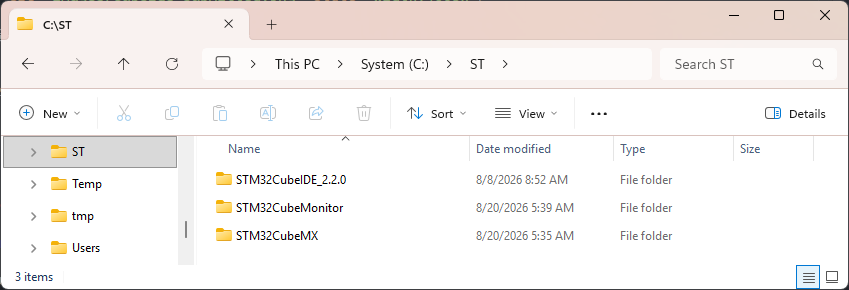</br>

STM32CubeMX는 사용할 MCU와 보드를 선택하면 핀 배치, 클럭 트리, 주변장치 초기 설정을 그래픽 환경에서 구성하고 이를 바탕으로 초기 프로젝트 코드를 자동 생성해 주는 도구이고, STM32CubeIDE는 STM32CubeMX가 생성한 프로젝트를 열어 실제 C 코드를 작성하고, 컴파일하고, 보드에 다운로드하여 디버깅까지 수행하는 통합개발환경이다.

STM32CubeMonitor는 MCU가 실행 중인 상태에서 내부 변수나 레지스터 데이터를 실시간으로 모니터링하고 시각화(대시보드 구성)하는 런타임 데이터 분석 도구이다. STM32CubeMX가 개발 초기 설정과 코드 생성을 담당한다면, STM32CubeMonitor는 개발 중반 이후의 디버깅, 테스트, 성능 최적화를 담당한다.

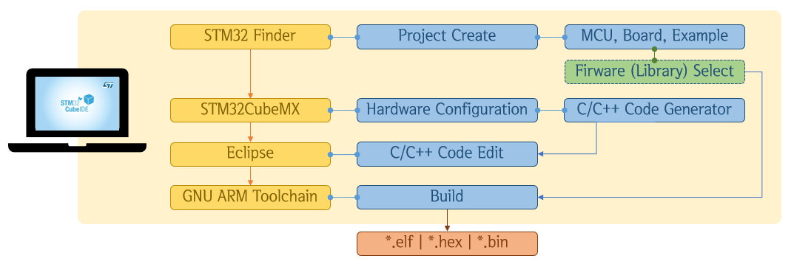</br>

**STM32 CubeIDE 설치**

STM32CubeIDE는 Eclipse 기반에 GCC 컴파일러와 GDB 디버거, ST-LINK 드라이버까지 하나로 통합한 ST의 공식 무상 개발 환경이다. 별도의 컴파일러나 디버거를 따로 설치하지 않아도 이 프로그램 하나만으로 코드 작성부터 보드 다운로드, 중단점 디버깅까지 모두 처리할 수 있다는 점이 특징이다.

설치 파일은 아래 순서로 내려받는다.

1. 웹브라우저에서 https://www.st.com/en/development-tools/stm32cubeide.html 접속한 후 하단 Get Software에서 STM32CubeIDE 항목 중 해당 OS(현재는 Windows)의 'Download'를 선택한다.
   </br>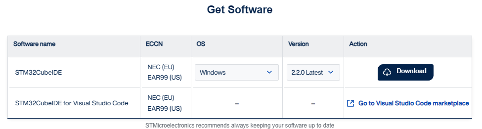
2. License Agreement 화면이 표시되면 'Accept'를, 다운로드 정보 선택 화면 표시되면 'Download as a guest'를, 게스트 정보 입력 화면이 표시되면, 'Professional Email' 항목에 자신의 이메일 주소 입력하고 'Please keep me informed...'를 체크한 후 'Get link to download' 선택한다.
   </br>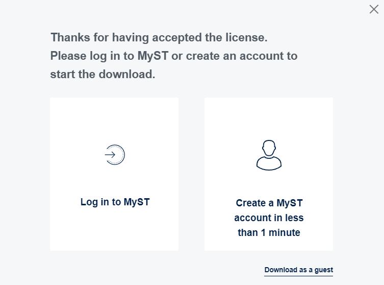
   </br>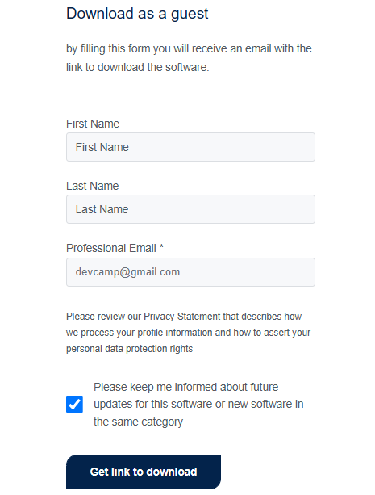
3. 메인 전송 완료 팝업이 표시되면 'ok' 선택한다.
   </br>
4. 앞서 입력한 메일함으로 이동해 STMicroelectronics에서 보낸 메일을 열고, 본문에 포함된 'Download now'를 선택해 압축된 설치 파일을 PC로 다운로드한다.
   </br>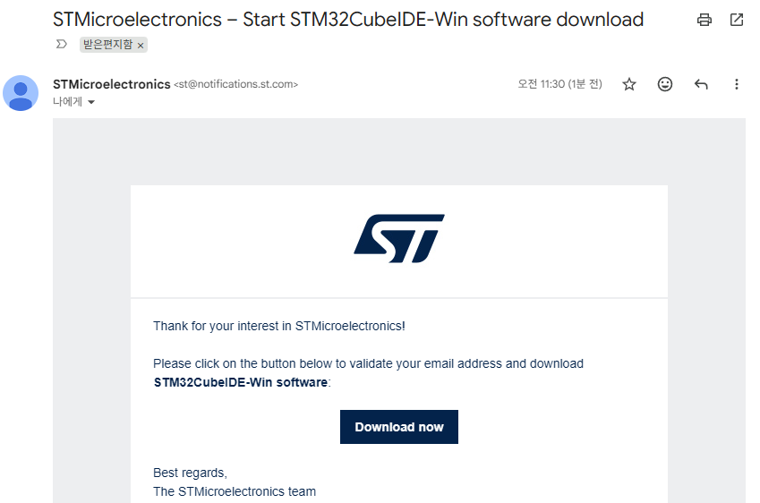

다운로드한 파일의 압축을 해제한 후 다음과 같이 설치를 진행한다.

1. 압축 해제한 stm32cubeide_x.y.z_m1_m2_m3-Win-x86_64.exe를 실행하면, 사용자 계정 컨트롤 창이 표시되는데, 'Yes' 선택 후 'Next'를 눌러 설치를 시작한다.
   </br>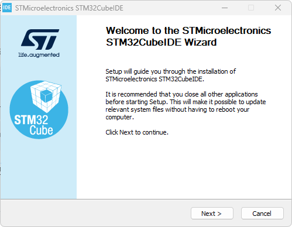
2. Choose Install Location 패이지에서 설치 위치(기본값은 C:\ST\STM32CubeIDE_x.y.z)를 입력한다. (본 교재에서는 C:\ST를 루트경로로 사용) 
   </br>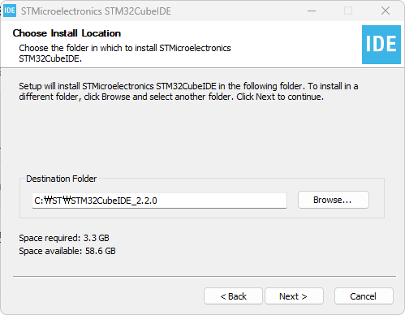</br>
3. Choose Components 페이지에서 SEGGER J-Link drivers만 체크를 해제한 후 'Install'을 선택한다.
   </br>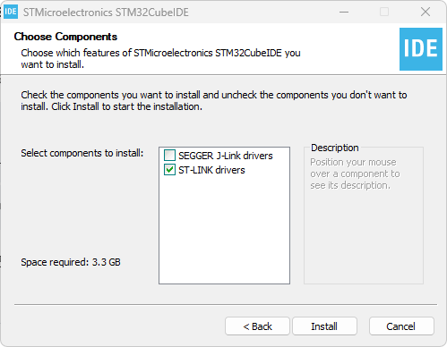
4. 범용 드라이버 설치 과정에서 Windows Security 창이 표시되면 '설치' 선택한다.
   </br>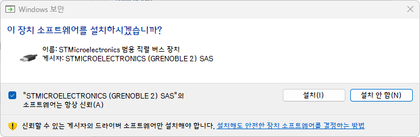

4번 줄은 STM32CubeIDE에 내장된 ST-LINK USB 드라이버를 설치하는 과정에서 표시되며, 이 드라이버가 설치되어야 이후 실습에서 ST-LINK로 코드를 다운로드하고 디버깅할 수 있다.

**STM32 CubeMX 설치**

STM32CubeMX는 사용할 보드나 MCU를 선택하면 그 칩이 실제로 지원하는 핀 기능, 클럭 소스, 주변장치 목록을 그래픽 화면에 보여주고, 그 안에서 어떤 핀을 무슨 용도로 쓸지, 시스템 클럭을 어떤 경로로 구성할지, GPIO와 타이머와 ADC 같은 주변장치를 어떤 모드로 초기화할지를 마우스 클릭만으로 설정할 수 있게 해 주는 도구이다. 이렇게 화면에서 구성한 내용은 GENERATE CODE 버튼 한 번으로 실제 C 프로젝트로 변환되는데, 이때 생성되는 코드에는 클럭 트리 초기화, 각 주변장치의 레지스터 설정, 인터럽트 벡터 등록까지 필요한 초기화 루틴이 이미 채워져 있어서, 개발자가 데이터시트를 뒤져가며 초기화 코드를 손으로 작성하지 않아도 된다는 것이 CubeMX의 핵심 가치이다. 

사용자는 이렇게 생성된 프로젝트를 STM32CubeIDE로 열어 이후 `while (1)` 반복문 안의 로직만 작성하면 되므로, CubeMX는 새 프로젝트를 시작할 때 반복적으로 사용하게 된다. 예전에는 STM32CubeIDE 안에 플러그인 형태로도 내장되어 있었지만, 현재는 완전히 분리되어 독립 실행형으로 따로 설치해야 한다.

설치 파일은 아래 순서로 내려받는다.

1. 웹브라우저에서 https://www.st.com/en/development-tools/stm32cubemx.html 접속한 후 하단 Get Software에서 STM32CubeMX 항목 중 해당 OS(현재는 Windows)의 'Download'를 선택한다.
   </br>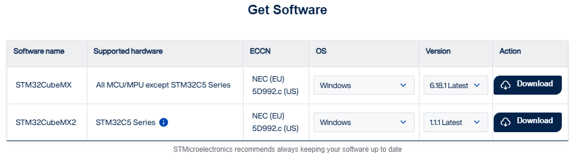
2. License Agreement 화면이 표시되면 Accept 선택한다.
   </br>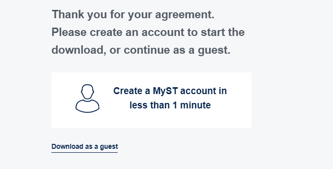
3. 게스트 다운로드 화면이 표시되면 'Be informed about..."를 체크한 후 'Download now' 선택해 압축된 설치 파일을 PC에 저장한다.
   </br>

다운로드한 파일의 압축을 해제한 후 다음과 같이 설치를 진행한다.

1. 압축 해제한 SetupSTM32CubeMX-x.y.z.exe 실행 후 Select Install mode 창이 표시되면 'Install for all users' 선택한다.
   </br>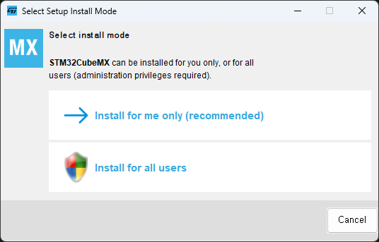
2. 설치 경로 설정 페이지에서 STM32CubeMX 상위 경로를 앞서 설치한 STM32CubeIDE 상위 경로(예: C:\ST)로 지정한다.
   </br>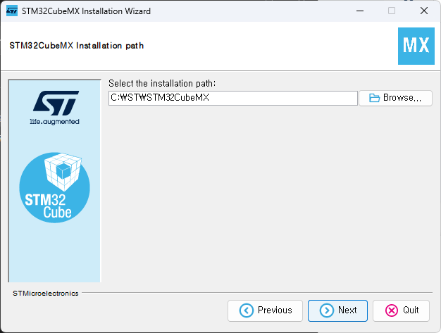
3. 단축 메뉴 설정 페이지에서 기본값으로 설치를 마무리한다.
   </br>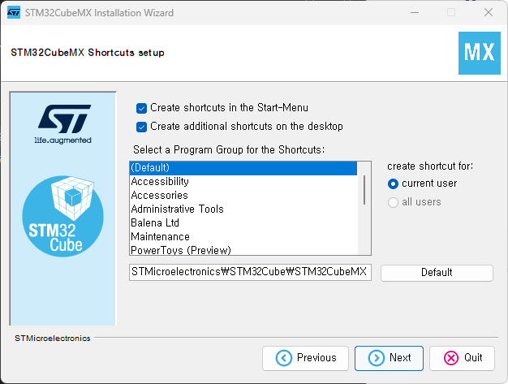

설치경로를 STM32CubeIDE가 설치된 폴더 하위로 지정해 두면, STM32CubeIDE에서 프로젝트의 .ioc 파일을 열었을 때 STM32CubeMX를 찾아 실행하기 편하다.

**STM32 CubeMonitor 설치**

STM32CubeMonitor는 MCU의 동작을 방해하지 않고 실행 중인 변수와 레지스터 데이터를 실시간으로 추출하는데, 노드 레드(Node-RED) 기반의 그래픽 환경을 제공하여 사용자가 드래그 앤 드롭 방식으로 데이터 흐름을 쉽게 구성할 수 있다. 추출한 데이터를 그래프, 차트, 게이지 등 다양한 시각화 위젯을 활용해 맞춤형 대시보드로 표기한다. 멀티 OS 환경을 지원할 뿐만 아니라 웹 브라우저를 통해 원격으로도 실시간 모니터링 화면에 연결할 수 있다.

설치 파일은 아래 순서로 내려받는데, ST-LINK 공유 모드로 STM32CubeIDE의 디버깅 기능과 함께 실행하려면 반드시 1.10.0 버전을 선택해야 한다. (현재 1.11.0, 1.12.0은 STM32CubeIDE의 디버깅 기능과 함께 사용할 수 없음.)

1. 웹브라우저에서 https://www.st.com/en/development-tools/stm32cubemonitor.html 접속한 후 하단 Get Software에서 해당 OS(현재는 Windows)의 설치 프로그램을 다운로드할 때 반드시 1.10.0을 선택 한다.
   </br>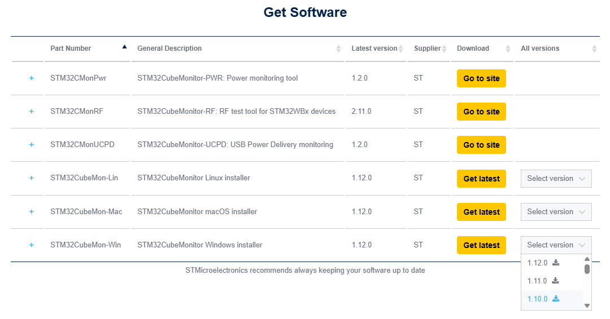
2. 이후 절차는 STM32CubeIDE 다운로드와 같이 게스트로 진행한다.
3. 등록한 메일을 통해 압축된 설치 파일을 PC에 저장한다.

압축을 해제한 후 다음과 같이 설치를 진행한다.

1. 압축 해제한 setupSTM32CubeMonitor-x.y.z.exe 실행 후 설치 경로 설정 페이지에서 STM32CubeMonitor 상위 경로를 앞서 설치한 STM32CubeIDE 상위 경로(예: C:\ST)로 지정한다
   </br>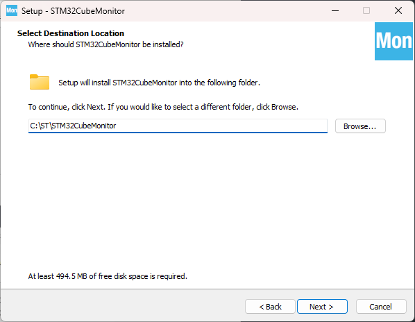
2. 나머지는 기본값으로 설치를 마무리한다.

### STM32CubeMX 기반 새 프로젝트 

이번 절은 STM32CubeMX와 STM32CubeIDE를 연동하여 실제 프로젝트를 만드는 과정을 다룬다. 즉 STM32CubeMX로 하드웨어 초기 설정을 마친 뒤 STM32CubeIDE 넘어가 로직을 작성하는 흐름이 교재의 실습 전체에서 반복되므로, 이 절에서 두 도구의 연동 과정을 확실히 다져 둔다.

**STM32CubeMX로 새 프로젝트 생성**

STM32CubeMX에서 보드를 선택하고 코드를 생성하면, 그 결과물이 STM32CubeIDE에서 곧바로 열리는 프로젝트 형태로 만들어진다는 점이 이 과정의 핵심이다. 이 절차는 이후 각 장의 실습마다 새 프로젝트를 만들 때 동일하게 반복되므로, 한 번 익혀 두면 이후 실습에서는 반복 설명 없이 이 과정을 그대로 적용한다.

이번 실습은 STM32CubeMX에서 NUCLEO-G0B1RE 보드를 기준으로 새 프로젝트를 생성하고 STM32CubeIDE용 코드를 만들어, 이후 실습마다 반복하게 될 프로젝트 생성 과정을 직접 손에 익히는 것을 목표로 한다.

1. 시작 메뉴에서 설치된 STM32CubeMX 실행 후 펌웨어 설치 경로를 바꾸기 위해 'Help > Connection & Updates' 선택한다. 창이 표시되면 Repository Folder를 'C:/ST/Firmware'로 변경하는데, 기본 경로 대신 이렇게 별도 경로를 지정해 두면, 이후 여러 프로젝트가 내려받는 HAL 펌웨어 패키지를 한 곳에 모아 관리할 수 있고 사용자 계정 경로가 길어지면서 생길 수 있는 경로 길이 문제도 피할 수 있다.
   </br>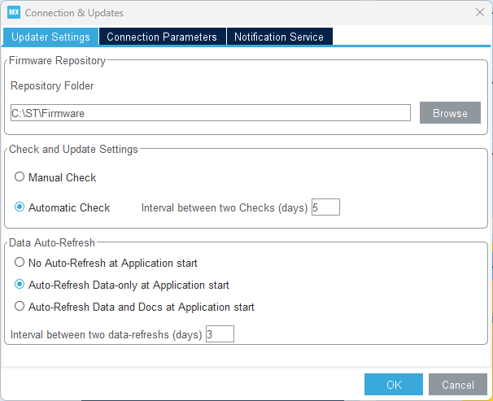
2. 메인 창의 New Project 영역에서 'ACCESS TO BOARD SELECTOR' 선택한다. 처음 실행하면 보드 정보가 저장된 Finder DB가 자동 다운로드된다.
   </br>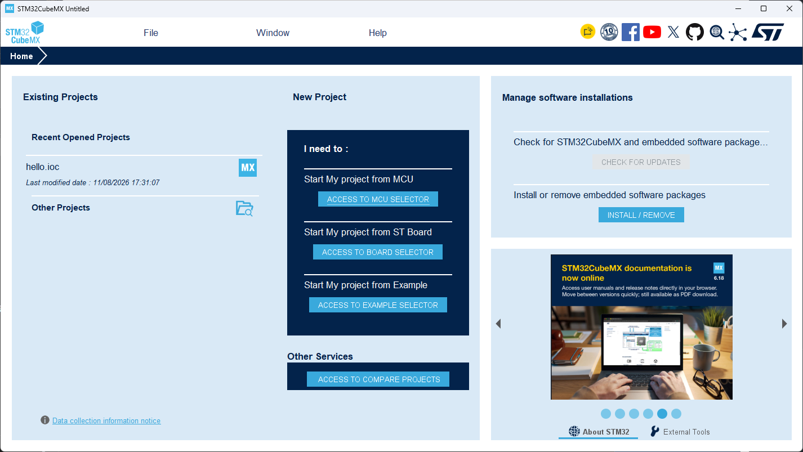
   </br>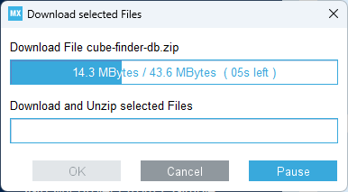
3. 보드 선택 화면의 Commercial Part Number에 'g0b1re'를 입력하면, 오른쪽 목록에서 NUCLEO-G0B1RE를 볼 수 있다. 이 항목을 선택한 후 'Start Project'를 선택하는데, 오른쪽 별표를 함께 체크해 두면, 이후 새 프로젝트를 만들 때, 왼쪽 상단의 별표(Favorites)를 눌려, 등록된 보드를 바로 찾을 수 있다.
   </br>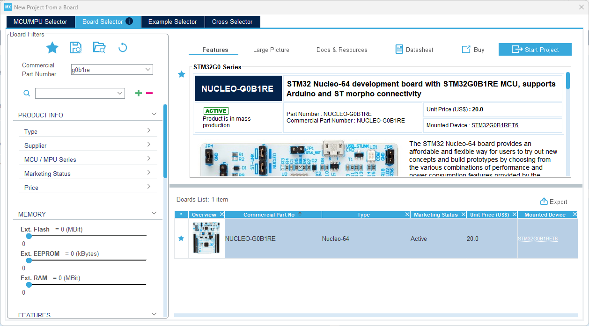
4. 하드웨어 정보를 기본값으로 사용하는 'Initialize all peripherals...' 창이 표시되면 'Yes' 선택한다.
   </br>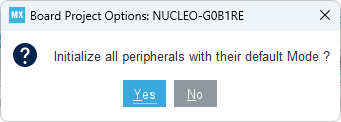
5. 'Pinout & Configuration' 탭에서 기본 하드웨어 인터페이스 정보를 확인한다. 이후 이곳에서 Easy Module Shield에 맞춰 하드웨어 인터페이스를 설정하게 된다.
   </br>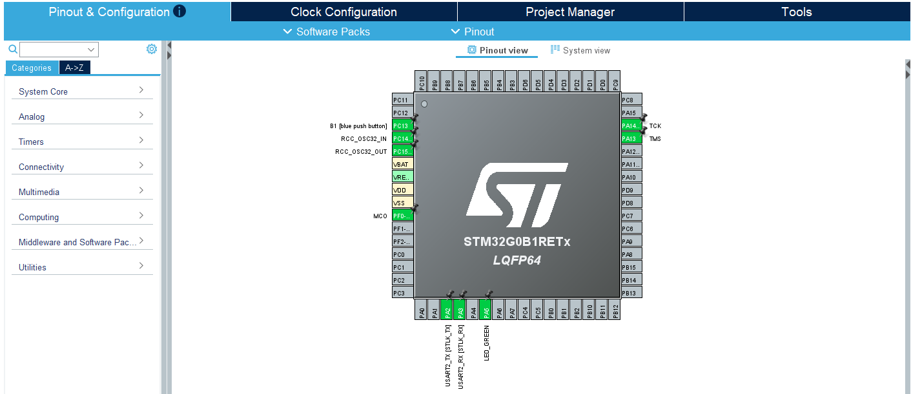
6. 'Clock Configuration' 탭에서 클럭 설정을 확인한다. 현재는 16MHz HSI RC가 HCLK에 그대로 전달되어 16MHz로 동작하지만, NUCLEO-G0B1RE 보드의 최고 클럭 속도는 64MHz이므로 '차량용 BCM 및 인터페이스 회로 필요성' 절의 실습에서 이 클럭 설정을 64MHz로 수정한다.
   </br>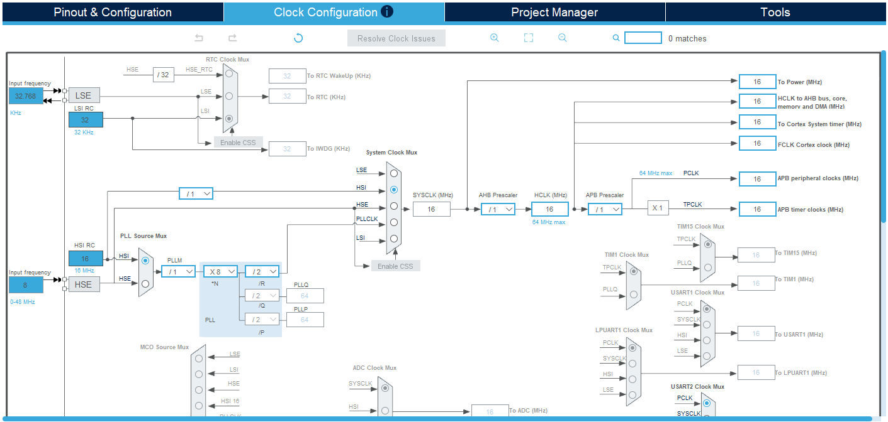
7. 'Project Manager' 탭을 선택하고 다음과 같이 설정한 후 우측 상단의 'GENERATE CODE'를 선택하면, 현재 'Pinout & Configuration'와 'Clock Configuration'를 기반으로 프로젝트 코드가 자동 생성된다. 
   - Project Name: 프로젝트 이름 입력 (예: hello)
   - Project Location: 최초 1회 작업 경로 입력 (예: D:\STM32Workspace)
   - Toolchain / IDE: STM32CubeIDE
   </br>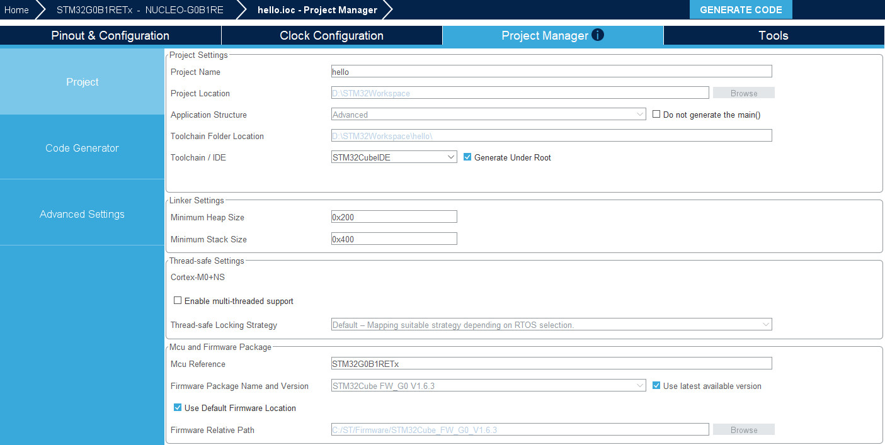
8. 아직 실습 보드용 HAL API가 설치되지 않은 상태이므로, 펌웨어 패키지 다운로드 창이 표시되는데, 'Yes'를 선택한다. 
   </br>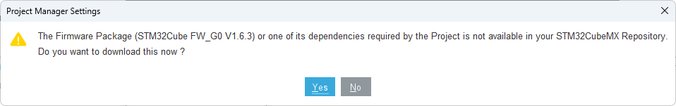
9. 이후 메인 알림 창이 표시되면 'Don't ask me again'를, 설치 과정에서 설치되는 버전 별로 License Agreement 창이 표시되면 'I have read, and I agree...'를 체크한 후 'Finish'를 선택한다. (다운로드 개수에 따라 2회 이상 표시될 수 있음) 
   </br>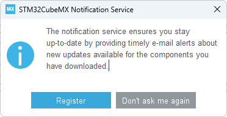
   </br>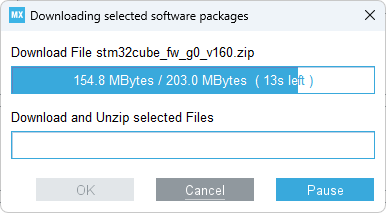
10. 코드 생성이 완료되면 Code Generation 창에서 'Close' 선택한다.
   </br>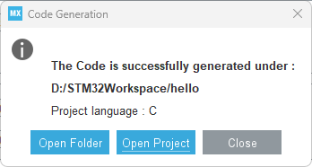

4번 단계에서 'Yes'를 선택하면 선택한 보드에 이미 연결되어 있는 사용자 LED, 버튼 등 온보드 주변장치까지 기본값으로 함께 초기화된다. Easy Module Shield처럼 별도의 확장 보드에 연결되는 핀은 이후 각 실습에서 자동차 전장 부품 매핑표에 맞추어 다시 재구성하므로, 이 단계에서는 우선 Yes를 눌러 기본 설정을 만들어 두는 것으로 충분하다.

STM32CubeMX에 의해 생성된 프로젝트 구조는 다음과 같다.
- `.ioc`: CubeMX 설정 파일
- `.ld`: 리셋 핸들러에 대한 링커 스크립트 파일로 코드 배치 정보와 힙 및 스택 크기 지정
- `Core/`: 사용자 구현 응용프로그램 헤더 및 소스 코드
   - `Inc/`: `main.h`
   - `Src/`: `main.c`
- `Drivers/`
   - `CMSIS/`: ARM 코어 및 칩 벤더 헤더 파일
      - `Device/ST/STM32G0xx/Include/stm32g0b1xx.h`
      - `Include/cmsis_gcc.h`, `core_cm0plus.h` 등
   - `STM32G0xx_HAL_Driver/`: STM32 HAL 라이브러리 헤더 및 소스 코드
      - CubeMX에서 선택한 하드웨어 리소스(`GPIO`, `DMA`, `EXTI`, `RCC` 등)에 대한 헤더 및 소스 파일

**STM32CubeIDE로 새 프로젝트 진행**

이번 실습은 STM32CubeMX가 생성한 프로젝트를 STM32CubeIDE로 열어, 소스 코드 편집과 빌드까지 이어지는 개발 흐름을 직접 확인하는 것을 목표로 한다.

1. 시작 메뉴에서 설치된 STM32CubeIDE 실행 후 작업공간 선택 창이 표시되면 STM32CubeMX에서 설정한 경로(예: D:\STM32Workspace)를 입력하고 'Use this as the default..."를 체크한 후 'Launch'를 선택한다. Exclusion 체크 창에서는 'Exclude STM32CubeIDE from...' 체크 후 'Proceed'를 선택한다.
   </br>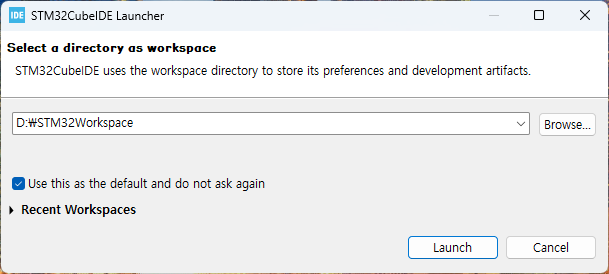
   </br>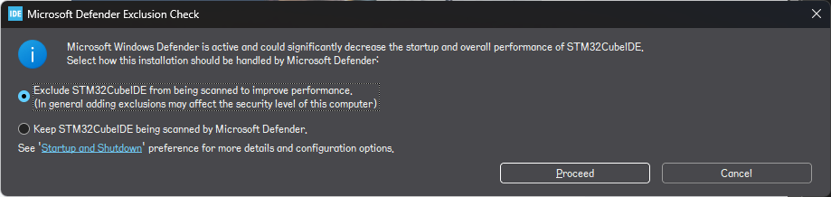
2. Window 보안 창이 표시되면 '허용'을 선택한다.
3. STM32CubeIDE 창이 표시되면 왼쪽 Project Exploer에서 STM32CubeMX에서 생성한 프로젝트 확인한다.
   </br>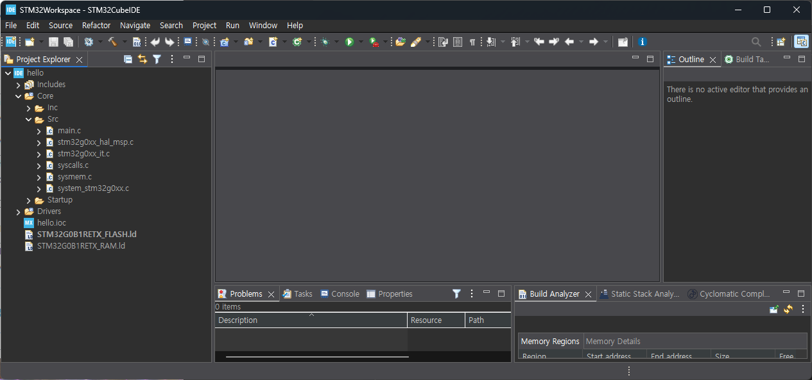
4. 코드 편집은 'Proejct Explorer > \<your project> > Core > Src > main.c'를 선택 후 편집창에서 진행한다.
   </br>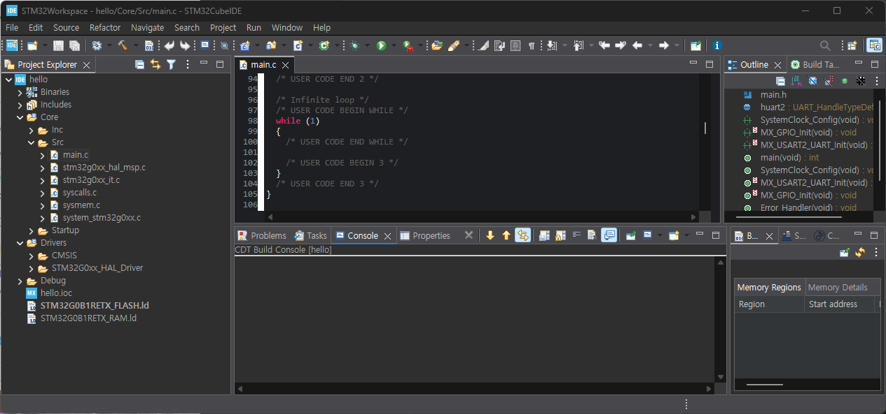
5. 빌드는 'Project Exploer > \<your project> > 마우스 우클릭 > Build Project' 또는 '도구 모음 > Build'를 선택히며, 결과는 'Project Exploer > \<your_project> Debug > \<project_name>.elf'에 위치한다.
   </br>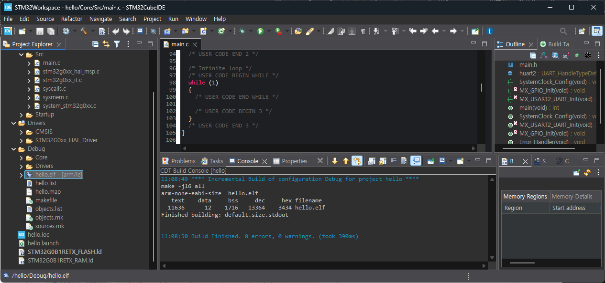

1번 단계에서 'Use this as the default...'를 체크하면 다음에 STM32CubeIDE를 실행할 때 작업공간 선택 창 없이 곧바로 같은 작업공간을 열며, Exclusion 체크는 백신 프로그램이 작업공간 폴더를 실시간 검사 대상에서 제외하도록 등록해 소스 파일이 많은 임베디드 프로젝트의 빌드 속도 저하를 막기 위한 것이다.

만약 나중에 작업공간 경로 변경이 필요하면 'File > Switch Workspace > Other...'를 선택하고, Workspace Launcher 창이 표시되면 'Browse...' 버튼을 눌러 원하는 새로운 폴더 경로를 지정한다. 또한 시작할 때 항상 작업공간 경로를 물어보도록 변경하고 싶을 때는 'Window > Preferences...'를 선택하고, Preferences 창이 뜨면 왼쪽 탐색창에서 'General -> Startup and Shutdown -> Workspaces'를 선택한 다음 우측 화면 상단에 있는 Prompt for workspace on startup 항목에 체크한다.

5번 줄에 의한 STM32CubeIDE 내부 빌드 절차는 다음과 같다.

- 내부 빌드 참조변수 PATH에는 GNU 툴 체인 및 make 툴 설치 경로가 포함됨
- 빌드 모드에 따라 하위에 Debug 또는 Release 빌드 폴더 생성
- 빌드 폴더에 Makefile 생성
- make를 호출해 Makefile 실행
  - Core 및 Drivers 폴더 아래 모든 소스 파일(*.c)을 전처리해 전처리 파일 생성(*.i)
  - 모든 전처리 파일을 컴파일해 Cortex-M Thumb-2용 어셈블리 파일 생성(*.s)
  - 모든 어셈블리 파일을 번역해 재배치 가능한 오브젝트 파일 생성(*.o)
  - 모든 재배치 가능한 오브젝트 파일을 하나의 실행 가능한 오브젝트 파일에 재배치(.elf)
  - 필요에 따라 실행 가능한 오브젝트 파일 포맷 변환 
    - .elf로 부터.hex 또는 .bin 파일 생성

빌드 결과는 실행 가능한 오브젝트 파일이며, 디버그 모드(기본값)으로 생성한 ELF(Executable and Linkable Format)만 디버깅이 가능하다. 다음은 주요 오브젝트 파일 포맷이다.

- ELF: 유닉스에서부터 사용해온 헤더와 데이터로 구분된 실행파일 저장 포맷
  - 디버거/프로그래머에 의한 디버깅 및 로더에 의한 메모리 재배치에 유리
- HEX: 시작 주소와 함께 데이터나 명령을 16진수 ASCII 형식으로 저장한 포맷
  - ASCII 형식이므로 시리얼로 데이터를 다운로드할 때 제어문자와 데이터 구분이 명확함
- BIN: 시작 주소에 위치할 2진 데이터부터 차례로 저장한 가장 원시적인 포맷
  - 순수한 데이터 및 실행 명령으로만 구성되어, 크기가 가장 작음

빌드 결과 ELF 외에 HEX나 BIN도 필요하다면 'Project > Properties'로 프로퍼티 창을 띄우고, 왼쪽 카탈로그에서 'C/C++ Build > Settings'를, 오른쪽 'Tool Settings' 탭에 포함된 'MCU Post build outputs'를 선택한 후 'Convert to binary file'과 'Convert to Intel Hex file' 중 원하는 것을 추가로 선택한다.

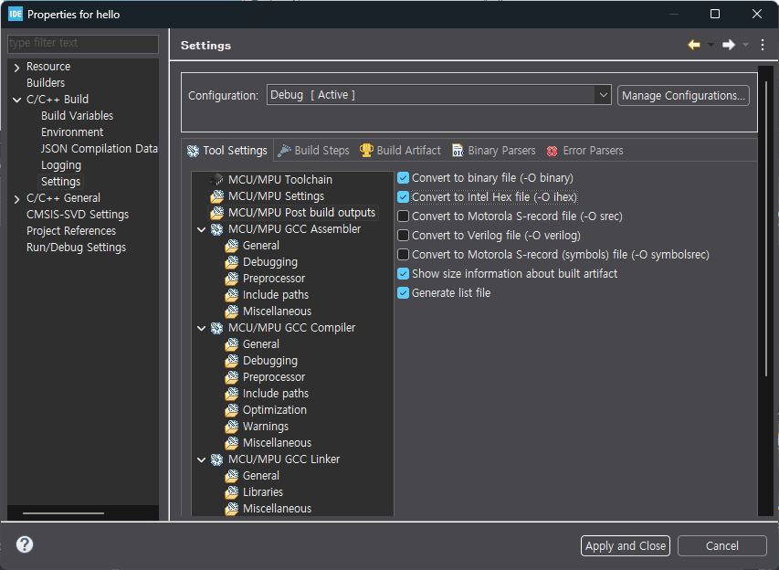

최종적으로 `main.c`를 다음과 같이 편집한다.
```c
/* USER CODE BEGIN PV */
volatile uint32_t g_count;
/* USER CODE END PV */
```
```c
   while (1)
   {
      /* USER CODE END WHILE */

      /* USER CODE BEGIN 3 */
   g_count++;
   HAL_Delay(100);
   }
   /* USER CODE END 3 */
}
```

**펌웨어 설치 및 실행**

빌드한 펌웨어는 STM32CubeIDE에서 ST-Link 및 CubeMX Programmer를 이용해 설치하며, BIN 파일을 설치할 때와 같이 필요에 따라 STM32CubeIDE를 사용하지 않고 수동으로 펌웨어 설치 가능하다.

이번 실습은 앞서 빌드한 ELF 파일을 ST-Link를 통해 NUCLEO 보드에 다운로드하고, 리셋 후 펌웨어가 실제로 실행되는 과정을 확인하는 것을 목표로 한다.

1. NUCLEO-64 보드에 연결된 ST-Link와 PC를 USB 케이블로 연결한다.
2. 다음 중 하나로 실행하는데, 최초 1회 Window 보안 창이 표시되면 '허용'을 선택한다.
   - 'Project Explorer > \<your project> > 마우스 우클릭 > Run As'
   - 'Menu > Run > Run' 
   - 'Toolbar > Run \<your project>' 
   </br>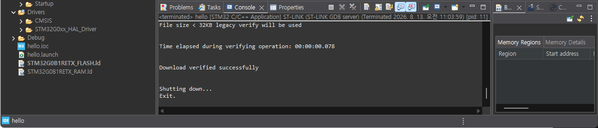
3. 아직 저장되지 않은 파일이 있으면, 저장할 지를 묻는 창이 표시되는데, 'Always save resources..."를 체크한 후 'OK'를 선택해 자동 저장하도록 한다.
   </br>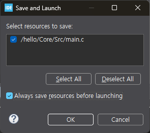
3. 최초 1회 Run Configuration 창이 표시되면 'Run’을 선택한다. 이 과정에서 사전에 빌드하지 않았다면, 빌드 후 설치를 진행한다.
   - 기본적으로 Debug\ \<usr project>.elf 파일을 STM 보드에 다운로드
   - BIN은 STM32CubeProgrammer로 직접 설치
   </br>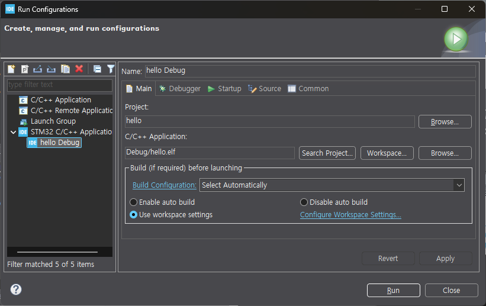
4. 만약 ST-Link 펌웨어 업드레이드 창이 표시되면, 'Open in update mode' 버튼을 선택한 후 'Upgrade'버튼을 눌러 ST-Link에 설치 후 창을 닫는다.
   </br>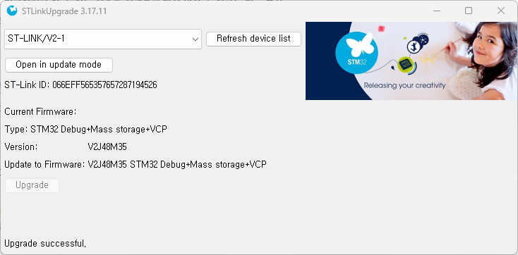
5. 설치가 완료되면 자동으로 리셋 신호가 STM 보드에 전달되어 펌웨어가 실행된다. 현재는 작성한 코드가 없으므로 Easy Module Shield에서는 아무런 반응이 없지만, 펌웨어가 다운로드되는 동안 ST-Link 쪽 LED가 깜빡이다가, 다운로드가 완료되면 멈추는 상태를 관찰한다.

**디버깅**

디버깅은 ST-Link를 통해 실행 중인 펌웨어를 원하는 지점에서 멈추고 그 순간의 STM32 내부 상태를 파악하는 기능으로, Core 및 임베디드 주변장치의 레지스터 값은 물론 메모리 덤프를 포함한 변수 값까지 확인할 수 있다. 사용자가 소스 코드를 기준으로 디버깅 시작 전 또는 후에 중단점을 추가하면, STM32CubeIDE는 백그라운드에서 ST-Link GDB Server를 통해 ST-Link를 제어한다.

이번 실습은 `main()` 함수에 중단점을 걸어 디버깅을 시작하고, 디버깅 도구 모음으로 실행 흐름을 제어하며 변수 값을 직접 확인하는 것을 목표로 한다.

1. `main.c`를 열고, `while` 루프에 추가한 `g_count++` 위치에서 줄 번호 왼쪽 빈 공간을 마우스로 더블클릭해 중단점을 설정한다.
   </br>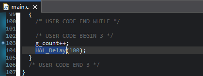
2. STM32CubeMonitor와 연동하려면, 다음 중 하나로 디버깅 설정 창을 열고, 가장 아랫쪽에 위치한 Mic 그룹의 'Shared ST-LINK'를 체크한 다음 'Apply'를 선택한다.
   </br>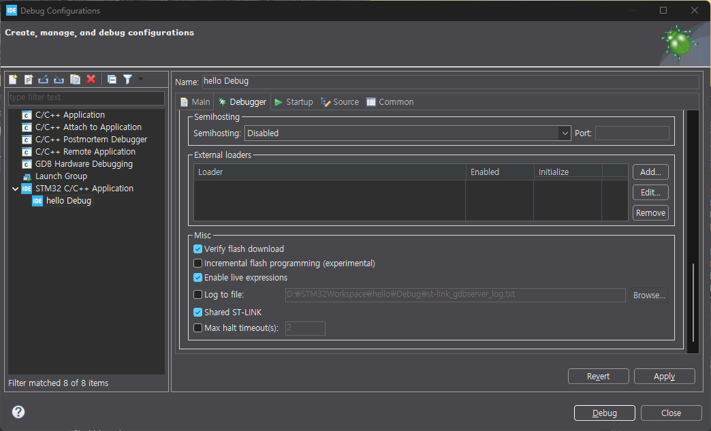
3. 다음 중 하나로 디버깅을 시작하는데, 사전 빌드되지 않았다면 자동 빌드도 함께 수행된다.
   - 'Project Explorer > \<your project> > 마우스 우클릭 > Debug As'
   - 'Menu > Run > Debug' 
   - 'Toolbar > Debug \<your project>'
4. 디버깅 퍼스펙티브 전환을 묻는 창이 표시되면, 'Remember my decision' 체크한 후 'Switch'를 선택한다.
   </br>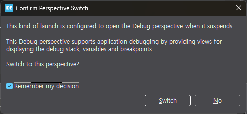
5. 디버깅이 시작되면 `main.c`의 `HAL_Init()`에서 자동으로 멈추는데, 디버깅 도구 모음을 통해 디버깅 흐름을 제어한다. 
   </br>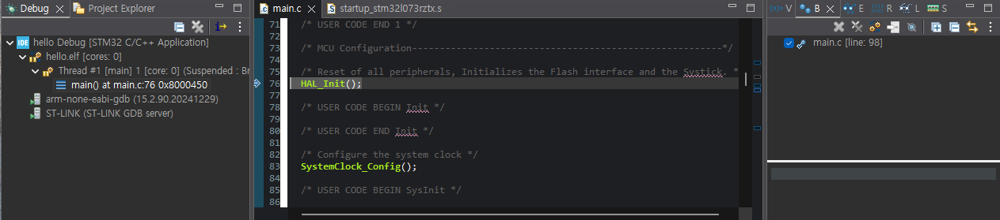
   </br>
   - Step Into: 다음 실행할 명령이 함수 호출이면 함수 내부로 진입
   - Step Over: 다음 실행할 명령이 함수 호출이면 내부 명령 모두 실행한 후 다음 명령으로 이동
   - Step Return: 함수 내부의 남은 명령을 모두 실행한 후 호출한 곳으로 이동
   - Resume: 중단된 디버깅 재개 또는 다음 중단점까지 계속 실행
   - Suspend: 디버깅 중단
   - Terminate: 디버깅 종료
6. 'Resume'을 눌러 사전 중단점 위치까지 실행한다. 
  </br>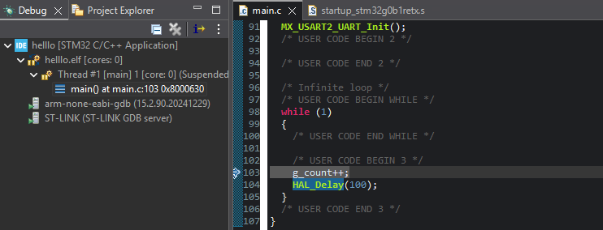
7. 오른쪽 Expressions 탭에서 'Add new express' 항목을 선택하고 `g_count`를 입력하면, 'Resume'을 누를 때마다 값이 변한다.
  </br>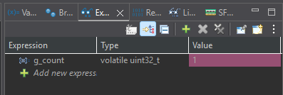
8. 'Terminate'를 눌러 디버깅을 종료한다. 

중단점은 디버깅 중에도 설정 가능하므로, 필요에 따라 편집창의 줄 번호 왼쪽 빈 공간을 더블클릭해 중단점을 추가하거나 기존 중단점을 해제할 수 있다. 또한 중단된 상태에서 변수 위에 마우스를 위치시키면 값이 표시된다.

### STM32CubeMonotor로 실시간 모니터링

STM 보드에 펌웨어가 실행 중일때, ELF 정보와 ST-Link를 통해 실시간으로 전역 변수나, 레지스터 값을 모니터링할 수 있다.

1. 시작 메뉴에서 설치된 STM32CubeMonitor를 실행하며, 기본 템플릿(`Basic_Flow`)이 이미 정의되어 있다.
   </br>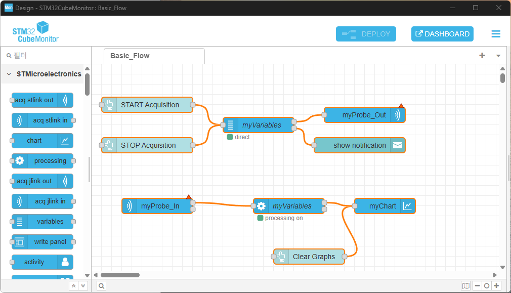
2. `myProbe_out` 노드를 더블클릭한 후 Probe Config의 '+' 버튼을 누른다. 속성 화면의 Probe 목록에서 ST-Link를 선택하고 'Add' 버튼을 눌러 이전 화면으로 돌아온다. Probe Config에 ST-Link 정보가 표시되면, 'Done' 버튼을 누른다.
   </br>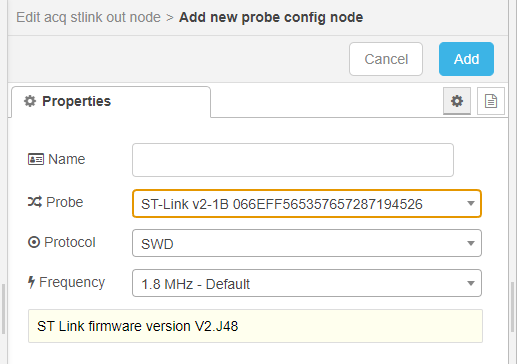
   </br>
3. `myProbe_In` 노드를 더블클릭한 후 Probe Config 목록에서 ST-Link를 선택한 후 'Done' 버튼을 누른다.
   </br>
4. `myVariables` 노드를 더블클릭한 후 Executable 항목의 '+' 버튼을 누른다. 속성 화면의 Name에 이름(예: `hello`)을 입력하고, Folder에 프로젝트의 ELF 파일이 있는 위치(예: `D:\STM32Workspace\hello\Debug`)를 입력한 후 File에서 `.elf`를 선택(예: `hello.elf`)한다. 'Add' 버튼을 눌러 이전으로 돌아온 후 'Done' 버튼을 누른다.
   </br>
   </br>
5. 오른쪽 상단의 'DEPLOY' 버튼을 눌러 배포하는데, 오류가 없어야 한다.
   </br>
6. 오른쪽 상단의 'DASHBOARD' 버튼을 눌러 대시보드를 실행한다. 'START ACQUISITION' 버튼을 누르면 모니터링을 시작하고, 'STOP ACQUISITION' 버튼을 누르면 중단한다.
   </br>

---

<!-- 이 태그 뒷부분부터 새 페이지에서 시작됩니다 -->
<div style="page-break-after: always;"></div>

## 2장. 임베디드 인터페이스 개론 및 MCU 핀 특성

### 차량용 BCM 및 인터페이스 회로 필요성

MCU는 Micro Controller Unit의 약자로, 연산을 담당하는 CPU 코어와 프로그램/데이터를 저장하는 메모리, 그리고 GPIO(General Purpose Input/Output)라 불리는 입출력 핀들을 하나의 작은 칩 안에 모두 담아 놓은 반도체이다. 이 교재에서 다루는 STM32G0B1RE도 MCU의 한 종류이며, 이후 MCU라는 용어가 나오면 이 칩을 가리킨다고 이해하면 된다.

BCM은 Body Control Module의 약자로, 자동차의 차체 관련 전장 기능을 통합 제어하는 전자 제어 장치이다. BCM은 도어 잠금, 실내외 조명, 방향지시등, 와이퍼, 각종 경고음 등 운전자와 직접 맞닿는 편의 기능 대부분을 담당하며, 내부적으로는 수십 개의 스위치 입력과 릴레이, LED, 모터 등의 출력을 하나의 MCU가 관리하는 구조로 되어 있다. BCM 내부의 MCU는 입력 신호를 그대로 받아들이지 않고, 반드시 인터페이스 회로를 거쳐 전압과 전류를 안전한 범위로 변환한 뒤에 처리한다. 그 이유는 차량 배터리 전원이 12V를 기준으로 하고 부하 전류가 MCU 입출력 핀의 정격을 크게 초과하기 때문이다. 

여기서 초보자가 흔히 갖는 의문이 하나 있다. "스위치와 램프가 수십 개나 되는데, 어떻게 MCU 하나가 그 많은 것을 동시에 다 처리할 수 있을까?" 하는 것이다. 답은 MCU의 처리 속도에 있다. 이 교재에서 다루는 STM32G0B1RE는 최대 64MHz, 즉 1초에 6400만 번의 명령어 사이클을 처리할 수 있는 반면, 사람이 스위치를 누르거나 램프가 반응하는 물리적인 속도는 아무리 빨라도 수 밀리초, 즉 수만 사이클에 한 번 일어나는 수준이다. MCU 입장에서 보면 사람의 동작은 마치 슬로우 모션처럼 느리게 보이므로, while 반복문 하나로 수십 개의 스위치와 램프를 순서대로 아주 빠르게 훑어보아도(이를 뒤에서 배울 폴링이라고 한다) 사람 눈에는 모든 것이 동시에 처리되는 것처럼 느껴진다. 이것이 바로 하나의 MCU가 여러 개의 배선을 하나로 묶어 처리하는 '멀티플렉싱(Multiplexing)'이 가능한 근본적인 이유이며, 실제 차량에서도 예전처럼 스위치마다 굵은 전선을 배터리까지 따로 연결하는 대신, 스위치 신호선은 모두 BCM으로 모으고 BCM이 판단한 결과만 필요한 곳으로 내보내는 구조로 바뀌면서 배선 뭉치(와이어링 하네스)의 두께와 무게를 크게 줄일 수 있었다.

예를 들어 12V 배터리 전원을 아무런 보호 회로 없이 MCU의 입력 핀에 그대로 연결하면, 핀 내부의 아주 작은 반도체 구조가 견딜 수 있는 전압을 훌쩍 넘어서면서 그 즉시 핀이 손상되고 MCU 전체가 정상적으로 동작하지 못하게 된다. 그래서 실제 차량용 MCU 보드에는 배터리 전압을 낮추는 레귤레이터, 신호 크기를 맞추는 트랜지스터나 릴레이 같은 인터페이스 회로가 MCU 앞단에 반드시 놓인다.

</br>

다만 인터페이스 회로가 필요한 이유를 12V와 3.3V라는 전압 크기 차이만으로 이해하면 절반만 이해한 것이다. 더 근본적인 이유는 MCU 내부의 CPU 코어가 오직 0과 1, 즉 디지털 신호밖에 계산하지 못한다는 점에 있다. 반면 MCU 바깥 세상, 즉 스위치, 램프, 모터, 온도, 밝기 같은 것들은 켜짐/꺼짐으로 딱 떨어지지 않거나(연속적인 아날로그 값), 단순히 On/Off로만 표현하기에는 세기 조절이 필요하다(밝기, 회전 속도, 소리 크기). 그래서 MCU 칩 내부에는 CPU 코어와 바깥 세상 사이를 이어주는 전용 회로 블록, 즉 임베디드 주변장치(Embedded Peripheral)가 미리 내장되어 있으며, 이 교재에서 다루는 GPIO, PWM(타이머 출력 비교), ADC가 바로 그 대표적인 세 가지 인터페이스 회로이다.

- GPIO(General Purpose Input/Output)는 CPU의 디지털 논리값(0 또는 1)을 실제 핀의 전압(0V 또는 VDD)으로 바꾸어 내보내거나, 반대로 핀의 전압을 읽어 0 또는 1로 바꾸어 CPU에 전달하는 가장 기본적인 인터페이스 회로이다. 비상등 LED를 켜고 끄거나 SW1, SW2 버튼의 눌림 여부를 읽는 모든 동작이 GPIO를 통해 이루어진다.
- PWM(Pulse Width Modulation)은 CPU가 낼 수 있는 것이 어차피 On/Off뿐이라는 한계를 극복하기 위한 회로로, 타이머 주변장치가 아주 빠른 속도로 On과 Off를 반복하면서 그 안에서 On으로 켜져 있는 시간의 비율(듀티비)만 조절하는 방식이다. 사람의 눈이나 부저, 모터는 이 On/Off 반복이 충분히 빠르면 마치 중간 밝기, 중간 세기의 아날로그 신호처럼 받아들이므로, PWM은 디지털 신호만으로 아날로그적인 세기 조절 효과를 만들어내는 인터페이스 회로라고 할 수 있다. 헤드램프 밝기 조절이나 부저의 음높이 조절이 이 원리를 이용한다.
- ADC(Analog-to-Digital Converter)는 PWM과 정반대 방향의 인터페이스 회로로, 조도센서나 온도센서처럼 연속적으로 변하는 아날로그 전압을 CPU가 계산할 수 있는 정수 값으로 바꾸어 준다. GPIO가 디지털 신호를, PWM이 디지털로 아날로그를 흉내 낸 신호를 다룬다면, ADC는 진짜 아날로그 신호를 디지털 세계로 옮겨오는 관문 역할을 한다.

즉 인터페이스 회로란 단순히 "높은 전압을 낮은 전압으로 낮추는 회로"가 아니라, "CPU가 이해하는 디지털 신호 체계"와 "바깥 세상의 On/Off, 세기, 연속값이라는 서로 다른 신호 체계" 사이를 연결하는 모든 회로를 통틀어 부르는 말이며, 전압 차이로 인한 보호 회로는 그 여러 사례 중 하나일 뿐이다. 앞으로 2장에서는 GPIO를 중심으로 디지털 신호의 전기적 특성을, 4장에서는 ADC를 중심으로 아날로그 신호의 인터페이스를, 6장에서는 PWM을 중심으로 디지털 신호로 아날로그적 세기를 표현하는 방법을 차례로 다룬다.

이번 실습에서 사용하는 NUCLEO-G0B1RE는 코어 전압이 3.3V인 STM32G0B1RE MCU를 탑재한 보드이며, Easy Module Shield는 5V를 기준으로 설계된 학습용 확장 보드이다. 즉 이 실습 조합 자체가 서로 다른 전압 체계를 가진 두 시스템을 인터페이스하는 축소 모델이며, 실제 차량에서 12V 전장과 MCU 사이에 놓이는 인터페이스 회로의 개념을 그대로 체험할 수 있는 구성이다.

NUCLEO-G0B1RE는 ST의 Nucleo-64 폼팩터를 따르며, 보드 상단에 Arduino UNO R3 규격의 헤더가 배치되어 있다. Easy Module Shield는 이 헤더에 그대로 꽂아 사용하도록 설계되어 있으며, 보드에 내장된 가변저항, 조도센서, LED, RGB LED, 버튼, 부저가 모두 정해진 핀에 배선되어 있다. 이번 실습에서는 이 핀 배치를 위의 자동차 전장 부품 매핑표대로 해석하여 사용한다.

**실습**

이번 실습은 NUCLEO-G0B1RE 보드를 기준으로 STM32CubeMX에서 새 프로젝트를 생성하고, 자동차 전장 부품 매핑표에 따라 각 핀에 User Label을 지정한 뒤 시스템 클럭을 64MHz로 구성하여 이후 모든 실습에서 반복 사용할 기본 프로젝트를 완성하는 것을 목표로 한다.

1. STM32CubeMX를 실행하고 새 프로젝트를 생성한다. Board Selector 탭에서 NUCLEO-G0B1RE를 검색하여 선택한다.
2. 프로젝트가 생성되면 'Pinout and Configuration' 탭에서 PA5, PA6, PA10, PB3, PB4, PA0, PA1, PC7, PB0, PA7 핀의 위치를 확인하는데, 하단의 검색 기능을 활용하면 편리하다.

   </br>

3. 아래 표와 같이 각 핀에 대해 먼저 마우스 좌클릭으로 인터페이스 목록에서 해당 인터페이스를 선택하고 이후 우클릭하여 User Label 항목에 자동차 부품 이름을 입력한다. User Label을 지정해 두면 이후 Pinout view나 생성된 코드에서 `PA6`, `PA5` 같은 핀 번호 대신 `TURN_SIGNAL_L`처럼 의미가 드러나는 이름으로 표시되므로, 실습이 진행될수록 어떤 핀이 어떤 부품인지 매번 자동차 전장 부품 매핑표를 다시 찾아보지 않아도 된다.

   | STM32 핀 | 인터페이스 | User Label | 대응 부품 |
   |---|---|---|---|
   | `PA0` | `ADC1_IN0` | `DIMMER_SW` | 가변저항(운전자 조명 조절 스위치) |
   | `PA1` | `ADC1_IN1` | `AUTO_LIGHT_SENSOR` | CdS 조도센서(차량 조도 센서) |
   | `PC7` | `TIM2_CH4` | `HEADLAMP_R` | RGB LED 빨강 채널(헤드램프/DRL) |
   | `PB0` | `TIM1_CH2N` | `HEADLAMP_G` | RGB LED 초록 채널(헤드램프/DRL) |
   | `PA7` | `TIM14_CH1` | `HEADLAMP_B` | RGB LED 파랑 채널(헤드램프/DRL) |
   | `PA6` | `GPIO_Output` | `TURN_SIGNAL_L` | LED2(비상등, 좌측 방향지시등) |
   | `PA5` | `GPIO_Output` | `TURN_SIGNAL_R` | LED1(비상등, 우측 방향지시등) |
   | `PA10` | `GPIO_Input` | `HAZARD_SW` | SW1(비상등 버튼) |
   | `PB3` | `GPIO_Input` | `DOOR_SW` | SW2(도어 스위치) |
   | `PB4` | `GPIO_Output` | `CHIME_BUZZER` | 피에조 부저(안전벨트 미착용 및 후방 경고음) |

   </br>

4. NUCLEO-G0B1RE 보드를 최고 클럭 속도인 64MHz로 동작시키기 위해 'Clock Configuration' 탭을 선택하고 다음과 같이 설정한다. 단, `HSE`를 사용할 때는 보드 뒷면의 `MCO`에 가볍게 납땜을 진행해 연결(초기 상태는 끊어짐)해야한다.
    - PLL Source Mux: 기본값인 `HSI` 대신 `HSE` 선택
       - PLL 배율기/분주기 수치: `PLLM`은 /1 (기본값), `PLLN`은 x16 (사용자 변경), `DivR`은 /2 (기본값)
    - System Clock Mux: 기본값인 `HSE` 대신 `PLLCLK` 선택
    - `HCLK`가 64인지 확인
   </br>
   - 만약 `MCO` 연결이 어려워 `HSI`를 사용할 때는 `HSE` 설정에서 PLL Source Mux를 `HSI`로 설정하고, `PLLN`만 X8로 변경하면 된다.
   </br>

5. Project Manager 탭에서 프로젝트 이름을 `interface`로 지정하고 Toolchain을 STM32CubeIDE로 선택한 후 코드를 생성한다. 이때 완료 상태에 따른 결과는 다음과 같다.
- Open Folder 또는 Close
  - STM32CubeIDE에서 'File > Import > Import STM32 Project > STM32CubeMX/STM32CubeIDE Project'를 선택한 후 작업공간에서 해당 프로젝트를 선택해 등록한다.

   </br>

- Open Project
  - STM32CubeIDE에서(실행되지 않았으면 자동 실행 후) 자동으로 프로젝트를 등록한다.
6. STM32CubeIDE에서 `Core/Inc/main.h`를 열고 정의한 이름을 확인한다.

   </br>

7. 새로운 프로젝트를 시작할 때는 STM32CubeMX에서 'File > Load Project...'로 `interface/interface.ioc`를 열고 'file > Save Project as..'에서 마지막 프로젝트 이름을 `interface`에서 다른 이름으로 변경(예: `tick`)한 다음 필요한 Pinout & Configuration을 수정하고 코드를 생성한다.

   </br>

**결과**

User Label을 지정하고 코드를 생성하면, STM32CubeMX는 `Core/Inc/main.h` 파일에 `#define TURN_SIGNAL_L_Pin GPIO_PIN_6`, `#define TURN_SIGNAL_L_GPIO_Port GPIOA`처럼 각 핀마다 `<라벨>_Pin`과 `<라벨>_GPIO_Port`라는 매크로 한 쌍을 자동으로 만들어 준다. 즉 이후 코드에서 `HAL_GPIO_WritePin(GPIOA, GPIO_PIN_6, ...)` 대신 `HAL_GPIO_WritePin(TURN_SIGNAL_L_GPIO_Port, TURN_SIGNAL_L_Pin, ...)`처럼 라벨 이름을 그대로 사용할 수 있으며, 이 교재의 이후 모든 실습 코드는 일관성을 위해 `GPIOx`, `GPIO_PIN_y` 같은 원시 핀 표기 대신 이 표에서 지정한 라벨 매크로를 사용한다. 핀 번호를 매번 매핑표에서 다시 찾아보지 않아도 코드만 보고 어떤 부품을 다루는지 바로 알 수 있다는 것이 이 방식의 가장 큰 장점이다.

### 디지털 및 아날로그 신호의 전기적 특성

디지털 신호는 두 개의 논리 레벨만을 가지는 신호이며, 실제 회로에서는 전압 구간으로 정의된다. 쉽게 말해 전압이 어느 기준 이상이면 High(1), 어느 기준 이하이면 Low(0)로 간주하고 그 중간의 애매한 구간은 사용하지 않기로 약속한 것이 디지털 신호이다. 입력 저전압 최대값은 VIL, 입력 고전압 최소값은 VIH로 표기하고, 출력 저전압 최대값은 VOL, 출력 고전압 최소값은 VOH로 표기한다. 스위치가 눌렸는지 여부를 MCU가 판단할 때는 이 VIL과 VIH 사이의 스위칭 임계 전압을 기준으로 High와 Low를 구분한다. 차량용 스위치 역시 이러한 논리 레벨 규격을 따르며, 접점이 닫히고 열리는 순간의 전압 변화를 MCU가 디지털 입력으로 읽어들인다.

일반적인 CMOS 입력 기준으로는 VIL(max)는 대략 0.3×VDD 이하, VIH(min)는 대략 0.7×VDD 이상으로 잡는다. NUCLEO-G0B1RE처럼 VDD가 3.3V인 경우로 환산하면 대략 다음과 같은 표로 정리할 수 있다.

| 구간 | 대략적인 전압 범위(VDD=3.3V 기준) | MCU가 읽는 값 |
|---|---|---|
| Low 구간 | 0V ~ 약 1.0V(0.3×VDD) 이하 | 0 (Low) |
| 부정(Undefined) 구간 | 약 1.0V ~ 약 2.3V 사이 | 사용하지 않는 애매한 구간 |
| High 구간 | 약 2.3V(0.7×VDD) 이상 ~ VDD | 1 (High) |

부정 구간이 존재하는 이유는 전압이 임계값 근처에서 미세하게 흔들릴 때 MCU가 0과 1을 번갈아 잘못 판단하는 것을 막기 위해서이다. 즉 Low와 High 판정 기준 사이에 일부러 여백을 두어, 약간의 노이즈가 섞여도 논리값이 뒤집히지 않도록 설계한 것이다. 이 개념은 뒤에서 배울 스위치의 채터링(바운싱) 현상, 그리고 오토라이트의 히스테리시스 개념과도 본질적으로 같은 원리이므로 기억해 두면 이후 내용을 이해하기 한결 쉬워진다.

</br>

STM32G0B1RE의 대부분의 GPIO 핀은 FT(Five-volt Tolerant) 구조로 설계되어 있다. Tolerant는 견딘다는 뜻으로, FT 구조란 MCU의 동작 전압이 3.3V이더라도 디지털 입출력 모드에서는 최대 5.5V까지의 신호를 안전하게 받아들일 수 있는 구조를 말한다. 이 덕분에 Easy Module Shield처럼 5V를 기준으로 동작하는 확장 보드의 디지털 신호를 별도의 레벨 변환 회로 없이 직접 연결할 수 있다. 다만 이 5V 톨러런트 특성은 핀이 디지털 모드로 동작할 때만 유효하며, 핀을 아날로그 입력 모드로 설정하면 이 보호 구조가 비활성화된다는 점을 반드시 기억해야 한다. 이 내용은 '아날로그 센서 인터페이스' 단원에서 다시 상세히 다룬다.

한편 조도센서나 온도센서처럼 연속적으로 변화하는 물리량을 표현하는 신호를 아날로그 신호라고 한다. 아날로그 신호는 디지털 신호와 달리 임의의 실수 값을 가지므로, MCU가 이를 처리하려면 일정한 시간 간격으로 전압을 측정하는 샘플링 과정을 거쳐야 한다. 이 샘플링과 디지털 변환을 담당하는 회로가 ADC, 즉 Analog-to-Digital Converter이며, 'ADC 입력 범위와 분해능(Resolution)'와 '다채널 ADC 스캐닝 및 오토라이트 연동'에서 자세히 다룬다.

**실습**

이번 실습은 디지털 신호의 논리 레벨 전환이든 아날로그 신호의 샘플링이든 결국 일정한 시간 간격을 정확히 재는 것이 전제되어야 한다는 점에서 출발하여, 앞으로 모든 실습에서 시간의 기준이 되는 `SysTick`과 `HAL_GetTick()`이 앞서 구성한 64MHz 클럭에서도 실제로 1ms 단위로 정확히 동작하는지 확인하는 것을 목표로 한다.

이번 실습에서 처음 사용하는 `HAL_GetTick()` 함수는 `uint32_t HAL_GetTick(void)` 형태로 선언되어 있으며, 매개변수 없이 `SysTick`이 부팅 이후 1ms마다 증가시켜 온 누적 시간을 `uint32_t` 값으로 반환한다. `HAL_Delay()` 함수는 `void HAL_Delay(uint32_t Delay)` 형태로 선언되어 있으며, 매개변수로 넘긴 시간(ms)만큼 이 `HAL_GetTick()` 값이 흐르기를 기다린 뒤 별도의 반환값 없이 돌아온다.

1. `interface` 프로젝트를 복제(Save Project As)해 새 프로젝트(예: `tick`)를 생성한 후, Clock Configuration 탭에서 `HCLK`가 이전 실습에서 설정한 64MHz 그대로 유지되고 있는지 다시 한 번 확인한다.
2. `main()` 함수의 `while (1)` 반복문 안에 `HAL_GetTick()` 값을 지역 변수에 저장하고 `HAL_Delay(500)` 뒤에 다시 읽어 두 값의 차이를 계산하는 코드를 작성한다.

```c
/* USER CODE BEGIN PV */
volatile uint32_t elapsed;
/* USER CODE END PV */
```
```c
   while (1)
   {
       uint32_t t1 = HAL_GetTick();
       HAL_Delay(500);
       uint32_t t2 = HAL_GetTick();
       elapsed = t2 - t1;
   }
```

3. 디버거로 중단점을 걸어 `SysTick` 카운터가 1ms 간격으로 정확히 증가하는지 확인한다. `SysTick`은 `HCLK`를 기준으로 내부적으로 재분주되어 항상 1ms 틱을 유지하도록 CubeMX가 자동 설정하므로, 시스템 클럭이 64MHz로 바뀌어도 `HAL_Delay()`와 `HAL_GetTick()`의 시간 단위 자체는 달라지지 않는다는 점을 이번 실습으로 확인한다.

### MCU GPIO 핀 구조와 전기적 한계

STM32의 GPIO 핀은 내부적으로 출력 드라이버, 입력 버퍼, 풀업 저항, 풀다운 저항, 아날로그 스위치로 구성된 블록으로 이루어져 있다. 

</br>

출력 모드는 크게 두 가지로 나뉘는데, Push-Pull 모드는 High와 Low를 모두 트랜지스터로 능동 구동하는 방식이고, Open-Drain 모드는 Low만 능동으로 구동하고 High는 외부 풀업 저항에 의존하는 방식이다. 쉽게 비유하면 Push-Pull은 핀이 전원과 접지 어느 쪽으로도 스스로 밀어붙일 수 있는 방식이고, Open-Drain은 핀이 접지 쪽으로 끌어내리는 것만 할 수 있어서 High로 올라가려면 외부에 미리 걸어 둔 풀업 저항의 도움을 받아야 하는 방식이다. LED나 부저처럼 MCU가 전류를 공급해야 하는 부하를 구동할 때는 Push-Pull 모드를 사용하고, I2C 버스처럼 여러 장치가 하나의 선을 공유해야 하는 경우에는 Open-Drain 모드를 사용한다.

</br>

GPIO 입력 모드에서는 풀업 저항 또는 풀다운 저항을 내부적으로 활성화할 수 있다. 풀업 저항은 핀과 전원 사이를, 풀다운 저항은 핀과 접지 사이를 큰 저항값으로 살짝 연결해 두는 것이다. 풀업 저항을 켜면 핀이 아무 것도 연결되지 않았을 때 자동으로 High 상태를 유지하고, 풀다운 저항을 켜면 Low 상태를 유지한다. 스위치처럼 접점이 열려 있을 때 전압이 정해지지 않는 플로팅 상태를 방지하려면 반드시 풀업 또는 풀다운 저항 중 하나를 활성화해야 한다.

</br>

STM32G0B1RE의 GPIO 핀은 하나의 핀당 최대 약 20mA까지 전류를 안전하게 흘릴 수 있으며, 이는 데이터시트의 절대정격 항목에 명시되어 있다. 또한 하나의 GPIO 포트 전체, 나아가 MCU 패키지 전체가 동시에 흘릴 수 있는 총 전류에도 한계가 있으므로, 여러 개의 LED를 동시에 구동할 때는 개별 핀 전류뿐 아니라 전체 전류 합도 함께 검토해야 한다.

STM32CubeMX에서 GPIO mode, GPIO Pull-up/Pull-down 같은 항목을 마우스로 클릭해서 설정하면, 실제로는 그 내용이 MCU 내부의 특정 레지스터 비트에 그대로 기록된다. 레지스터란 CPU가 주변장치를 제어하기 위해 읽고 쓰는 작은 저장 공간이며, GPIO 한 포트마다 다음과 같은 레지스터들이 존재한다.

| 레지스터 이름 | 역할 | CubeMX 화면 대응 항목 |
|---|---|---|
| `MODER` | 핀을 입력/출력/대체기능(AF)/아날로그 중 어떤 모드로 쓸지 결정 | `GPIO_Input`, `GPIO_Output`, `ADC1_INx` 등 핀 기능 선택 |
| `OTYPER` | 출력 모드일 때 Push-Pull인지 Open-Drain인지 결정 | GPIO mode(Output Push Pull / Open Drain) |
| `OSPEEDR` | 출력 신호가 얼마나 빠르게 전환될지(슬루레이트) 결정 | `GPIO_SPEED_FREQ_LOW` / `GPIO_SPEED_FREQ_HIGH` |
| `PUPDR` | 풀업/풀다운 저항을 켤지, 켠다면 어느 쪽으로 켤지 결정 | GPIO Pull-up/Pull-down |
| `IDR` | 입력 핀의 현재 논리값을 담고 있는 레지스터(읽기 전용) | `HAL_GPIO_ReadPin()`이 내부적으로 읽는 값 |
| `ODR` | 출력 핀에 내보낼 논리값을 담고 있는 레지스터(쓰기) | `HAL_GPIO_WritePin()`이 내부적으로 쓰는 값 |

즉 `HAL_GPIO_WritePin(GPIOA, GPIO_PIN_6, GPIO_PIN_SET)` 한 줄은 실제로는 `GPIOA` 포트의 `ODR` 레지스터 중 6번 비트를 1로 세팅하는 것과 같은 동작이며, HAL 함수는 이 레지스터 조작을 사람이 읽기 쉬운 함수 이름으로 감싸 놓은 것일 뿐이다. CubeMX가 그래픽 화면으로 보여주는 모든 설정 항목은 결국 이 표에 있는 레지스터 중 하나에 대응된다는 사실을 이해하면, 이후 데이터시트나 레퍼런스 매뉴얼을 직접 찾아볼 때도 훨씬 수월해진다.

**자주 하는 실수**

- GPIO mode를 Output으로 지정하지 않고 Input 상태로 둔 채 `HAL_GPIO_WritePin()`을 호출하는 실수이다. 이 경우 컴파일과 다운로드는 정상적으로 되지만, `MODER` 레지스터가 여전히 입력으로 남아 있어 실제 핀 전압은 전혀 바뀌지 않는다.
- 여러 개의 LED를 동시에 켤 때 GPIO 포트 전체 전류 한도를 넘기는 실수이다. LED 하나당 정격 전류가 작더라도 여러 개를 한 포트에서 동시에 켜면 합산 전류가 한도를 넘어설 수 있으므로, 다음 장의 전류 제한 저항 계산과 함께 항상 합산치를 확인하는 습관을 들여야 한다.
- Pull-up과 Pull-down을 반대로 설정하는 실수이다. Easy Module Shield의 `HAZARD_SW`, `DOOR_SW`처럼 실드 자체에 이미 풀업 저항이 내장된 경우 CubeMX에서 굳이 Pull-down을 걸면 두 저항이 서로 충돌하여 어중간한 전압이 만들어질 수 있으므로, 실드의 회로 구조를 먼저 파악한 뒤 설정해야 한다.

**실습**

이번 실습은 STM32CubeMX에서 같은 출력 핀의 세부 설정만 Push Pull에서 Open Drain으로 바꾸어 가며 코드를 다시 생성하고, 두 출력 구조의 동작 차이를 실제 LED에서 눈으로 확인하는 것을 목표로 한다. Pinout view에서 핀을 클릭했을 때 나오는 `GPIO_Input`, `GPIO_Output`, `GPIO_Analog` 같은 목록은 핀의 큰 분류(입력/출력/아날로그)를 고르는 메뉴이고, Push Pull과 Open Drain을 고르는 GPIO mode 항목은 핀을 `GPIO_Output`으로 지정한 뒤 Configuration 탭의 System Core > GPIO 설정 화면에서 별도로 나타난다.

</br>

1. `interface` 프로젝트를 복제(Save Project As)해 새 프로젝트(예: `leds`)를 생성한 후 Pinout view에서 `TURN_SIGNAL_L`(`PA6`)을 클릭해 `GPIO_Output`으로 지정한다.
2. Configuration 탭의 System Core > GPIO 화면에서 `TURN_SIGNAL_L`(`PA6`) 행을 선택하고 기본값인 GPIO mode가 Output Push Pull, GPIO Pull-up/Pull-down은 No pull-up and no pull-down인지 확인한 뒤 코드를 생성한다.
   </br>

3. `main()` 함수의 `while (1)` 반복문에 아래 코드를 작성하여 LED가 정상적으로 점등, 소등되는지 확인한다. 이번에 처음 사용하는 `HAL_GPIO_WritePin()` 함수는 `void HAL_GPIO_WritePin(GPIO_TypeDef *GPIOx, uint16_t GPIO_Pin, GPIO_PinState PinState)` 형태로 선언되어 있으며, 첫 번째 인자로 포트, 두 번째 인자로 핀 번호, 세 번째 인자로 `GPIO_PIN_SET` 또는 `GPIO_PIN_RESET`을 받아 그 핀의 출력 상태를 그 값으로 확정할 뿐 반환값은 없다.

```c
   while (1)
   {
      HAL_GPIO_WritePin(TURN_SIGNAL_L_GPIO_Port, TURN_SIGNAL_L_Pin, GPIO_PIN_SET);
      HAL_Delay(500);
      HAL_GPIO_WritePin(TURN_SIGNAL_L_GPIO_Port, TURN_SIGNAL_L_Pin, GPIO_PIN_RESET);
      HAL_Delay(500);
   }
```

4. 다시 STM32CubeMX의 System Core > GPIO 화면에서 `TURN_SIGNAL_L`(`PA6`)의 GPIO mode만 Output Open Drain으로 바꾸고 GPIO Pull-up/Pull-down은 No pull-up and no pull-down으로 그대로 둔 채 코드를 다시 생성한 뒤, 프로젝트를 다시 빌드하고 보드에 다운로드한다. 동일한 코드인데도 LED가 전혀 켜지지 않는 것을 확인하고, Open-Drain은 Low만 능동으로 끌어내릴 뿐 High를 출력해도 핀이 아무 것도 구동하지 않는 플로팅 상태가 되어 LED에 전류를 공급하지 못하기 때문임을 회로 관점에서 이해한다.

5. 같은 화면에서 `TURN_SIGNAL_L`(`PA6`)의 GPIO Pull-up/Pull-down 항목만 Pull-up으로 바꾸어 코드를 다시 생성하고 다시 다운로드한다. 내부 풀업 저항을 통해 미세한 전류가 흘러 LED가 아주 희미하게 켜지거나 여전히 꺼진 채로 보이는지 확인하고, 1번 단계의 Push-Pull 밝기와 비교하여 STM32의 내부 풀업 저항값이 LED를 정상적으로 켜기에는 너무 크며 Open-Drain 출력이 확실한 High를 만들려면 별도의 외부 풀업 저항이 필요하다는 점을 이해한다.

### 기본 출력을 통한 비상등 점멸 타이밍 제어

HAL은 Hardware Abstraction Layer의 약자로, MCU마다 다른 레지스터 조작을 매번 직접 다루지 않아도 되도록 ST가 미리 만들어 둔 함수 모음이다. 이 교재에서 계속 등장하는 `HAL_GPIO_WritePin()`, `HAL_ADC_Start()` 같은 함수들이 모두 이 HAL 라이브러리에 속한다. HAL 라이브러리는 GPIO 제어를 위해 `HAL_GPIO_WritePin()`과 함께 `HAL_GPIO_TogglePin()` 함수도 제공한다. `HAL_GPIO_TogglePin()` 함수는 `void HAL_GPIO_TogglePin(GPIO_TypeDef *GPIOx, uint16_t GPIO_Pin)` 형태로 선언되어 있으며, 포트와 핀 번호만 인자로 받아 그 핀의 현재 출력 상태를 반대로 뒤집을 뿐 반환값은 없다. 점멸 동작처럼 On과 Off를 반복하는 경우에는 상태 값을 직접 지정해야 하는 `WritePin` 대신 `TogglePin`을 사용하면 코드가 더 간결해진다.

`HAL_Delay()` 함수는 `SysTick` 타이머를 이용해 지정된 밀리초만큼 CPU를 대기시키는 Blocking 방식 지연 함수이다. Blocking이라는 말은 지연이 끝날 때까지 다른 어떤 코드도 실행되지 못한다는 뜻으로, 한 사람이 은행 창구에서 자기 볼일을 다 마칠 때까지 뒷사람이 아무 일도 못 하고 줄만 서 있는 상황에 비유할 수 있다. 실제 차량의 방향지시등은 국내 규정상 분당 60에서 120회, 즉 대략 1Hz 전후의 주기로 점멸하도록 되어 있으며, 이번 실습에서는 500ms 간격으로 점멸하여 1Hz에 가까운 점멸을 구현한다. 이번 시간에는 Blocking 방식의 한계를 아직 다루지 않고, 우선 `HAL_Delay()`만으로 점멸 타이밍을 구현하는 데 집중한다. Blocking 방식의 문제점은 이후 폴링 실습과 인터럽트 실습에서 자연스럽게 드러난다.

</br>

**실습**

이번 실습은 `HAL_Delay()`를 이용한 Blocking 방식으로 두 방향지시등 LED를 서로 반대 위상으로 점멸시켜 실제 차량의 방향지시등 점멸 타이밍을 재현하고, 지연 시간을 바꾸어 가며 점멸 속도와 점등 패턴이 어떻게 달라지는지 확인하는 것을 목표로 한다.

1. `TURN_SIGNAL_L`(`PA6`)은 앞선 실습에서 이미 `GPIO_Output`으로 설정해 두었으므로 그대로 사용하고, `TURN_SIGNAL_R`(`PA5`)만 추가로 설정한다. STM32CubeMX의 Pinout view에서 `TURN_SIGNAL_R`(`PA5`)를 클릭해 `GPIO_Output`으로 지정한 다음, Configuration 탭의 System Core > GPIO 화면에서 `TURN_SIGNAL_R`(`PA5`) 행을 선택하고 GPIO mode를 Output Push Pull, GPIO Pull-up/Pull-down을 No pull-up and no pull-down으로 `TURN_SIGNAL_L`(`PA6`)과 동일하게 맞춘 뒤 코드를 다시 생성한다.
2. 아래 코드와 같이 두 LED를 500ms 간격으로 서로 반대 위상으로 점멸시켜 좌우 방향지시등이 교대로 깜빡이는 모양을 구현한다.

```c
   while (1)
   {
      HAL_GPIO_WritePin(TURN_SIGNAL_L_GPIO_Port, TURN_SIGNAL_L_Pin, GPIO_PIN_SET);
      HAL_GPIO_WritePin(TURN_SIGNAL_R_GPIO_Port, TURN_SIGNAL_R_Pin, GPIO_PIN_RESET);
      HAL_Delay(500);
      HAL_GPIO_WritePin(TURN_SIGNAL_L_GPIO_Port, TURN_SIGNAL_L_Pin, GPIO_PIN_RESET);
      HAL_GPIO_WritePin(TURN_SIGNAL_R_GPIO_Port, TURN_SIGNAL_R_Pin, GPIO_PIN_SET);
      HAL_Delay(500);
   }
```

3. 지연 시간을 300ms, 800ms 등으로 바꾸어 점멸 속도가 달라지는 것을 확인하고, `HAL_GPIO_TogglePin()`을 이용해 두 LED를 동시에 켜고 끄는 비상등(Hazard) 패턴으로도 바꾸어 실습한다.

**재미있는 도전 과제: LED로 모스부호 보내기**

`HAL_Delay()` 하나로 On/Off 시간을 자유롭게 조절할 수 있다는 사실을 이용하면, LED 점멸만으로 문자를 전달하는 모스부호(Morse Code)도 구현할 수 있다. 모스부호는 짧은 신호(점, dot)와 긴 신호(선, dash)의 조합으로 알파벳을 표현하며, 국제 조난 신호로 잘 알려진 SOS는 점 3번, 선 3번, 점 3번(···---···)으로 이루어진다. 아래와 같은 시간 규칙을 사용하면 별도의 부품 추가 없이 `TURN_SIGNAL_L`(`PA6`) 하나만으로 재현할 수 있다.

| 신호 | 점등 시간 | 다음 신호까지 간격 |
|---|---|---|
| 점(dot) | 200ms | 200ms |
| 선(dash) | 600ms | 200ms |
| 문자 사이 | - | 600ms |

```c
  /* USER CODE BEGIN 2 */
  void morse_dot(void)
  {
      HAL_GPIO_WritePin(TURN_SIGNAL_L_GPIO_Port, TURN_SIGNAL_L_Pin, GPIO_PIN_SET);
      HAL_Delay(200);
      HAL_GPIO_WritePin(TURN_SIGNAL_L_GPIO_Port, TURN_SIGNAL_L_Pin, GPIO_PIN_RESET);
      HAL_Delay(200);
  }

  void morse_dash(void)
  {
      HAL_GPIO_WritePin(TURN_SIGNAL_L_GPIO_Port, TURN_SIGNAL_L_Pin, GPIO_PIN_SET);
      HAL_Delay(600);
      HAL_GPIO_WritePin(TURN_SIGNAL_L_GPIO_Port, TURN_SIGNAL_L_Pin, GPIO_PIN_RESET);
      HAL_Delay(200);
  }

  void morse_sos(void)
  {
      for (int i = 0; i < 3; i++) morse_dot();
      HAL_Delay(400); /* 문자 사이 간격 보정 */
      for (int i = 0; i < 3; i++) morse_dash();
      HAL_Delay(400);
      for (int i = 0; i < 3; i++) morse_dot();
      HAL_Delay(600);
  }
  /* USER CODE END 2 */
```

`morse_sos()` 함수를 `while (1)` 안에서 반복 호출하면 `TURN_SIGNAL_L`이 실제로 SOS 신호를 계속 깜빡이며 보낸다. 여유가 있다면 자신의 이름 이니셜을 모스부호표에서 찾아 같은 방식으로 구현해 보거나, `TURN_SIGNAL_R`(`PA5`)까지 함께 사용하여 두 사람이 각자 다른 문자를 동시에 보내는 것으로 확장해도 좋다. 이 과제는 새로운 부품이 전혀 필요 없이, 지금까지 배운 `HAL_GPIO_WritePin()`과 `HAL_Delay()`만으로 완성할 수 있다는 점에서 Blocking 딜레이의 활용 범위를 몸으로 익히는 좋은 복습이 된다.

---

<!-- 이 태그 뒷부분부터 새 페이지에서 시작됩니다 -->
<div style="page-break-after: always;"></div>

## 3장. 디지털 입력/출력 회로 및 디바운싱

### 디지털 입출력 회로 및 전류 제한 저항

LED를 구동하는 회로에는 반드시 전류 제한 저항이 함께 사용된다. LED는 일반 저항과 달리 양단 전압과 흐르는 전류가 비례하지 않는 비선형 소자이며, 양단에 걸리는 전압이 순방향 전압 VF를 넘어서는 순간 전류가 걷잡을 수 없이 급격하게 증가한다. 따라서 저항 없이 전원에 직결하면 전류가 소자의 정격을 넘어서면서 순식간에 과전류로 소손될 수 있다. 전류 제한 저항은 이 전류가 일정 값 이상으로 커지지 않도록 직렬로 끼워 넣어 흐름을 제한하는 역할을 하며, 그 값은 옴의 법칙(V = IR)을 응용한 다음 식으로 계산한다.

   R = (VCC - VF) / ID

여기서 `VCC`는 공급 전압, `VF`는 LED의 순방향 전압 강하, `ID`는 목표로 하는 LED 구동 전류이다. Easy Module Shield에 내장된 `TURN_SIGNAL_L`(`PA6`), `TURN_SIGNAL_R`(`PA5`)도 이 계산식에 따라 저항이 이미 실장되어 있으며, 회로도를 통해 LED가 MCU 출력 핀에서 전류를 끌어오는 구조인지, 아니면 전원에서 LED를 거쳐 MCU 핀으로 전류를 흘려보내는 구조인지 파악하면 해당 핀이 Active High인지 Active Low인지 판단할 수 있다.

이 계산식을 실제 숫자로 따라가 보면 이해가 훨씬 쉬워진다. STM32G0B1RE의 출력 전압(VCC)은 3.3V이고, 빨간색 LED의 순방향 전압(VF)을 대략 2.0V, 목표 구동 전류(ID)를 10mA(0.01A)로 잡는다면 다음과 같이 계산한다.

   R = (3.3V - 2.0V) / 0.01A = 130Ω

실제로는 이 계산값과 정확히 같은 저항이 시중에 존재하지 않으므로, 계산값보다 조금 큰 표준 규격값(예: 150Ω 또는 220Ω)을 고른다. 저항값을 계산값보다 크게 고르면 실제 구동 전류가 목표치보다 약간 작아져 LED가 조금 덜 밝게 켜지는 데 그치는 반면, 작게 고르면 구동 전류가 목표치를 초과해 LED의 수명이 짧아지거나 최악의 경우 소손될 수 있다. 즉 저항값은 "계산값 이상 중 가장 가까운 표준값"을 고르는 것이 안전한 설계 관례이다.

LED의 순방향 전압(VF)은 발광색에 따라 달라지는데, 이는 LED의 반도체 재료와 밴드갭(발광하는 에너지)이 색상마다 다르기 때문이다.

| LED 색상 | 일반적인 VF(순방향 전압) |
|---|---|
| 적색(Red) | 약 1.8V ~ 2.2V |
| 녹색(Green) | 약 2.0V ~ 3.0V |
| 청색/백색(Blue/White) | 약 2.8V ~ 3.4V |

이 표는 5장의 RGB LED(빨강녹 3색 동시 내장)에서도 그대로 적용되는데, 색상마다 VF가 다르기 때문에 Easy Module Shield는 R, G, B 세 채널에 각각 다른 값의 전류 제한 저항을 따로 실장해 두어 세 색상이 비슷한 밝기로 보이도록 보정한다.

</br>

**실습**

이번 실습은 실드에 내장된 LED의 Active High/Low 구조를 회로도나 실측으로 직접 판별하고, 두 LED를 독립적으로 제어하는 다양한 점등 패턴을 구현하며 GPIO 출력 속도 설정이 점멸 동작에 미치는 영향을 확인하는 것을 목표로 한다.

1. 실드의 회로도 또는 실측을 통해 `TURN_SIGNAL_L`(`PA6`), `TURN_SIGNAL_R`(`PA5`)가 Active High 구조인지 Active Low 구조인지 확인한다.
2. `TURN_SIGNAL_L`(`PA6`), `TURN_SIGNAL_R`(`PA5`)의 출력을 각각 독립적으로 전환하며 두 LED를 동시에 켜는 경우와 하나씩 번갈아 켜는 경우를 각각 구현한다.

```c
   while (1)
   {
      HAL_GPIO_WritePin(TURN_SIGNAL_L_GPIO_Port, TURN_SIGNAL_L_Pin, GPIO_PIN_SET);
      HAL_GPIO_WritePin(TURN_SIGNAL_R_GPIO_Port, TURN_SIGNAL_R_Pin, GPIO_PIN_SET);
      HAL_Delay(500);
      HAL_GPIO_WritePin(TURN_SIGNAL_L_GPIO_Port, TURN_SIGNAL_L_Pin, GPIO_PIN_RESET);
      HAL_GPIO_WritePin(TURN_SIGNAL_R_GPIO_Port, TURN_SIGNAL_R_Pin, GPIO_PIN_RESET);
      HAL_Delay(500);

      HAL_GPIO_WritePin(TURN_SIGNAL_L_GPIO_Port, TURN_SIGNAL_L_Pin, GPIO_PIN_SET);
      HAL_Delay(300);
      HAL_GPIO_WritePin(TURN_SIGNAL_L_GPIO_Port, TURN_SIGNAL_L_Pin, GPIO_PIN_RESET);
      HAL_GPIO_WritePin(TURN_SIGNAL_R_GPIO_Port, TURN_SIGNAL_R_Pin, GPIO_PIN_SET);
      HAL_Delay(300);
      HAL_GPIO_WritePin(TURN_SIGNAL_R_GPIO_Port, TURN_SIGNAL_R_Pin, GPIO_PIN_RESET);
   }
```

3. `GPIO_InitTypeDef` 구조체의 `Speed` 항목을 `GPIO_SPEED_FREQ_LOW`와 `GPIO_SPEED_FREQ_HIGH`로 각각 설정하여 코드를 다시 빌드하고, 오실로스코프나 육안으로 LED 점멸에 차이가 있는지 비교한다. 두 설정의 차이가 주로 고속 신호의 슬루레이트와 전자파 방출 특성에 관련된 것이며, LED 점멸처럼 느린 신호에서는 육안상 차이가 없다는 점을 이해한다.

### 스위치 회로, 플로팅 현상 및 디바운싱

차량용 접점 스위치를 MCU 입력에 연결할 때 풀업 또는 풀다운 저항 없이 연결하면, 스위치가 열려 있는 동안 핀의 전압이 정해지지 않는 플로팅 현상이 발생한다. 플로팅 상태의 핀은 전원에도 접지에도 붙잡혀 있지 않은 채 허공에 떠 있는 안테나처럼 주변 전자기 노이즈를 그대로 주워 담아 예측할 수 없는 값을 읽어들이게 된다. 그래서 반드시 풀업 또는 풀다운 저항으로 스위치가 열려 있을 때의 전압을 미리 정해 두어야 한다. Easy Module Shield의 `HAZARD_SW`, `DOOR_SW`는 보드 자체에 풀업 저항이 내장되어 있어 버튼을 누르면 Low, 떼면 High가 되는 Active Low 구조이다.

</br>

기계식 스위치는 접점이 붙거나 떨어지는 순간 금속 스프링의 탄성 때문에 수 밀리초 동안 On과 Off가 여러 번 반복되는 바운싱, 또는 채터링 현상이 발생한다. 이 현상을 그대로 소프트웨어에서 읽으면 한 번 누른 스위치를 여러 번 누른 것으로 잘못 인식하게 된다. 실제 차량에서 도어 스위치나 비상등 스위치의 채터링을 걸러내지 못하면 램프가 순간적으로 여러 번 깜빡이거나 경고음이 여러 번 울리는 오작동으로 이어질 수 있다.

디바운싱 기법은 크게 두 가지로 나뉜다. 첫째는 스위치 상태가 변한 시점에서 일정 시간, 보통 10ms에서 50ms 정도를 그대로 대기한 뒤 다시 한 번 상태를 확인하는 지연 방식이다. 이 방식은 `HAL_Delay()`를 그대로 사용하는 것과 같으므로, 앞서 배운 Blocking 지연을 디바운싱에 적용한 형태라고 볼 수 있다. 둘째는 `HAL_GetTick()`으로 얻은 타임스탬프를 저장해 두고, 이전 변화 시점과의 시간 차이가 일정 값 이상일 때만 유효한 변화로 인정하는 비동기 방식이다. 지연 방식은 구현이 간단하지만 그 시간 동안 다른 작업을 할 수 없다는 단점이 있고, 타임스탬프 방식은 코드가 조금 더 복잡하지만 다른 작업을 막지 않는다는 장점이 있다.

일반적인 기계식 버튼의 바운싱 지속 시간은 짧게는 1~2ms, 길게는 20~30ms까지도 이어질 수 있으며, 스위치의 재질과 사용 기간(마모 정도)에 따라 달라진다. 그래서 디바운싱 시간을 정할 때는 트레이드오프가 발생한다. 디바운싱 시간을 너무 짧게(예: 5ms) 잡으면 바운싱이 다 가라앉기 전에 다시 카운트되어 여전히 한 번 누름이 여러 번으로 잘못 인식될 수 있고, 반대로 너무 길게(예: 200ms) 잡으면 사용자가 버튼을 빠르게 연속으로 눌러도 뒤의 입력을 놓쳐버려 스위치가 둔하게 반응한다는 느낌을 주게 된다. 이 교재에서 사용하는 50ms는 대부분의 기계식 버튼에서 바운싱을 충분히 걸러내면서도 사람이 느끼기에 답답하지 않은 절충값으로 흔히 쓰이는 기준이다.

</br>

**실습**

이번 실습은 버튼 입력에서 발생하는 채터링 현상을 디바운싱 없이 직접 관찰한 뒤, 타임스탬프 비교를 이용한 비동기 디바운싱 로직을 적용해 스위치 한 번 누름이 정확히 한 번으로만 인식되도록 만드는 것을 목표로 한다.

</br>

1. `interface` 프로젝트를 복제(Save Project As)해 새 프로젝트(예: `switchs`)를 생성한다.
2. Pinout view에서 `HAZARD_SW`(`PA10`)를 클릭해 `GPIO_Input`으로 지정한 다음, Configuration 탭의 System Core > GPIO 화면에서 `HAZARD_SW`(`PA10`) 행을 선택하고 GPIO Pull-up/Pull-down 항목을 Pull-up으로 설정한다. Easy Module Shield 자체에도 풀업 저항이 내장되어 있지만, MCU 내부 풀업까지 함께 켜 두면 배선 접촉이 불안정한 상황에서도 플로팅을 이중으로 방지할 수 있다.
3. 이번 실습부터 결과를 화면으로 확인하기 위해 UART(`USART2`)를 처음 사용한다. Pinout view에서 `PA2`가 `USART2_TX`, `PA3`가 `USART2_RX`로 지정되었는지 확인하고, Connectivity 항목에서 `USART2`를 선택해 Mode를 Asynchronous로 지정(기본값)한 뒤 Parameter Settings의 Baud Rate를 115200으로 설정(기본값)하고 코드를 생성한다. `USART2`는 ST-LINK의 가상 COM 포트와 연결되어 있으므로 별도의 USB-Serial 변환기 없이 PC의 시리얼 모니터에서 바로 확인할 수 있다. `printf()` 출력을 `USART2`로 내보내려면 아래 저수준 함수 `__io_putchar()`를 `main.c`에 추가로 작성해야 한다. (이 설정은 이후 모든 장에서 계속 재사용된다.)

   ```c
   /* USER CODE BEGIN Includes */
   #include <stdio.h>
   /* USER CODE END Includes */
   ```
   ```c
   /* USER CODE BEGIN PFP */
   int __io_putchar(int ch) 
   {
      if (ch == '\n') {
         HAL_UART_Transmit(&huart2, (uint8_t *)"\r", 1, HAL_MAX_DELAY);
      }

      HAL_UART_Transmit(&huart2, (uint8_t *)&ch, 1, HAL_MAX_DELAY);
      return ch;
   }
   /* USER CODE END PFP */
   ```

4. 디바운싱 없이 버튼을 누른 횟수를 카운트하여 UART로 출력하는 코드를 작성하고, 한 번만 눌렀는데도 여러 번 카운트되는 채터링 현상을 직접 관찰한다. 이번에 처음 사용하는 `HAL_GPIO_ReadPin()` 함수는 `GPIO_PinState HAL_GPIO_ReadPin(GPIO_TypeDef *GPIOx, uint16_t GPIO_Pin)` 형태로 선언되어 있으며, 포트와 핀 번호를 인자로 받아 그 핀의 현재 논리 상태를 `GPIO_PIN_SET` 또는 `GPIO_PIN_RESET` 값으로 반환하는 함수이다. 

   ```c
   /* USER CODE BEGIN WHILE */
   uint32_t pressCount = 0;
   ```
   ```c
   while (1)
   {
      GPIO_PinState currentState = HAL_GPIO_ReadPin(HAZARD_SW_GPIO_Port, HAZARD_SW_Pin);
      if (currentState == GPIO_PIN_RESET)
      {
         pressCount++;
         printf("Press count: %lu\r\n", pressCount);
      }
   }
   ```

5. `HAL_GetTick()`을 이용해 마지막으로 카운트한 시점과 현재 시점의 차이가 50ms 이상일 때만 카운트를 증가시키는 비동기 디바운싱 로직으로 수정하고, 동일하게 버튼을 눌러 카운트가 정확히 한 번씩만 증가하는지 확인한다.
   ```c
   /* USER CODE BEGIN WHILE */
   GPIO_PinState previousState = GPIO_PIN_SET;
   uint32_t lastPressTick = 0;
   ```

   ```c
   while (1)
   {
      GPIO_PinState currentState = HAL_GPIO_ReadPin(HAZARD_SW_GPIO_Port, HAZARD_SW_Pin);
      if (previousState == GPIO_PIN_SET && currentState == GPIO_PIN_RESET)
      {
         uint32_t now = HAL_GetTick();
         if ((now - lastPressTick) > 50)
         {
            pressCount++;
            printf("Press count: %lu\r\n", pressCount);
            lastPressTick = now;
         }
      }
      previousState = currentState;
   }
   ```


**PC 시리얼 모니터에서 결과 확인하기**

USB Mini-B 케이블로 NUCLEO 보드의 ST-LINK USB 단자와 PC를 연결한다. Windows의 장치 관리자에서 포트(COM 및 LPT) 항목을 열고 STMicroelectronics STLink Virtual COM Port (COMx)로 표시된 포트 번호를 확인한다. 이 항목이 보이지 않으면 ST-LINK 드라이버가 설치되었는지, USB 케이블이 충전 전용이 아닌 데이터 통신용인지 확인한다.

</br>

Tera Term이나 PuTTY와 같은 시리얼 터미널 프로그램을 실행한 뒤, 연결 방식은 Serial로 선택하고 앞에서 확인한 COM 포트를 지정한다. 터미널의 통신 설정은 CubeMX의 USART2 설정과 같아야 하며, 다음 값을 사용한다.

| 항목 | 설정값 |
|---|---|
| Baud Rate | 115200 |
| Data Bits | 8 |
| Parity | None |
| Stop Bits | 1 |
| Flow Control | None |

시리얼 모니터를 연결한 상태에서 STM32CubeIDE로 프로그램을 빌드하고 보드에 다운로드한 뒤 실행한다. 프로그램은 시작할 때 문장을 출력하지 않으므로, `HAZARD_SW`(SW1)를 눌렀을 때 다음과 같은 내용이 터미널에 나타나는지 확인한다.

```text
Press count: 1
Press count: 2
```

디바운싱을 적용하기 전에는 한 번 누른 뒤 여러 줄이 연속으로 출력될 수 있고, 디바운싱을 적용한 뒤에는 한 번의 누름이 한 줄의 출력으로 안정되어야 한다. 시리얼 모니터를 나중에 열면 이미 출력된 내용은 보이지 않으므로, 프로그램을 다시 실행하거나 버튼을 다시 눌러 새 결과를 확인한다.

### 폴링(Polling) 방식 차량 스위치, 램프 제어

폴링(Polling)이란 원래 여론조사처럼 정해진 대상에게 주기적으로 물어보고 답을 받아 온다는 뜻이며, 임베디드 시스템에서는 MCU가 while 반복문 안에서 입력 핀의 상태를 계속 읽어들이며 변화를 감지하는 방식을 가리킨다. 폴링 방식은 구현이 단순하지만, MCU가 다른 작업 없이 계속 입력만 확인하는 구조이므로 CPU 자원을 낭비하고, 반복문 안에 다른 무거운 처리가 섞여 있으면 스위치 변화에 대한 응답이 늦어질 수 있다는 한계가 있다.

`HAL_GPIO_ReadPin()` 함수는 호출되는 순간의 상태 하나만 알려주므로, 눌리는 순간이라는 변화 자체를 잡아내려면 직전 루프에서 읽은 값을 별도의 변수에 저장해 두고 현재 값과 비교해야 한다. 폴링 방식에서는 이렇게 이전 상태와 현재 상태를 비교함으로써 상태 변화, 즉 눌림과 뗌의 순간을 판단한다.

폴링 방식이 "CPU 자원을 낭비한다"는 말은 조금 더 구체적으로 이해할 필요가 있다. STM32G0B1RE는 1초에 6400만 번의 명령어를 처리할 수 있는데, 사람이 스위치를 눌렀다 떼는 데 걸리는 시간은 아무리 빨라도 수십 밀리초, 즉 수만에서 수십만 사이클에 해당한다. 그런데 `while (1)` 반복문은 그 사이에도 쉬지 않고 `HAL_GPIO_ReadPin()`을 수백만 번 호출하며 "눌렸습니까? 눌렸습니까?"를 끊임없이 되묻는다. 이렇게 반복해서 물어보는 호출 대부분은 답이 "아니오"인 채로 버려지는 셈이므로, CPU 입장에서는 실제로 의미 있는 일(램프 제어, 통신 등)을 할 수 있었던 시간을 스위치 상태 확인에 쏟아붓는 것과 같다. 이 비효율은 다음 절에서 배울 EXTI(외부 인터럽트) 방식으로 해결한다.

</br>

**실습**

이번 실습은 폴링 방식으로 두 스위치의 상태 변화를 감지해 방향지시등을 토글하고, 두 스위치의 조합에 따라 좌측 점멸, 우측 점멸, 비상등, 소등 네 가지 상태를 구현하면서 앞서 익힌 디바운싱을 함께 적용하는 것을 목표로 한다.

1. `HAZARD_SW`(`PA10`)을 누를 때마다 방향지시등 `TURN_SIGNAL_L`(`PA6`)의 상태가 토글되는 프로그램을 작성한다. 이전 루프에서 읽은 버튼 상태와 현재 상태를 비교하여 Low로 바뀌는 순간, 즉 눌리는 순간에만 토글하도록 구현한다.

   ```c
   GPIO_PinState previousState = GPIO_PIN_SET;

   while (1)
   {
      GPIO_PinState currentState = HAL_GPIO_ReadPin(HAZARD_SW_GPIO_Port, HAZARD_SW_Pin);
      if (previousState == GPIO_PIN_SET && currentState == GPIO_PIN_RESET)
      {
         HAL_GPIO_TogglePin(TURN_SIGNAL_L_GPIO_Port, TURN_SIGNAL_L_Pin);
      }
      previousState = currentState;
   }
   ```

2. `DOOR_SW`(`PB3`)를 `HAZARD_SW`(`PA10`)와 동일한 방식으로 CubeMX Pinout view에서 클릭해 `GPIO_Input`으로 지정하고, Configuration 탭의 System Core > GPIO 화면에서 `DOOR_SW`(`PB3`) 행의 Pull-up/Pull-down을 Pull-up으로 설정한 뒤 코드를 생성한다. 이렇게 `HAZARD_SW`(`PA10`)와 `DOOR_SW`(`PB3`)를 함께 사용하여 좌측 방향지시등만 점멸, 우측 방향지시등만 점멸, 두 지시등을 동시에 점멸하는 비상등, 모두 소등의 네 가지 조합 상태를 구현한다.

   ```c
   uint8_t sw1Pressed = (HAL_GPIO_ReadPin(HAZARD_SW_GPIO_Port, HAZARD_SW_Pin) == GPIO_PIN_RESET);
   uint8_t sw2Pressed = (HAL_GPIO_ReadPin(DOOR_SW_GPIO_Port, DOOR_SW_Pin) == GPIO_PIN_RESET);

   if (sw1Pressed && !sw2Pressed)
   {
      HAL_GPIO_WritePin(TURN_SIGNAL_L_GPIO_Port, TURN_SIGNAL_L_Pin, GPIO_PIN_SET);
      HAL_GPIO_WritePin(TURN_SIGNAL_R_GPIO_Port, TURN_SIGNAL_R_Pin, GPIO_PIN_RESET);
   }
   else if (!sw1Pressed && sw2Pressed)
   {
      HAL_GPIO_WritePin(TURN_SIGNAL_L_GPIO_Port, TURN_SIGNAL_L_Pin, GPIO_PIN_RESET);
      HAL_GPIO_WritePin(TURN_SIGNAL_R_GPIO_Port, TURN_SIGNAL_R_Pin, GPIO_PIN_SET);
   }
   else if (sw1Pressed && sw2Pressed)
   {
      HAL_GPIO_WritePin(TURN_SIGNAL_L_GPIO_Port, TURN_SIGNAL_L_Pin, GPIO_PIN_SET);
      HAL_GPIO_WritePin(TURN_SIGNAL_R_GPIO_Port, TURN_SIGNAL_R_Pin, GPIO_PIN_SET);
   }
   else
   {
      HAL_GPIO_WritePin(TURN_SIGNAL_L_GPIO_Port, TURN_SIGNAL_L_Pin, GPIO_PIN_RESET);
      HAL_GPIO_WritePin(TURN_SIGNAL_R_GPIO_Port, TURN_SIGNAL_R_Pin, GPIO_PIN_RESET);
   }
   ```

3. 앞서 '스위치 회로, 플로팅 현상 및 디바운싱' 절에서 구현한 비동기 디바운싱 로직을 반드시 함께 적용하여, 채터링으로 인해 상태가 잘못 전환되지 않도록 한다.

**재미있는 도전 과제: 반응속도 측정기**

폴링으로 시간을 재는 능력을 활용하면 사람의 반응 속도를 측정하는 간단한 게임도 만들 수 있다. `TURN_SIGNAL_R`(`PA5`)가 무작위 시간 뒤에 켜지면 최대한 빨리 `DOOR_SW`(`PB3`)를 눌러야 하고, 프로그램은 `TURN_SIGNAL_R`이 켜진 순간부터 `DOOR_SW`가 눌리는 순간까지 걸린 시간을 밀리초 단위로 측정해 UART로 알려준다. 무작위 대기 시간은 표준 C 라이브러리의 `rand()` 함수로 만들며, 이 함수는 `int rand(void)` 형태로 선언되어 있고 매개변수 없이 호출할 때마다 0부터 `RAND_MAX` 사이의 의사난수 정수를 반환한다.

```c
#include <stdlib.h>

while (1)
{
   uint32_t waitMs = 500 + (rand() % 2500); /* 0.5~3초 사이 무작위 대기 */
   HAL_Delay(waitMs);

   HAL_GPIO_WritePin(TURN_SIGNAL_R_GPIO_Port, TURN_SIGNAL_R_Pin, GPIO_PIN_SET); /* TURN_SIGNAL_R 점등: 신호! */
   uint32_t startTick = HAL_GetTick();

   while (HAL_GPIO_ReadPin(DOOR_SW_GPIO_Port, DOOR_SW_Pin) == GPIO_PIN_SET)
   {
      /* DOOR_SW가 눌릴 때까지 폴링으로 대기 */
   }

   uint32_t reactionMs = HAL_GetTick() - startTick;
   HAL_GPIO_WritePin(TURN_SIGNAL_R_GPIO_Port, TURN_SIGNAL_R_Pin, GPIO_PIN_RESET);
   printf("Reaction time: %lu ms\r\n", (unsigned long)reactionMs);

   HAL_Delay(1000); /* 다음 라운드 전 잠시 대기 */
}
```

이 프로그램은 새 부품 없이 지금까지 사용한 `TURN_SIGNAL_R`, `DOOR_SW`, UART만으로 완성되지만, `TURN_SIGNAL_R`이 켜지기 전에 `DOOR_SW`를 미리 눌러버리는 '부정 출발'을 걸러내는 로직이 아직 없다는 한계가 있다. 여유가 있다면 `TURN_SIGNAL_R`이 켜지기 전까지 `DOOR_SW` 상태를 감시하다가 미리 눌리면 "Too early!"를 출력하고 라운드를 다시 시작하는 조건을 추가해 보자. 여러 명이 돌아가며 도전하고 평균 반응 속도를 UART 로그로 비교해 보는 것도 좋은 복습이 된다.

### 외부 인터럽트(EXTI)를 활용한 비상등, 도어 스위치 제어

STM32의 EXTI(EXTernal Interrupt)는 GPIO 핀의 전압 변화를 하드웨어적으로 감지하여 즉시 CPU에 인터럽트 신호를 전달하는 주변장치이다. NVIC(Nested Vectored Interrupt Controller)는 여러 인터럽트 소스의 우선순위를 관리하고 실제로 어떤 인터럽트 서비스 루틴을 실행할지 결정하는 컨트롤러이다. 폴링이 전화기를 손에 들고 계속 벨이 울리는지 확인하는 것이라면, 인터럽트는 벨이 울릴 때만 알림을 받고 평소에는 다른 일을 할 수 있는 것에 비유할 수 있다. EXTI를 사용하면 폴링 방식과 달리 반복문이 다른 작업을 하고 있는 도중에도 스위치 변화 순간을 놓치지 않고 즉시 처리할 수 있다.

</br>

EXTI는 트리거 조건을 Rising Edge, Falling Edge, 또는 둘 다로 설정할 수 있다. Active Low 구조인 `HAZARD_SW`, `DOOR_SW`는 버튼을 누르는 순간 High에서 Low로 바뀌므로 Falling Edge를 트리거 조건으로 설정하면 버튼이 눌리는 순간만 감지할 수 있다.

</br>

인터럽트 서비스 루틴, 즉 ISR은 가능한 한 짧고 빠르게 실행되고 종료되어야 한다는 원칙이 있다. ISR 내부에서 `HAL_Delay()`처럼 긴 시간 대기하는 함수를 호출하면 그 시간 동안 다른 모든 인터럽트 처리가 지연되어 시스템 전체의 응답성이 크게 나빠진다. 따라서 디바운싱이 필요한 경우에도 ISR 안에서는 시간을 재는 타임스탬프 비교만 수행하고, 실제 지연은 두지 않는 방식으로 구현해야 한다.

STM32G0 계열은 EXTI 라인을 몇 개씩 묶어 하나의 인터럽트 핸들러가 공유하도록 설계되어 있다. 라인 0과 1은 `EXTI0_1_IRQn`이, 라인 2와 3은 `EXTI2_3_IRQn`이, 라인 4부터 15까지는 `EXTI4_15_IRQn` 하나가 함께 담당한다. `HAZARD_SW`(`PA10`)는 라인 10이므로 `EXTI4_15_IRQn`을, `DOOR_SW`(`PB3`)는 라인 3이므로 `EXTI2_3_IRQn`을 사용하며, 두 스위치를 동시에 EXTI로 사용하더라도 서로 다른 인터럽트 핸들러에 걸리므로 한쪽 처리가 다른 쪽을 가로막지 않는다. 만약 여러 인터럽트가 정확히 같은 순간에 발생한다면, NVIC(Nested Vectored Interrupt Controller)에 설정된 우선순위(Preemption Priority)가 높은, 즉 숫자가 더 작은 인터럽트가 먼저 처리되고 나머지는 대기한다. 이 교재의 실습처럼 인터럽트 한두 개만 사용하는 경우에는 우선순위를 모두 기본값으로 두어도 무방하지만, 실제 차량용 BCM처럼 수십 개의 인터럽트가 동시에 얽히는 시스템에서는 에어백처럼 인명과 직결된 인터럽트에 가장 높은 우선순위를 부여하는 설계가 중요해진다.

최신 STM32G0 HAL은 EXTI edge를 `HAL_GPIO_EXTI_Rising_Callback()`과 `HAL_GPIO_EXTI_Falling_Callback()`으로 나누어 호출한다. 두 함수는 모두 `void 함수명(uint16_t GPIO_Pin)` 형태이며, 사용자가 직접 호출하지 않는다. HAL 인터럽트 처리 루틴이 edge를 판별한 뒤 해당 weak callback을 호출하고, 사용자가 같은 이름의 함수를 작성하면 그 내용이 실제 처리 코드가 된다. 인자로 전달되는 `GPIO_Pin`은 인터럽트를 발생시킨 핀 번호(`GPIO_PIN_x` 형태)다. `HAZARD_SW`와 `DOOR_SW`가 같은 edge callback을 공유할 수 있으므로, 함수 내부에서는 `GPIO_Pin`을 검사해 어느 스위치에서 발생했는지 구분한다. 이 실습의 `HAZARD_SW`는 pull-up active-low 입력이고 falling edge만 설정하므로 `HAL_GPIO_EXTI_Falling_Callback()`만 구현한다.

**실습**

이번 실습은 `HAZARD_SW`의 상태 변화를 EXTI 인터럽트로 감지해 비상등을 즉시 토글하도록 구현하고, 앞서 구현한 폴링 방식과 응답 속도를 직접 비교하여 인터럽트 방식의 장점을 체감하는 것을 목표로 한다.

1. STM32CubeMX의 Pinout view에서 `HAZARD_SW`(`PA10`)를 다시 클릭하여 이번에는 `GPIO_Input` 대신 `GPIO_EXTI10`을 선택하고, 초기화된 User Label도 다시 입력한다. Configuration 탭의 System Core > GPIO 화면에서 `HAZARD_SW`(`PA10`) 행을 선택하고 GPIO Pull-up/Pull-down을 Pull-up으로, GPIO mode를 External Interrupt Mode with Falling edge trigger detection으로 설정한다. 
2. System Core > NVIC 화면으로 이동해 `EXTI4_15` interrupt(라인 4~15 공용 핸들러) 항목의 Enabled 체크박스를 선택한 뒤 코드를 생성한다.
3. 코드 생성이 끝나면 `Core/Src/stm32g0xx_it.c` 파일에서 `EXTI4_15_IRQHandler()` 함수가 생성되었는지 확인한다. 이 함수는 NVIC에서 발생한 인터럽트를 HAL의 GPIO 처리 함수로 넘기는 연결 고리이며, 다음과 같이 `HAZARD_SW_Pin`을 인자로 전달해야 한다.

   ```c
   void EXTI4_15_IRQHandler(void)
   {
      HAL_GPIO_EXTI_IRQHandler(HAZARD_SW_Pin);
   }
   ```
4. `Drivers/STM32G0xx_HAL_Driver/Src/stm32g0xx_hal_gpio.c`에서 `HAL_GPIO_EXTI_IRQHandler()` 함수 정의를 확인한다. 이 함수는 인터럽트 종류에 따라 `HAL_GPIO_EXTI_Rising_Callback()`과 `HAL_GPIO_EXTI_Falling_Callback()`를 호출한다.
   ```c
   void HAL_GPIO_EXTI_IRQHandler(uint16_t GPIO_Pin)
   {
      /* EXTI line interrupt detected */
      if (__HAL_GPIO_EXTI_GET_RISING_IT(GPIO_Pin) != 0x00u)
      {
         __HAL_GPIO_EXTI_CLEAR_RISING_IT(GPIO_Pin);
         HAL_GPIO_EXTI_Rising_Callback(GPIO_Pin);
      }

      if (__HAL_GPIO_EXTI_GET_FALLING_IT(GPIO_Pin) != 0x00u)
      {
         __HAL_GPIO_EXTI_CLEAR_FALLING_IT(GPIO_Pin);
         HAL_GPIO_EXTI_Falling_Callback(GPIO_Pin);
      }
   }
   ```
5. `HAL_GPIO_EXTI_Falling_Callback()` 함수를 아래와 같이 작성하여, 인터럽트가 발생한 핀 번호가 `HAZARD_SW`(`PA10`)인지 확인하고 마지막 처리 시점과의 시간 차이가 50ms 이상일 때만 비상등 상태를 즉시 토글하도록 구현한다.

   ```c
   void HAL_GPIO_EXTI_Falling_Callback(uint16_t GPIO_Pin)
   {
      static uint32_t lastTick = 0;
      if (GPIO_Pin == HAZARD_SW_Pin)
      {
         uint32_t now = HAL_GetTick();
         if ((now - lastTick) > 50)
         {
               HAL_GPIO_TogglePin(TURN_SIGNAL_L_GPIO_Port, TURN_SIGNAL_L_Pin);
               HAL_GPIO_TogglePin(TURN_SIGNAL_R_GPIO_Port, TURN_SIGNAL_R_Pin);
               lastTick = now;
         }
      }
   }
   ```

앞에서 소개한 폴링 방식 코드와 이번 시간의 인터럽트 방식 코드를 비교하여, 메인 반복문 안에 일부러 긴 지연을 넣었을 때 두 방식의 버튼 응답성이 어떻게 달라지는지 관찰하고 그 차이를 이해한다.

---

<!-- 이 태그 뒷부분부터 새 페이지에서 시작됩니다 -->
<div style="page-break-after: always;"></div>

## 4장. 아날로그 센서 인터페이스 및 ADC

### 차량용 아날로그 센서 회로 구조 분석

아날로그 센서 대부분은 분압 회로, 즉 Voltage Divider 형태로 MCU에 신호를 전달한다. 분압 회로는 두 개의 저항 또는 저항과 가변 저항 소자를 직렬로 연결하고 그 중간 지점의 전압을 출력으로 사용하는 구조이며, 출력 전압은 다음 식으로 계산한다.

   Vout = Vin x R2 / (R1 + R2)


</br>

가변저항, 즉 `DIMMER_SW`(`PA0`)는 운전자가 손으로 돌리는 조명 밝기 조절 스위치, 즉 Dimmer 역할을 맡는다. 가변저항의 두 고정 단자에는 전원과 접지가 연결되고, 회전하는 와이퍼 단자의 전압이 `A0`으로 출력된다. 즉 가변저항 내부에서는 노브를 돌릴 때 와이퍼가 저항체 위를 물리적으로 미끄러지면서 `R1`과 `R2`의 비율을 바꾸는 것이다. 조도센서, 즉 `AUTO_LIGHT_SENSOR`(`PA1`)는 CdS 소자를 이용한 포토레지스터로, 주변이 밝을수록 저항이 작아지고 어두울수록 저항이 커지는 특성을 가진다. 이 교재에서 사용하는 CdS 조도센서는 밝은 곳에서는 약 1k옴 수준까지, 어두운 곳에서는 약 10k옴 이상까지 저항이 크게 변하는 소자로, 이 저항 변화를 고정 저항과 직렬로 연결한 분압 회로를 구성하면 주변 밝기에 따라 `A1`의 전압이 변하며, 이를 오토라이트 제어용 차량 외장 조도 센서로 사용한다.

두 신호 모두 Easy Module Shield의 5V 전원을 기준으로 동작하므로 원리적으로 0V에서 5V까지의 전체 범위를 가질 수 있다. 그런데 STM32의 GPIO 핀은 디지털 모드에서만 5V Tolerant이고, 아날로그 입력 모드로 전환하는 순간 이 보호 구조가 비활성화되어 ADC 기준전압인 `VDDA`, 즉 3.3V를 넘는 입력은 절대정격을 벗어나게 된다. 이런 경우 흔히 쓰는 해결책이 전압분배 회로이다. 신호선에 10k옴 저항을 직렬로 연결하고 ADC 입력 핀과 접지 사이에 15k옴 저항을 연결하면 분배비가 0.6이 되어, 5V 입력을 최대 3.0V까지 낮추어 STM32 ADC 핀에 안전하게 연결할 수 있다. 다만 이 방법은 `A0`, `A1`처럼 3.3V를 넘는 아날로그 신호선마다 저항을 한 쌍씩 추가로 배선해야 하므로, 채널 수가 늘어날수록 회로가 그만큼 번거로워진다는 단점이 있다.

가변저항과 조도센서는 모두 Easy Module Shield의 5V 전원 레일에서 갈라져 나온 전압을 신호로 사용하는 구조이다. 따라서 각 신호선을 개별적으로 낮추는 대신, 애초에 이 5V 전원 레일 자체를 3.3V로 낮추어 두면 두 채널의 출력 전압이 처음부터 0V에서 3.3V 범위 안에서만 움직이게 되어 별도의 분배 회로 없이도 안전해진다. 이 원리를 이용해 본 실습에서는 Easy Module Shield의 5V 핀으로 이어지는 배선을 잘라 기존 5V 전원 공급 경로와 분리하고, 그 자리에 Arduino 헤더의 `3V3` 핀을 대신 연결하는 방식으로 개조한 실드를 사용한다. 이렇게 개조하면 실드 내부에서 5V라고 표시된 전원 레일이 실제로는 3.3V로 동작하게 되므로, 가변저항과 조도센서의 출력 전압도 함께 3.3V 이내로 낮아져 `DIMMER_SW`(`PA0`), `AUTO_LIGHT_SENSOR`(`PA1`) 신호선을 저항 없이 STM32 ADC 핀에 바로 연결해도 절대정격을 넘지 않는다.

> **주의**
> 이 개조 또는 채널별 전압 분배 회로가 준비되기 전에는 실드의 `PA0`, `PA1` 아날로그 신호를 STM32 ADC 핀에 직접 연결하면 안 된다. STM32G0B1RE의 5V tolerant 특성은 디지털 모드에만 적용되며, 아날로그 모드의 ADC 입력에는 3.3V를 넘는 신호를 인가할 수 없다. 실드의 전원 레일을 자르거나 다시 배선하는 작업은 전원을 분리한 상태에서 수행하고, 완료 후에는 3.3V와 GND 사이의 단락 여부를 먼저 확인한다.

</br>

**실습**

이번 실습은 Easy Module Shield의 전원 레일을 3.3V로 개조하여 아날로그 신호가 STM32 ADC의 절대정격을 넘지 않도록 만들고, ADC 채널을 추가로 구성하여 이후 아날로그 센서 실습에 필요한 환경을 구축하는 것을 목표로 한다. UART(`USART2`)와 `printf()` 리다이렉션은 3장의 '스위치 회로, 플로팅 현상 및 디바운싱' 절에서 이미 구성해 두었으므로 이번 실습에서 다시 설정할 필요는 없다.

1. Easy Module Shield의 5V 핀 배선을 잘라 기존 5V 전원 공급 경로와 분리하고, 그 자리에 Arduino 헤더의 `3V3` 핀을 대신 연결하여 보드 내부 전원 레일이 3.3V로 동작하도록 개조한 Easy Module Shield를 사용한다.
2. STM32CubeMX의 Pinout view에서 `DIMMER_SW`(`PA0`)를 클릭하면 나타나는 목록 중 `ADC1_IN0`을, `AUTO_LIGHT_SENSOR`(`PA1`)를 클릭하면 나타나는 목록 중 `ADC1_IN1`을 선택한다. 이는 앞서 GPIO 실습에서 핀을 `GPIO_Output`으로 지정하던 것과 같은 방식으로 핀의 역할을 고르는 선택일 뿐이며, 이 선택만으로 GPIO mode가 자동으로 Analog로 바뀌므로 별도로 다시 지정할 필요는 없다.
3. Configuration 탭의 Analog > ADC1 화면에서 방금 추가한 IN0, IN1 채널이 체크 표시되는지 확인하고, Parameter Settings의 ADC_Settings에서 Resolution을 12 bits(기본값)로 둔다. 처음 이어지는 단일 채널 폴링 실습에서는 Channel 0(IN0, Dimmer)만 Rank 1로 지정한다.
4. 단일 채널 폴링 실습에서는 Scan Conversion Mode를 Disable, Continuous Conversion Mode를 Disable, End Of Conversion Selection을 End of single conversion으로 두고 Number Of Conversion을 1로 설정한다. Rank 1의 SamplingTime Common 1은 160.5 Cycles로 설정한다. 높은 임피던스를 갖는 가변저항과 CdS 분압 회로에서 충분한 샘플링 시간을 확보하기 위한 설정이다. 다음 절의 다채널 스캔 실습을 시작할 때는 이 설정을 다시 변경한다.
5. `printf()`로 소수점 값을 출력할 때 사용하는 `%f` 서식은 STM32CubeIDE가 기본으로 사용하는 경량 C 라이브러리(`newlib-nano`)에서 기본적으로 지원하지 않으므로, 'Project 우클릭 > Properties > C/C++ Build > Settings > Tool Settings > MCU Settings'에서 'Use float with printf from newlib-nano' 항목을 체크해야 한다. 이 설정을 빠뜨리면 `%f` 자리에 값 대신 엉뚱한 문자가 출력되거나 아무 것도 출력되지 않는다.
  </br>

**ADC 설정**

STM32CubeMX에서 ADC 관련 세부 설정의 의미는 다음과 같다.

- Clock Prescaler (ADC 클록 원본 및 분주비)
   - ADC 변환에 사용할 클록 원본과 분주비를 지정하는 항목이다.
   - 시스템 클록과 AHB 클록이 64MHz인 구성에서 Synchronous clock mode divided by 2를 선택하면, AHB 클록을 2로 나누므로 ADC는 32MHz로 동작한다.
   - Asynchronous clock mode divided by 2는 RCC에서 선택한 ADC 전용 클록을 2로 나누는 별도 설정이다. 최종 주파수가 같아질 수 있어도 클록 원본이 다르므로 두 설정을 같은 것으로 취급하지 않는다.
   - 클럭 주파수가 너무 높으면 내부 샘플링 커패시터가 충분히 충전되지 못해 측정 오차가 커지며, 반대로 너무 낮으면 변환 완료까지 소요되는 시간이 길어진다.
- Scan Conversion Mode (스캔 변환 모드)
  - 2개 이상의 아날로그 채널을 다룰 때, 지정된 시퀀스 순서에 따라 채널을 순차적으로 전환하며 변환할지 여부를 결정한다.
  - 본 모드가 활성화되면 내부 하드웨어 멀티플렉서(MUX)가 자동으로 동작하여 현재 채널의 변환이 완료되는 즉시 다음 채널로 입력 소스를 전환한다.
- Continuous Conversion Mode (연속 변환 모드)
  - 단 한 번의 변환 요청으로도 하드웨어가 정지하지 않고 아날로그-디지털 변환 과정을 무한히 반복하도록 설정하는 항목이다.
  - Enable: 변환이 한 번 시작되면 CPU가 명시적인 정지 명령을 내릴 때까지 백그라운드에서 끊임없이 변환 프로세스를 수행한다.
   - Disable: 소프트웨어 명령(`HAL_ADC_Start()`)이 인입될 때 지정된 채널 혹은 시퀀스 1주기만 변환한 후 자동으로 동작을 멈춘다. 레지스터를 직접 확인하는 폴링(Polling) 방식으로 채널을 끊어 읽을 때는 본 옵션을 비활성화(Disable)하는 것이 안전하다.
- Overrun Behaviour (오버런 처리 방식)
   - 기존 변환 데이터가 변환 데이터 레지스터(`ADC_DR`)에서 읽히지 않은 상태에서 다음 새로운 변환 작업이 완료되었을 때의 하드웨어 대응 방식을 정의한다.
  - Overrun data preserved: 데이터 버퍼가 넘칠 경우 새로 생성된 데이터를 폐기하고, 기존에 저장되어 있던 이전 데이터를 그대로 유지한다.
  - Overrun data overwritten: 데이터 버퍼가 넘칠 경우 기존 데이터를 지우고, 새로 인입된 최신 데이터로 레지스터 값을 덮어쓴다.
- SampleTime Common 1 / Common 2 (공통 샘플링 시간)
  - 아날로그 신호를 내부 커패시터에 입력받는 충전(샘플링) 시간 스펙을 템플릿(Common 1, 2)으로 사전 정의하고, 각 채널이 이를 선택하여 사용하도록 유도하는 기능이다.
  - 외부 아날로그 전압을 정밀한 디지털 수치로 변환하려면 내부 샘플링 콘덴서에 전압이 완전히 충전되어 안정화되어야 한다. 외부 센서 회로의 임피던스(저항 성분)가 높을수록 충전 속도가 느려지므로 샘플링 타임(Cycles)을 길게 확보해야 정확한 결과값을 얻을 수 있다.
- External Trigger Conversion Source (외부 트리거 변환 소스)
  - ADC 하드웨어가 아날로그 변환을 시작하도록 유도하는 시작 신호(Trigger)의 출처를 지정한다.
   - Regular Conversion launched by software: 외부 하드웨어 트리거를 사용하지 않으며, CPU가 소스 코드 내에서 직접 구동 명령(`HAL_ADC_Start()`)을 실행하는 시점에만 변환이 개시된다.
   - Timer X Trigger Out / EXTI Line X: 내부 타이머의 주기적인 오버플로우 신호나 특정 GPIO 핀의 외부 인터럽트 신호가 발생하는 찰나의 순간에, CPU의 개입 없이 하드웨어가 스스로 변환을 촉발(Trigger)하도록 설정한다.
- External Trigger Conversion Edge (외부 트리거 변환 에지)
  - 지정된 외부 트리거 소스(타이머 또는 EXTI 신호)가 인입될 때, 해당 신호 파형의 어느 변화 시점(에지)을 감지하여 ADC 변환을 발동시킬지 결정한다.
  - None: 소프트웨어 명령 기반으로 동작할 때 선택하며, 외부 하드웨어 에지 감지 기능을 비활성화한다.
  - Trigger detection on the rising edge: 트리거 신호가 Low(0V)에서 High(3.3V)로 올라가는 상승 에지 순간에 변환을 시작한다.
  - Trigger detection on the falling edge: 트리거 신호가 High(3.3V)에서 Low(0V)로 떨어지는 하강 에지 순간에 변환을 시작한다.
  - Trigger detection on both rising and falling edges: 트리거 신호의 전압 상태가 변화하는 모든 순간(상승 및 하강 에지 전체)에 변환을 시작한다.


### ADC 입력 범위와 분해능(Resolution)

ADC(Analog-to-Digital Converter)는 연속적인 전압값을 MCU가 다룰 수 있는 정수 값으로 바꾸어 주는 변환기이다. 분해능(Resolution)은 이 변환기가 전체 전압 범위를 얼마나 촘촘하게 나누어 표현할 수 있는지를 나타내는 지표로, 눈금이 촘촘한 자일수록 길이를 더 세밀하게 잴 수 있는 것과 같은 개념이다. STM32G0B1RE의 ADC1은 12비트 분해능을 지원하며, 변환 결과는 0에서 4095(2의 12제곱 빼기 1) 사이의 정수 값으로 표현된다. 이 정수 값을 실제 전압으로 환산하려면 다음 식을 사용한다.

   V = (ADC_Value / 4095) x 3.3

여기서 3.3은 ADC 기준전압인 `VDDA`의 값이며,이 식으로 얻은 전압은 STM32 ADC 핀에 실제로 들어온 전압이다.

분해능이 왜 중요한지는 더 낮은 분해능과 비교해 보면 뚜렷해진다. 같은 0~3.3V 범위를 표현하더라도 분해능에 따라 한 눈금이 나타낼 수 있는 최소 전압 차이(분해능 한 스텝의 크기)가 크게 달라진다.

| 분해능 | 표현 가능한 정수 범위 | 한 스텝의 전압 크기(3.3V 기준) |
|---|---|---|
| 8비트 | 0 ~ 255 | 약 12.9mV |
| 10비트 | 0 ~ 1023 | 약 3.2mV |
| 12비트 | 0 ~ 4095 | 약 0.8mV |

숫자가 촘촘할수록(분해능이 높을수록) 가변저항이나 조도센서를 아주 조금만 움직여도 그 미세한 변화를 MCU가 놓치지 않고 잡아낼 수 있다는 뜻이다. STM32G0B1RE가 12비트를 지원한다는 것은 이 교재의 실습에서 아주 미세한 밝기나 손잡이 회전 변화까지 세밀하게 감지할 수 있다는 의미이다.

ADC가 실제로 전압을 숫자로 바꾸는 내부 원리는 SAR(Successive Approximation Register, 逐次比較) 방식이다. 이는 양팔저울로 물건의 무게를 재는 과정과 비슷하다. 저울추를 절반 무게부터 올려보고, 물건이 더 무거우면 그 추를 유지한 채 남은 절반 무게의 추를 추가하고, 더 가벼우면 그 추를 내리는 과정을 추의 개수만큼 반복하면 결국 물건의 정확한 무게를 알아낼 수 있다. SAR ADC도 마찬가지로, 입력 전압과 내부 기준 전압을 최상위 비트부터 한 비트씩 비교해 나가면서 12비트 결과값을 순차적으로 확정한다. 그래서 SAR 방식의 변환 시간은 분해능의 비트 수에 비례하며, 분해능이 높을수록(비교 횟수가 많을수록) 변환에 걸리는 시간도 길어진다.

변환 시간(tCONV)은 대략 다음과 같이 근사할 수 있다.

   tCONV ≈ (Sampling Time + 12.5 ADC Clock Cycles) / ADC Clock 주파수

여기서 Sampling Time은 CubeMX에서 채널별로 지정하는 값(예: 160.5 ADC Clock Cycles)이고, 12.5 사이클은 12비트 변환 자체에 걸리는 고정 오버헤드이다. 이 실습처럼 ADC 클럭이 32MHz이고 Sampling Time을 160.5 사이클로 설정하면, tCONV ≈ (160.5 + 12.5) / 32,000,000 ≈ 5.4마이크로초이다. 사람이 가변저항을 아무리 빠르게 돌려도 따라잡을 수 없을 만큼 짧은 시간이며, Sampling Time을 충분히 길게 확보해 높은 임피던스 센서의 측정값도 안정화할 수 있다.

</br>

폴링 방식 ADC 변환은 세 단계로 이루어진다. 먼저 `HAL_ADC_Start()` 함수로 변환을 시작하고, `HAL_ADC_PollForConversion()` 함수로 변환이 끝날 때까지 대기하며, 변환이 끝나면 `HAL_ADC_GetValue()` 함수로 결과값을 읽어온다. 이 방식은 코드가 단순하지만 변환이 끝날 때까지 CPU가 다른 작업을 하지 못한다는 점에서 앞서 다룬 폴링 방식 GPIO 읽기와 동일한 한계를 가진다.

**실습**

이번 실습은 폴링 방식 ADC 변환 함수로 가변저항과 조도센서의 값을 읽어 정수값과 실제 전압값으로 환산하고, 이를 PC 시리얼 모니터로 출력하여 12비트 분해능의 ADC가 아날로그 입력을 어떻게 표현하는지 확인하는 것을 목표로 한다.

</br>

1. Dimmer 스위치, 즉 `DIMMER_SW`(`PA0`)의 ADC 값을 `HAL_ADC_Start()`, `HAL_ADC_PollForConversion()`, `HAL_ADC_GetValue()` 순서로 읽어 0에서 4095 범위의 정수값과 0.0V에서 3.3V 범위의 전압값을 함께 계산한다. 
2. `HAL_ADC_PollForConversion()` 함수는 `HAL_StatusTypeDef HAL_ADC_PollForConversion(ADC_HandleTypeDef *hadc, uint32_t Timeout)` 형태로 선언되어 있으며, ADC 핸들과 최대 대기시간(ms)을 인자로 받아 변환이 끝날 때까지 기다린 뒤 결과를 `HAL_StatusTypeDef` 값으로 반환한다. `HAL_ADC_GetValue()` 함수는 `uint32_t HAL_ADC_GetValue(ADC_HandleTypeDef *hadc)` 형태로 선언되어 있으며, ADC 핸들 하나만 인자로 받아 방금 끝난 변환 결과를 0에서 4095 사이의 정수 값으로 반환한다.
3. `while (1)`에 들어가기 전 USER CODE BEGIN 2 영역에서 ADC 보정을 한 번 수행하고, 계산한 값을 `printf()`로 `USART2`에 출력하여 PC 시리얼 모니터에서 실시간으로 확인한다.
```c
   /* USER CODE BEGIN 2 */
   if (HAL_ADCEx_Calibration_Start(&hadc1) != HAL_OK)
   {
      Error_Handler();
   }
   /* USER CODE END 2 */

   while (1)
   {
      if (HAL_ADC_Start(&hadc1) == HAL_OK)
      {
         if (HAL_ADC_PollForConversion(&hadc1, HAL_MAX_DELAY) == HAL_OK)
         {
            uint32_t adcValue = HAL_ADC_GetValue(&hadc1);
            float voltage = (adcValue / 4095.0f) * 3.3f;

            printf("ADC: %lu, Voltage: %.2fV\r\n", (unsigned long)adcValue, voltage);
         }
         HAL_ADC_Stop(&hadc1);
      }
       HAL_Delay(200);
   }
```

가변저항을 천천히 돌리면서 출력되는 정수값과 전압값이 연속적으로 변하는지 관찰하고, 완전히 왼쪽으로 돌렸을 때와 오른쪽으로 돌렸을 때의 값이 각각 0과 4095 부근인지 확인한다.

### 다채널 ADC 스캐닝 및 오토라이트 연동

채널이란 하나의 ADC 변환기에 연결될 수 있는 여러 입력 핀 각각을 구분하는 번호이며, 앞서 사용한 `DIMMER_SW`(`PA0`, `IN0`)와 `AUTO_LIGHT_SENSOR`(`PA1`, `IN1`)도 서로 다른 채널이다. 하나의 ADC 변환기로 여러 개의 아날로그 채널을 순서대로 읽어들이는 기능을 스캔 모드라고 한다. STM32G0B1RE의 ADC는 채널 선택 레지스터에 여러 채널을 동시에 등록하고 스캔 방향을 Forward로 지정하면, 등록된 채널을 번호가 낮은 순서대로 자동으로 차례차례 변환한다. 이 방식을 사용하면 여러 센서를 별도의 채널 재설정 없이 하나의 시퀀스로 묶어 반복 측정할 수 있다.

</br>

오토라이트 기능은 조도센서 값이 미리 정한 임계값, 즉 Threshold 아래로 내려가면 헤드램프를 자동으로 점등하는 기능이다. 자동차 전장 부품 매핑표에서 헤드램프, 주간주행등(DRL) 역할을 맡은 부품은 RGB LED, 즉 `HEADLAMP_R`/`HEADLAMP_G`/`HEADLAMP_B`(`PC7`/`PB0`/`PA7`)이므로, 이번 절부터는 헤드램프를 켤 때 RGB LED의 세 핀을 모두 High로 출력하여 흰색으로 점등한다. 이번 시간에는 우선 임계값과 단순 비교하여 램프를 켜고 끄는 방식으로 구현하고, 다음 절에서 이 판단에 필터링을 추가하여 오작동을 줄이는 방법을 다룬다.

**실습**

이번 실습은 ADC 스캔 모드로 가변저항과 조도센서 두 채널을 하나의 시퀀스로 순차 변환하고, 조도센서 값을 임계값과 비교하여 헤드램프(RGB LED)를 자동으로 켜고 끄는 오토라이트 기능을 구현하는 것을 목표로 한다.

</br>

1. 헤드램프 역할의 RGB LED를 아직 디지털 On/Off로만 제어할 것이므로, STM32CubeMX의 Pinout view에서 `HEADLAMP_R`(`PC7`), `HEADLAMP_G`(`PB0`), `HEADLAMP_B`(`PA7`) 세 핀을 각각 클릭해 `GPIO_Output`으로 지정한다. Configuration 탭의 System Core > GPIO 화면에서 세 핀 모두 GPIO mode를 Output Push Pull, Pull-up/Pull-down을 No pull-up and no pull-down으로 설정한다(듀티 비를 이용한 밝기 조절용 PWM 설정은 5장에서 다시 다룬다).
2. Analog > ADC1 화면에서 Parameter Settings의 Scan Conversion Mode를 Enabled, Continuous Conversion Mode를 Enabled, End Of Conversion Selection을 End of sequence, DMA Continuous Requests를 Enabled, Low Power Auto Wait를 Disable로 설정한다. Number Of Conversion을 2로 설정하면 두 채널의 Rank(변환 순서)가 나타난다. Rank 1은 Channel 0(IN0, Dimmer), Rank 2는 Channel 1(IN1, AutoLightSensor)로 지정하고, 두 Rank의 Sampling Time은 Common 1(160.5 Cycles)을 사용한다. System Core > DMA에서 ADC1 요청을 추가한 뒤 Direction은 Peripheral To Memory, Mode는 Circular, Peripheral Data Width와 Memory Data Width는 Half Word, Memory Increment는 Enable로 설정한다. DMA1 Channel1 interrupt도 활성화하고 코드를 생성한다. CubeMX가 생성한 main()에서 MX_DMA_Init()이 MX_ADC1_Init()보다 먼저 호출되는지도 확인한다.
3. 오토라이트 센서 측정값의 임계값을 정의한다. 
   ```c
   /* USER CODE BEGIN PD */
   #define LIGHT_THRESHOLD 1500
   /* USER CODE END PD */
   ```
4. 측정값을 `volatile` 전역 변수로 선언하여 메인 루프에서 매번 갱신되도록 한다. `volatile` 키워드는 컴파일러가 이 변수를 최적화 과정에서 임의로 제거하거나 레지스터에만 캐싱하지 못하도록 막아, 디버거나 외부 모니터링 도구가 항상 최신 값을 메모리에서 읽을 수 있게 해 준다.
   ```c
   /* USER CODE BEGIN 0 */
   volatile uint16_t g_adcValues[2];
   volatile uint16_t g_rawDimmer;
   volatile uint16_t g_rawLight;
   volatile uint16_t g_filteredLight;
   /* USER CODE END 0 */
   ```
   5. 오토라이트 센서 측정값이 정해 놓은 임계값 이하로 내려가면 헤드램프 역할의 `HEADLAMP_R`(`PC7`), `HEADLAMP_G`(`PB0`), `HEADLAMP_B`(`PA7`) 세 핀을 모두 켜고, 임계값을 초과하면 모두 끄는 조건문을 추가한다. USER CODE BEGIN 2 영역에서 ADC 보정을 한 번 수행하고 DMA를 한 번만 시작한다. 이후 DMA가 Rank 1과 Rank 2의 최신 값을 `g_adcValues[0]`, `g_adcValues[1]`에 계속 갱신하므로, 메인 루프는 이 버퍼를 읽기만 하면 된다.

   ```c
      /* USER CODE BEGIN 2 */
      if (HAL_ADCEx_Calibration_Start(&hadc1) != HAL_OK)
      {
         Error_Handler();
      }
      if (HAL_ADC_Start_DMA(&hadc1, (uint32_t *)g_adcValues, 2) != HAL_OK)
      {
         Error_Handler();
      }
      /* USER CODE END 2 */

   while (1)
   {
      g_rawDimmer = g_adcValues[0];
      g_rawLight = g_adcValues[1];

      GPIO_PinState headlampState = (g_rawLight < LIGHT_THRESHOLD) ? GPIO_PIN_SET : GPIO_PIN_RESET;
      HAL_GPIO_WritePin(HEADLAMP_R_GPIO_Port, HEADLAMP_R_Pin, headlampState);
      HAL_GPIO_WritePin(HEADLAMP_G_GPIO_Port, HEADLAMP_G_Pin, headlampState);
      HAL_GPIO_WritePin(HEADLAMP_B_GPIO_Port, HEADLAMP_B_Pin, headlampState);
      HAL_Delay(200);
   }
   ```

6. STM32CubeIDE에서 'Run'으로 프로젝트를 빌드하고 보드에 다운로드한 뒤 실행한다.
7. STM32CubeMonitor를 실행하고, 1장의 'STM32CubeMonitor로 실시간 모니터링' 절에서 했던 것과 같은 방식으로 `myVariables` 노드에 이번 프로젝트의 ELF 파일 경로를 지정한다.
8. Dashboard의 차트 위젯에 `g_rawDimmer`와 `g_rawLight` 두 변수를 함께 추가하고 'START ACQUISITION'을 눌러 실시간 수집을 시작한다.

조도센서를 손으로 가리거나 조명을 비추어 헤드램프(RGB LED)가 흰색으로 자동 점등/소등되는지 확인한다. 임계값 근처에서는 헤드램프가 깜빡이는데, 다음 절의 히스테리시스(Hysteresis)로 이 문제를 해결해 보자. 

### 차량 센서 신호 필터링 및 노이즈 억제

실제 차량은 엔진 진동, 노면 충격, 전장 부품의 스위칭 노이즈 등으로 인해 센서 신호에 순간적인 잡음이 섞여 들어온다. 노이즈란 측정하려는 실제 값과 무관하게 순간적으로 끼어드는 원치 않는 전압 변화를 말하며, 이 잡음을 그대로 판단에 사용하면 오토라이트가 순간적으로 오작동하거나, 터널을 지나갈 때처럼 밝기가 임계값 부근에서 왔다 갔다 하는 상황에서 램프가 짧은 시간에 여러 번 켜지고 꺼지는 현상이 발생한다.

이동 평균 필터는 최근 N개의 샘플을 저장해 두고 그 평균값을 최종 출력으로 사용하는 필터이다. 예를 들어 최근 값이 1000, 1200, 900이었다면 이 세 값의 평균인 1033을 출력값으로 사용하는 식이며, 순간적으로 튄 값 하나가 전체 평균에 미치는 영향이 줄어드는 원리이다. N이 클수록 잡음은 더 많이 줄어들지만 실제 밝기 변화에 반응하는 속도도 함께 느려진다는 트레이드오프가 있다. 지수 이동 평균, 즉 EMA 필터는 모든 과거 샘플을 저장하지 않고 새 샘플과 이전 평균값을 일정 비율로 섞어 계속 갱신하는 방식이며, 메모리 사용량이 적다는 장점이 있다. EMA는 보통 다음과 같은 한 줄짜리 식으로 구현한다.

```c
#define EMA_ALPHA 0.2f /* 0에 가까울수록 부드럽고 느리게, 1에 가까울수록 거칠고 빠르게 반응 */
static float emaValue = 0;

float exponential_moving_average(uint16_t new_sample)
{
   emaValue = EMA_ALPHA * new_sample + (1.0f - EMA_ALPHA) * emaValue;
   return emaValue;
}
```

그런데 왜 아날로그 신호에만 이런 노이즈 대책이 반복적으로 등장할까? 그 이유는 분압 회로의 구조에 있다. 가변저항과 조도센서는 수 k옴 단위의 비교적 높은 저항을 갖는 분압기(고임피던스 회로)로, 이런 회로는 외부의 미세한 전자기 노이즈를 그대로 받아들이기 쉽다(이를 High Impedance라 부른다). 반면 디지털 스위치 신호는 High/Low만 구분하면 되므로 약간의 노이즈가 섞여도 판정에 영향을 주지 않는다. 즉 아날로그 센서일수록 필터링이 더욱 중요해진다.

터널 출입 시의 잦은 깜빡임을 방지하려면 필터링 외에도 히스테리시스 기법을 함께 사용한다. 히스테리시스란 켜는 임계값과 끄는 임계값을 서로 다르게 설정하는 방법으로, 예를 들어 밝기가 1000 이하로 내려가면 켜고 1300 이상으로 올라가야 끄도록 설정하면 값이 임계값 부근에서 미세하게 흔들려도 램프 상태가 자주 바뀌지 않는다.

</br>

**실습**

이번 실습은 이동 평균 필터로 조도센서 값의 잡음을 줄이고, 켜는 임계값과 끄는 임계값을 다르게 두는 히스테리시스를 오토라이트 로직에 추가하여 밝기가 임계값 부근에서 흔들려도 헤드램프가 자주 깜빡이지 않도록 만드는 것을 목표로 한다.

1. 최근 10개의 ADC 샘플을 저장하는 배열을 만들고, 매 측정마다 가장 오래된 샘플을 새 샘플로 교체한 뒤 배열 전체의 평균을 계산하는 이동 평균 필터를 구현한다.
   ```c
   #define FILTER_SIZE 10
   static uint16_t buffer[FILTER_SIZE];
   static uint8_t index = 0;
   static uint8_t sampleCount = 0;

   uint16_t moving_average(uint16_t new_sample)
   {
      uint32_t sum = 0;
      buffer[index] = new_sample;
      index = (index + 1) % FILTER_SIZE;
      if (sampleCount < FILTER_SIZE)
      {
         sampleCount++;
      }
      for (int i = 0; i < FILTER_SIZE; i++)
      {
         sum += buffer[i];
      }
      return (uint16_t)(sum / sampleCount);
   }
   ```

2. 샘플 개수를 10개와 30개로 각각 바꾸어 필터를 적용하고, 원본 값과 필터링 값을 UART로 함께 출력하여 두 값의 변화 속도 차이를 비교한다.
3. 앞 절의 오토라이트 임계값 비교 로직에 켜는 임계값과 끄는 임계값을 다르게 두는 히스테리시스를 추가하여, 조도센서를 임계값 부근에서 미세하게 움직여도 헤드램프(RGB LED)가 자주 깜빡이지 않는지 확인한다.

   ```c
   #define LIGHT_ON_THRESHOLD  1500
   #define LIGHT_OFF_THRESHOLD 1800

   void update_autolight(uint16_t filteredLight)
   {
       static uint8_t lampOn = 0;

       if (!lampOn && filteredLight < LIGHT_ON_THRESHOLD)
       {
           lampOn = 1;
       }
       else if (lampOn && filteredLight > LIGHT_OFF_THRESHOLD)
       {
           lampOn = 0;
       }

       GPIO_PinState headlampState = lampOn ? GPIO_PIN_SET : GPIO_PIN_RESET;
       HAL_GPIO_WritePin(HEADLAMP_R_GPIO_Port, HEADLAMP_R_Pin, headlampState);
       HAL_GPIO_WritePin(HEADLAMP_G_GPIO_Port, HEADLAMP_G_Pin, headlampState);
       HAL_GPIO_WritePin(HEADLAMP_B_GPIO_Port, HEADLAMP_B_Pin, headlampState);
   }

   while (1)
   {
      g_rawDimmer = g_adcValues[0];
      g_rawLight = g_adcValues[1];
      g_filteredLight = moving_average(g_rawLight);
      update_autolight(g_filteredLight);
      HAL_Delay(100);
   }
   ```

---

<!-- 이 태그 뒷부분부터 새 페이지에서 시작됩니다 -->
<div style="page-break-after: always;"></div>

## 5장. 부하 구동 회로 및 PWM 제어

### 차량용 부하 구동 회로와 트랜지스터(BJT) 스위칭

MCU의 GPIO 핀은 앞서 'MCU GPIO 핀 구조와 전기적 한계' 절에서 다룬 것처럼 최대 약 20mA 정도의 작은 전류만 흘릴 수 있다. 그런데 부저나 릴레이, 모터처럼 더 큰 전류가 필요한 부하는 MCU가 직접 구동할 수 없으므로, MCU 핀의 작은 전류로 큰 전류를 제어하는 트랜지스터 드라이버 회로가 필요하다.

트랜지스터는 작은 전류나 전압으로 훨씬 큰 전류의 흐름을 켜고 끌 수 있는 반도체 스위치이다. BJT는 Bipolar Junction Transistor의 약자로, 베이스, 컬렉터, 이미터라는 세 단자를 가진 가장 기본적인 트랜지스터 종류이며, 베이스에 흘려주는 작은 전류로 컬렉터와 이미터 사이의 훨씬 큰 전류를 제어할 수 있다. Easy Module Shield의 피에조 부저는 이 NPN 타입 BJT를 이용한 스위칭 회로로 구동된다. 실제로 이 실드에는 S8050이라는 NPN BJT와 베이스 전류를 제한하는 1k옴 저항(R13)이 실장되어 있으며, MCU 출력 핀이 이 베이스 저항을 거쳐 트랜지스터의 베이스에 연결되고, 트랜지스터의 컬렉터에는 부저가, 이미터는 접지에 연결되는 구조이다.

</br>

MCU 핀이 High를 출력하면 베이스 전류가 흘러 트랜지스터가 도통되고 부저에 전류가 흘러 소리가 나며, MCU 핀이 Low가 되면 트랜지스터가 차단되어 부저가 멈춘다. 베이스 저항은 트랜지스터의 베이스 전류를 적절한 값으로 제한하는 역할을 하는데, 이는 트랜지스터가 완전히 켜지거나(포화 영역) 완전히 꺼진(차단 영역) 상태만 오가며 스위치처럼 동작하도록 만들기 위함이다.

이 베이스 저항값이 왜 하필 1k옴으로 정해졌는지도 숫자로 따라가 보면 이해할 수 있다. 베이스 저항(`R_base`)은 다음과 같은 식으로 계산한다.

   R_base = (V_MCU - V_BE) / I_B

여기서 `V_MCU`는 MCU 출력 High 전압(3.3V), `V_BE`는 BJT가 켜질 때 베이스-이미터 간에 걸리는 전압(실리콘 BJT 기준 약 0.7V), `I_B`는 베이스에 흘려보낼 목표 전류이다. 부저를 충분히 구동하려면 컬렉터 전류(`I_C`)가 `hFE`(전류 증폭률, 수십~수백 배 수준)의 여유를 충분히 남기도록 `I_B`를 `I_C`/`hFE`보다 충분히 크게 잡는다. 예를 들어 부저의 구동 전류(`I_C`)가 약 20mA이고 `hFE`가 100이라면 최소 `I_B`는 0.2mA이지만, 포화 영역을 확실히 보장하기 위해 보통 그보다 수 배의 여유 전류를 흘린다. `I_B`를 약 2.6mA로 두고 다음을 대입해 보면

   R_base = (3.3V - 0.7V) / 0.0026A ≈ 1000Ω (1kΩ)

이런 식으로 실드 설계자가 정해 둔 1k옴이라는 값이 어떻게 도출되었는지 역산해 볼 수 있다. 만약 베이스 저항이 너무 작으면 베이스 전류가 과도하게 흘러 MCU 핀이나 트랜지스터에 무리가 가고, 너무 크면 베이스 전류가 부족해 트랜지스터가 완전히 포화되지 못하고 어중간한 상태(활성 영역)에 머물러 부저가 제대로 울리지 않거나 트랜지스터가 과열될 수도 있다.

</br>

실제 차량의 차임벨은 안전벨트 미착용, 도어 열림 상태에서의 주행, 후방 경고 등 다양한 상황에서 경고음을 낸다. 이런 경고음은 대부분 On과 Off를 짧은 주기로 반복하는 펄스 형태로 구현되며, 반복 주기를 다르게 하면 서로 다른 느낌의 경고음을 만들 수 있다.

**실습**

이번 실습은 BJT 트랜지스터로 구동되는 피에조 부저를 GPIO 스위칭만으로 소리 내어 보고, On/Off 반복 주기를 바꾸어 음높이가 달라지는 것을 확인하며 서로 다른 경고음 패턴을 만들어 보는 것을 목표로 한다.

1. STM32CubeMX의 Pinout view에서 `CHIME_BUZZER`(`PB4`)를 클릭해 `GPIO_Output`으로 지정한다. Configuration 탭의 System Core > GPIO 화면에서 `CHIME_BUZZER`(`PB4`) 행을 선택하고 GPIO mode를 Output Push Pull, GPIO Pull-up/Pull-down을 No pull-up and no pull-down으로 설정한 뒤 코드를 생성한다. 이후 `main()` 함수에서 `HAL_GPIO_WritePin()`으로 High와 Low를 반복하여 트랜지스터를 스위칭하고 부저 음향이 출력되는지 확인한다.

```c
   while (1)
   {
      HAL_GPIO_WritePin(CHIME_BUZZER_GPIO_Port, CHIME_BUZZER_Pin, GPIO_PIN_SET);
      HAL_Delay(1);
      HAL_GPIO_WritePin(CHIME_BUZZER_GPIO_Port, CHIME_BUZZER_Pin, GPIO_PIN_RESET);
      HAL_Delay(1);
   }
```
2. On과 Off 반복 주기를 1ms, 2ms 등으로 다르게 바꾸어 보면서 부저 소리의 높낮이가 달라지는 것을 관찰한다.
3. 짧은 펄스와 긴 펄스를 조합하여 안전벨트 경고음과 후방 경고음처럼 서로 다른 두 가지 패턴을 만들어 본다.

**재미있는 도전 과제: 나만의 멜로디 연주하기**

On/Off 반복 주기를 바꾸면 음높이가 달라진다는 사실은, 반대로 원하는 음(주파수)을 정확히 알면 그에 맞는 지연 시간을 계산해 원하는 음을 낼 수 있다는 뜻이기도 하다. 특정 주파수 f(Hz)의 사각파를 만들려면, 한 주기(1/f 초)의 절반 동안 High, 나머지 절반 동안 Low를 유지하면 된다. 아래는 4옥타브 도레미파솔라시에 해당하는 대표 주파수이다.

| 음 | 도(C4) | 레(D4) | 미(E4) | 파(F4) | 솔(G4) | 라(A4) | 시(B4) | 도(C5) |
|---|---|---|---|---|---|---|---|---|
| 주파수(Hz) | 262 | 294 | 330 | 349 | 392 | 440 | 494 | 523 |

이 표를 이용해 아래와 같이 원하는 주파수로 지정한 시간(ms)만큼 부저를 울리는 `buzzer_tone()` 함수를 만들 수 있다.

```c
void buzzer_tone(uint32_t freqHz, uint32_t durationMs)
{
   if (freqHz == 0U)
   {
      HAL_GPIO_WritePin(CHIME_BUZZER_GPIO_Port, CHIME_BUZZER_Pin, GPIO_PIN_RESET);
      HAL_Delay(durationMs);
      return;
   }

    uint32_t periodUs = 1000000 / freqHz;      /* 한 주기(us) */
    uint32_t halfPeriodUs = periodUs / 2;       /* 반주기(us) = High/Low 각각의 시간 */
    uint32_t cycles = (durationMs * 1000) / periodUs;

    for (uint32_t i = 0; i < cycles; i++)
    {
      HAL_GPIO_WritePin(CHIME_BUZZER_GPIO_Port, CHIME_BUZZER_Pin, GPIO_PIN_SET);
      for (volatile uint32_t d = 0; d < halfPeriodUs * 8; d++); /* 64MHz 기준 대략적인 마이크로초 지연 */
      HAL_GPIO_WritePin(CHIME_BUZZER_GPIO_Port, CHIME_BUZZER_Pin, GPIO_PIN_RESET);
      for (volatile uint32_t d = 0; d < halfPeriodUs * 8; d++);
    }
}
```

이 `buzzer_tone()` 함수와 음 목록을 배열로 엮으면 "학교종이 땡땡땡"의 첫 소절처럼 간단한 멜로디를 연주할 수 있다.

```c
uint32_t melody[] = { 391, 391, 440, 440, 391, 391, 330 };      /* 솔솔라라솔솔미 */
uint32_t noteDuration[] = { 400, 400, 400, 400, 400, 400, 800 }; /* ms */

for (int i = 0; i < 7; i++)
{
   buzzer_tone(melody[i], noteDuration[i]);
   HAL_Delay(50); /* 음과 음 사이 짧은 무음 간격 */
}
```

새 부품은 전혀 필요 없이 지금까지 사용한 피에조 부저 하나만으로 완성되는 과제이며, 좋아하는 다른 동요나 게임 음악의 첫 소절을 음이름과 박자로 옮겨 `melody`, `noteDuration` 배열만 바꾸면 얼마든지 새로운 곡을 연주할 수 있다.

**심화: 하드웨어 타이머 PWM으로 더 정확한 음 만들기**

위 `buzzer_tone()` 함수는 `for`문 안에서 CPU가 직접 시간을 세는 busy-wait 방식이라 구현은 간단하지만, 딜레이 상수(`halfPeriodUs * 8`)가 컴파일러 최적화 수준이나 클럭 조건에 따라 미세하게 틀어질 수 있어 음정이 정확하지 않을 수 있다. `CHIME_BUZZER`(`PB4`)는 `TIM3_CH1`으로도 PWM 출력이 가능하므로, `ARR` 값을 음 주파수에 맞추어 직접 바꾸고 `CCR`을 `ARR`의 절반(50% 듀티)으로 고정하면 busy-wait 없이 정확한 주파수의 사각파를 하드웨어가 자동으로 만들어 낸다. STM32CubeMX의 Pinout view에서 `CHIME_BUZZER`(`PB4`)를 다시 클릭해 `GPIO_Output` 대신 `TIM3_CH1`을 선택하고, Configuration 탭의 Timers 항목에서 `TIM3`를 열어 Clock Source를 Internal Clock으로 설정하고 Channel1을 PWM Generation CH1로 지정한다. Prescaler는 63으로 두어 타이머 입력 클럭을 1MHz로 낮추고, Counter Period와 Pulse는 코드에서 음마다 `__HAL_TIM_SET_AUTORELOAD()`와 `__HAL_TIM_SET_COMPARE()`로 갱신할 것이므로 임의값으로 두고 코드를 생성한다.

CubeMX는 PWM 채널을 준비만 해 둘 뿐 실제로 핀에 신호를 내보내는 것은 `HAL_TIM_PWM_Start()` 함수이므로, `main()` 함수에서 `buzzer_tone_pwm()`을 처음 사용하기 전에 반드시 `HAL_TIM_PWM_Start(&htim3, TIM_CHANNEL_1)`를 한 번 호출해 PWM 채널을 활성화해야 한다. 이 호출을 빠뜨리면 `ARR`과 `CCR`을 아무리 정확히 계산해 두어도 타이머의 Capture/Compare 출력 자체가 꺼져 있어 핀에는 아무 신호도 나가지 않고 소리도 나지 않는다.

```c
void buzzer_tone_pwm(uint32_t freqHz, uint32_t durationMs)
{
   if (freqHz == 0U)
   {
      __HAL_TIM_SET_COMPARE(&htim3, TIM_CHANNEL_1, 0);
   }
   else
   {
      uint32_t arr = (1000000U / freqHz) - 1U; /* 1MHz 타이머 클럭 기준 ARR 계산 */
      __HAL_TIM_SET_AUTORELOAD(&htim3, arr);
      __HAL_TIM_SET_COMPARE(&htim3, TIM_CHANNEL_1, (arr + 1U) / 2U); /* 50% 듀티 */
   }
    HAL_Delay(durationMs);
   __HAL_TIM_SET_COMPARE(&htim3, TIM_CHANNEL_1, 0);
}
```
```c
   HAL_TIM_PWM_Start(&htim3, TIM_CHANNEL_1);

   for (int i = 0; i < 7; i++)
   {
      //buzzer_tone(melody[i], noteDuration[i]);
      buzzer_tone_pwm(melody[i], noteDuration[i]);
      buzzer_tone_pwm(0, 50); /* 음과 음 사이 짧은 무음 간격 */
   }

   while (1)
   {
   }
```

헤드램프 RGB PWM은 `PC7`/`TIM2_CH4`, `PB0`/`TIM1_CH2N`, `PA7`/`TIM14_CH1`을 사용하므로, `CHIME_BUZZER`(`PB4`)의 `TIM3_CH1` 하드웨어 PWM과 독립적으로 동작한다. 따라서 이 심화 실습에서 설정한 부저 PWM은 이후 통합 BCM 프로젝트에서도 그대로 사용할 수 있다.

### PWM 기반 램프 밝기(Dimming) 및 주간주행등(DRL) 제어

PWM, 즉 Pulse Width Modulation은 일정한 주파수로 On과 Off를 반복하되 그 안에서 On 구간의 비율, 즉 듀티 비를 조절하여 평균 전압을 제어하는 기법이다. PWM의 핵심 요소는 세 가지로, 한 주기가 반복되는 빠르기를 나타내는 주파수, 한 번의 On과 Off가 반복되는 시간인 주기, 그리고 한 주기 중 On 상태가 차지하는 비율인 듀티 비이다.

STM32의 타이머는 Prescaler와 Auto-Reload Register, 즉 `PSC`와 `ARR` 값으로 PWM 주파수를 결정한다. Prescaler는 입력 클럭을 몇 분의 1로 나눌지 정하는 값이고, Auto-Reload Register는 타이머 카운터가 몇까지 세고 다시 0으로 돌아갈지를 정하는 값이다. 계산식은 다음과 같다.

   f_PWM = f_TIM / ((PSC + 1) x (ARR + 1))

여기서 `f_TIM`은 해당 타이머에 공급되는 클럭 주파수이다. 타이머는 0부터 `ARR`까지, 모두 `ARR + 1`번을 센 뒤 다시 0으로 돌아온다. PWM mode 1에서 듀티 비는 보통 `CCR / (ARR + 1)`로 생각하면 된다. `CCR` 값이 클수록 On 구간이 길어져 밝기가 밝아진다. 예를 들어 `ARR`이 999이고 `CCR`이 300이면 1000번의 카운트 중 300번이 On 상태가 되어 30퍼센트 밝기로 보인다. `CCR`을 `ARR + 1`, 즉 1000으로 설정하면 비교 일치가 발생하지 않아 한 주기 내내 On 상태가 되어 최대 밝기가 된다. 사람의 눈은 200Hz 이상의 점멸을 인지하지 못하므로, 이 원리를 이용하면 실제로는 켜졌다 꺼지기를 반복하는 LED를 마치 연속적으로 밝기가 변하는 것처럼 보이게 만들 수 있다. 이 원리가 바로 차량의 주간주행등과 실내 감성 조명에서 사용하는 디밍 제어의 원리이다.

STM32CubeMX에서는 이 `PSC`와 `ARR` 값을 타이머 설정 화면의 Parameter Settings에서 각각 Prescaler, Counter Period라는 입력란에 숫자로 직접 입력한다. 예를 들어 시스템 클럭이 앞서 구성한 64MHz이고 타이머에 공급되는 클럭도 64MHz라면, Prescaler를 63으로 입력하면 (`PSC` + 1)이 64가 되어 타이머 입력 클럭이 1MHz로 낮아지고, Counter Period를 999로 입력하면 (`ARR` + 1)이 1000이 되어 PWM 주파수가 1MHz / 1000, 즉 1kHz가 된다. `CCR`에 해당하는 입력란의 이름은 Pulse이며, 이 값은 프로그램 실행 중 코드에서 실시간으로 바꿀 것이므로 CubeMX 화면에서는 우선 0으로 둔다.

한 가지 알아 두면 좋은 사실은, 듀티 비와 사람이 느끼는 밝기가 정비례하지 않는다는 점이다. 사람의 눈은 어두운 쪽의 변화에는 민감하고 밝은 쪽의 변화에는 둔감하게 반응하는 비선형적인 특성을 가지고 있어서, 듀티 비를 0%에서 50%로 올렸을 때 체감 밝기는 절반이 아니라 그보다 훨씬 밝게 느껴진다. 이 문제를 보정하는 방법이 감마 보정(Gamma Correction)이며, `CCR` 값을 그대로 선형으로 증가시키는 대신 `duty = (step / maxStep)^2.2` 같은 지수 함수 형태로 증가시켜, 사람 눈에는 오히려 밝기가 일정한 간격으로 자연스럽게 증가하는 것처럼 보이게 만든다. 이 교재의 기본 실습에서는 구현을 단순화하기 위해 선형 증가를 사용하지만, 밝기 변화가 부자연스럽게 느껴진다면 감마 보정 공식을 적용해 보는 것도 좋은 심화 학습이 된다.

</br>

이번 RGB PWM 실습에서 `HEADLAMP_R`/`HEADLAMP_G`/`HEADLAMP_B`는 `PC7`/`TIM2_CH4`, `PB0`/`TIM1_CH2N`, `PA7`/`TIM14_CH1`을 사용한다. `N`은 `TIM1` Channel 2의 보완 출력을 뜻한다. 녹색의 PWM 주파수와 듀티는 `TIM1` Channel 2의 Prescaler, `ARR`, `CCR2`로 정하므로 compare 값은 `TIM_CHANNEL_2`로 설정한다. 다만 `PB0`으로 실제 신호를 내보낼 때는 일반 `HAL_TIM_PWM_Start()` 대신 `HAL_TIMEx_PWMN_Start(&htim1, TIM_CHANNEL_2)`를 사용한다. `TIM1`은 고급 제어 타이머이므로 `TIM1->BDTR`의 `MOE`(Main Output Enable)가 1이어야 보완 출력이 핀에 전달되며, 이 HAL 함수가 `CC2NE`, `MOE`, 타이머 시작 비트를 함께 활성화한다. CubeMX의 **Break and Dead-Time**에 있는 `Automatic Output`은 `BDTR.AOE`를 설정해 break 이후 재출력을 자동화하는 항목이지 `MOE`를 직접 켜는 설정이 아니다. 이 실습처럼 break 입력을 쓰지 않을 때는 `Break State`와 `Automatic Output`을 Disabled로 두고, 생성 뒤에는 반드시 위의 보완 PWM 시작 함수를 한 번 호출한다. CubeMX에서 `PB0`은 `TIM1` Channel 2 complementary PWM으로, `PC7`과 `PA7`은 각각 `TIM2_CH4`와 `TIM14_CH1`의 PWM Generation으로 설정한다. 그 결과 CubeMX는 `MX_TIM1_Init()`, `MX_TIM2_Init()`, `MX_TIM14_Init()` 세 개의 초기화 함수와 `htim1`, `htim2`, `htim14` 타이머 핸들을 생성하며, 코드에서도 R, G, B 채널을 이 세 핸들과 채널 번호로 구분해 제어한다. 만약 원하는 핀에 하드웨어 타이머 채널이 배정되지 않는 경우에는 기본 타이머의 주기 인터럽트를 이용한 소프트웨어 PWM으로 대체할 수 있으며, 이 방식은 `06_RGB_LED_SoftPWM` 예제 폴더에 이미 구현되어 있으므로 참고할 수 있다.

**실습**

이번 실습은 타이머 PWM 채널로 RGB LED의 밝기를 서서히 변화시켜 듀티 비와 밝기의 관계를 확인하고, 가변저항의 ADC 값을 `CCR` 값으로 환산하여 손으로 돌리는 대로 헤드램프 밝기가 실시간으로 연동되는 디밍 기능을 구현하는 것을 목표로 한다.

</br>

1. STM32CubeMX Pinout 뷰에서 `HEADLAMP_R`(`PC7`)을 클릭하면 그 핀이 지원하는 여러 대체 기능(Alternate Function) 목록이 나타나는데, 그 중 `TIM2_CH4` 항목을 선택한다. 이는 앞서 GPIO 실습에서 핀을 `GPIO_Output`으로 지정하던 것과 같은 방식으로, 핀이 어떤 역할을 맡을지 고르는 선택일 뿐이다.
2. Configuration 탭의 Timers 항목에서 `TIM2`를 열고 Clock Source를 Internal Clock으로 설정한 뒤 Channel4를 PWM Generation CH4로 지정한다. Clock Source를 Internal Clock으로 설정해야 타이머 카운터가 실제로 클럭을 공급받아 동작하며, 이 설정을 빠뜨리면 `CCR` 값을 아무리 바꾸어도 LED 밝기가 전혀 변하지 않는다. 그러면 오른쪽 Parameter Settings에 Prescaler, Counter Period, Pulse 입력란이 나타나는데, 앞서 설명한 대로 Prescaler를 63, Counter Period를 999로 입력하여 1kHz PWM을 만들고 Pulse는 0으로 둔다.
3. `main()` 함수에서 `HAL_TIM_PWM_Start()` 함수로 PWM 출력을 시작하고, `__HAL_TIM_SET_COMPARE()` 매크로로 `CCR` 값을 0에서 최대값까지 서서히 증가시켜 RGB LED 중 빨간색 채널의 밝기가 서서히 밝아지는 것을 확인한다. `HAL_TIM_PWM_Start()` 함수는 `HAL_StatusTypeDef HAL_TIM_PWM_Start(TIM_HandleTypeDef *htim, uint32_t Channel)` 형태로 선언되어 있으며, 타이머 핸들과 채널 번호를 인자로 받아 해당 채널의 PWM 출력을 활성화하고 성공 여부를 `HAL_StatusTypeDef` 값으로 반환한다. `__HAL_TIM_SET_COMPARE()`는 함수가 아니라 매크로로 정의되어 있으며, 타이머 핸들과 채널, 새로 설정할 `CCR` 값을 인자로 받아 해당 채널의 Capture Compare Register 값을 직접 갱신할 뿐 반환값은 없다.
```c
   #define HEADLAMP_PWM_COUNTS 1000U /* Counter Period=999, ARR+1 */

   HAL_TIM_PWM_Start(&htim2, TIM_CHANNEL_4); /* HEADLAMP_R(PC7) */

   for (uint16_t ccr = 0; ccr <= HEADLAMP_PWM_COUNTS; ccr++)
   {
      __HAL_TIM_SET_COMPARE(&htim2, TIM_CHANNEL_4, ccr);
      HAL_Delay(100);
   }
```
4. 이 단독 디밍 실습에서는 4장의 다채널 DMA 설정을 그대로 사용하지 않는다. Analog > ADC1에서 IN0만 Rank 1로 선택하고 Scan Conversion Mode와 Continuous Conversion Mode를 Disable, End Of Conversion Selection을 End of single conversion, DMA Continuous Requests를 Disable로 설정한다. `while (1)`에 들어가기 전 USER CODE BEGIN 2 영역에서 ADC 보정을 한 번 수행한다. Dimmer 가변저항(`A0`)의 ADC 값을 읽어 0에서 4095 범위를 `CCR`의 0에서 1000 범위로 환산하고, 변환이 끝날 때마다 ADC를 정지하여 가변저항을 돌리는 대로 헤드램프 밝기가 실시간으로 연동되게 한다.
```c
   /* USER CODE BEGIN 2 */
   if (HAL_ADCEx_Calibration_Start(&hadc1) != HAL_OK)
   {
      Error_Handler();
   }
   /* USER CODE END 2 */

   while (1)
   {
      if (HAL_ADC_Start(&hadc1) == HAL_OK)
      {
         if (HAL_ADC_PollForConversion(&hadc1, HAL_MAX_DELAY) == HAL_OK)
         {
            uint32_t dimmerValue = HAL_ADC_GetValue(&hadc1);
            uint32_t duty = (dimmerValue * HEADLAMP_PWM_COUNTS) / 4095U;
            __HAL_TIM_SET_COMPARE(&htim2, TIM_CHANNEL_4, duty);
         }
         HAL_ADC_Stop(&hadc1);
      }
   }
```

**재미있는 도전 과제: 무지개색 크로스페이드**

RGB LED의 R, G, B 세 채널을 모두 PWM으로 제어할 수 있게 되면, 세 채널의 듀티 비를 시간에 따라 서로 다른 위상으로 서서히 변화시켜 빨강에서 초록, 초록에서 파랑, 파랑에서 다시 빨강으로 부드럽게 넘어가는 무지개색 크로스페이드를 구현할 수 있다. 원리는 세 채널의 듀티 비를 120도씩 위상이 어긋난 사인파처럼 움직이는 것인데, 여기서는 계산을 단순화하기 위해 사인 함수 대신 세 구간(빨강에서 녹색, 녹색에서 파랑, 파랑에서 빨강)을 선형으로 오가는 간단한 방식을 사용한다.

```c
volatile uint16_t g_red, g_green, g_blue;

void rainbow_step(uint16_t step) /* step: 0~299 반복 */
{
   uint16_t phase = step % 300;

   if (phase < 100)      { g_red = (100 - phase) * 10U;  g_green = phase * 10U;        g_blue = 0; }
   else if (phase < 200) { g_red = 0;                    g_green = (200 - phase) * 10U; g_blue = (phase - 100) * 10U; }
   else                  { g_red = (phase - 200) * 10U;  g_green = 0;                   g_blue = (300 - phase) * 10U; }

   __HAL_TIM_SET_COMPARE(&htim2, TIM_CHANNEL_4, g_red); /* Red: HEADLAMP_R(PC7) */
   __HAL_TIM_SET_COMPARE(&htim1, TIM_CHANNEL_2, g_green); /* Green: HEADLAMP_G(PB0), TIM1_CH2N */
   __HAL_TIM_SET_COMPARE(&htim14, TIM_CHANNEL_1, g_blue); /* Blue: HEADLAMP_B(PA7) */
}
```
```c
   HAL_TIM_PWM_Start(&htim2, TIM_CHANNEL_4);  /* HEADLAMP_R(PC7) */
   HAL_TIMEx_PWMN_Start(&htim1, TIM_CHANNEL_2); /* HEADLAMP_G(PB0), TIM1_CH2N */
   HAL_TIM_PWM_Start(&htim14, TIM_CHANNEL_1); /* HEADLAMP_B(PA7) */

   while (1)
   {
      static uint16_t step = 0;
      rainbow_step(step);
      step = (step + 1) % 300;
      HAL_Delay(10);
   }
```

이 과제는 R, G, B 세 채널을 각각 `TIM2_CH4`(`PC7`), `TIM1_CH2N`(`PB0`), `TIM14_CH1`(`PA7`)로 배정한다. CubeMX Pinout 뷰에서 세 핀에 정해진 `TIMx_CHy`를 각각 지정하고 `TIM1`, `TIM2`, `TIM14`의 Clock Source를 Internal Clock으로 설정한 뒤 해당 PWM 채널을 설정한다. 세 타이머는 모두 Prescaler 63, Counter Period 999, Pulse 0으로 설정해 같은 1kHz PWM 기준을 사용한다. `TIM1`의 **Break and Dead-Time**에서는 `Break State`와 `Automatic Output`을 Disabled로 둔다. `PB0`의 보완 출력은 `HAL_TIMEx_PWMN_Start(&htim1, TIM_CHANNEL_2)`로 시작하며, 이 호출이 필요한 `BDTR.MOE`도 함께 켠다. 또한 STM32CubeMonitor를 통해 `g_red`, `g_green`, `g_blue` 값의 변화도 실시간으로 관찰한다.

이 예제는 자동차의 앰비언트(감성) 조명이 실제로 이런 크로스페이드 효과를 즐겨 사용한다는 점에서, 디밍 제어의 원리가 단색 밝기 조절을 넘어 색상 전환에도 그대로 확장될 수 있음을 보여준다.

---

<!-- 이 태그 뒷부분부터 새 페이지에서 시작됩니다 -->
<div style="page-break-after: always;"></div>

## 6장. 종합 프로젝트: 자동차 BCM 스위치 및 램프 통합 제어 시스템

### BCM 통합 제어 로직 설계 및 상태 머신(FSM)

지금까지 다룬 모든 기능을 하나의 프로그램으로 통합하려면 전체 데이터 흐름을 먼저 설계해야 한다. 이번 종합 프로젝트의 데이터 흐름은 센서 입력(ADC와 필터) 처리, 스위치 이벤트 처리(EXTI), 제어 로직 판단, 그리고 램프와 경고음 출력(PWM과 GPIO)의 네 단계로 이어진다.

유한 상태 머신, 즉 FSM은 시스템이 가질 수 있는 상태를 미리 정의하고, 특정 조건이 만족되었을 때만 한 상태에서 다른 상태로 전환되도록 설계하는 방법이다. 신호등이 빨강, 노랑, 초록이라는 정해진 상태만 가지며 정해진 조건(시간 경과)에 따라서만 다음 상태로 넘어가는 것과 같은 개념으로, 프로그램이 동시에 여러 가지를 애매하게 처리하지 않고 한 번에 하나의 명확한 상태만 갖도록 정리해 준다. 

이번 프로젝트에서는 두 개의 독립적인 상태 그룹을 사용한다. 첫 번째는 오토라이트 상태로 `AUTO_LIGHT_OFF`와 `AUTO_LIGHT_ON` 두 가지이며, 조도센서의 필터링된 값과 히스테리시스 임계값에 따라 전환된다. 두 번째는 비상등 상태로 `HAZARD_OFF`와 `HAZARD_ON` 두 가지이며, `HAZARD_SW` 버튼의 EXTI 인터럽트가 발생할 때마다 전환된다.

FSM 설계를 글로만 풀어 쓰면 조건이 복잡해질수록 빠뜨리기 쉬우므로, 다음과 같은 상태 전환표(State Transition Table)로 먼저 정리해 두면 코드로 옮기는 과정이 훨씬 명확해진다.

**오토라이트 FSM 전환표**

| 현재 상태 | 이벤트/조건 | 다음 상태 | 수행 동작 |
|---|---|---|---|
| `AUTO_LIGHT_OFF` | 필터링된 조도 < `LIGHT_ON_THRESHOLD` | `AUTO_LIGHT_ON` | 헤드램프(RGB LED) 점등, 밝기는 Dimmer 값에 연동 |
| `AUTO_LIGHT_ON` | 필터링된 조도 > `LIGHT_OFF_THRESHOLD` | `AUTO_LIGHT_OFF` | 헤드램프 소등 |
| `AUTO_LIGHT_ON` | (상태 유지 중) | `AUTO_LIGHT_ON` | `DOOR_SW` 미착용 시 안전벨트 경고음 지속 |

**비상등 FSM 전환표**

| 현재 상태 | 이벤트/조건 | 다음 상태 | 수행 동작 |
|---|---|---|---|
| `HAZARD_OFF` | `HAZARD_SW` EXTI 발생(디바운싱 통과) | `HAZARD_ON` | `TURN_SIGNAL_L`, `TURN_SIGNAL_R` 1Hz 점멸 시작 |
| `HAZARD_ON` | `HAZARD_SW` EXTI 발생(디바운싱 통과) | `HAZARD_OFF` | `TURN_SIGNAL_L`, `TURN_SIGNAL_R` 소등 |

이런 표를 먼저 작성해 두면, "이 상태에서 이 조건이 맞으면 다음 상태로 가고 이런 동작을 한다"를 그대로 if문으로 옮기기만 하면 되므로, 다음 절의 통합 구현에서 실수를 훨씬 줄일 수 있다.

</br>

**실습**

이번 실습은 오토라이트와 비상등 두 기능을 각각 유한 상태 머신으로 정의하는 열거형과 상태 변수를 선언하고, 상태 전환 조건과 상태별 동작을 표로 정리하여 다음 절의 통합 구현에 앞서 전체 제어 로직을 설계하는 것을 목표로 한다.

1. 아래와 같이 두 상태 그룹을 나타내는 열거형과 상태 변수를 선언한다.
```c
   typedef enum { AUTO_LIGHT_OFF, AUTO_LIGHT_ON } AutoLightState;
   typedef enum { HAZARD_OFF, HAZARD_ON } HazardState;

   volatile AutoLightState autoLightState = AUTO_LIGHT_OFF;
   volatile HazardState hazardState = HAZARD_OFF;
```
2. 오토라이트 상태 전환 조건과 비상등 상태 전환 조건을 각각 표나 순서도로 정리하여 실습 노트에 작성한다.
3. 다음 절의 통합 구현에 앞서 각 상태에서 헤드램프, 방향지시등, 부저가 어떻게 동작해야 하는지 상태별 동작표를 미리 완성한다.

### 종합 실습 구현 및 동작 검증 (자동차 BCM 컨트롤러)

**실습 내용**

이번 실습은 지금까지 익힌 디바운싱, 폴링과 인터럽트, ADC 필터링과 히스테리시스, PWM 디밍을 하나의 프로그램으로 통합하여, 오토라이트/디밍, 비상등 점멸, 안전벨트 경고음, 상태 모니터링까지 자동차 BCM 컨트롤러의 핵심 기능을 종합적으로 구현하고 검증하는 것을 목표로 한다.

0. CubeMX 설정을 정리한다. 5장의 RGB PWM 실습과 같은 방식으로 `HEADLAMP_R`(`PC7`)은 `TIM2_CH4`, `HEADLAMP_G`(`PB0`)는 `TIM1` Channel 2 complementary PWM, `HEADLAMP_B`(`PA7`)는 `TIM14_CH1`로 CubeMX Pinout view에서 지정한다. `TIM1`, `TIM2`, `TIM14`의 Clock Source를 Internal Clock으로 설정하고, `PB0`에는 `TIM1` Channel 2 complementary PWM을, 나머지 두 핀에는 해당 채널의 PWM Generation을 설정한다. 세 타이머는 Prescaler 63, Counter Period 999, Pulse 0으로 설정한다. ADC1은 4장의 다채널 스캔 설정과 같이 Rank 1=IN0, Rank 2=IN1, 연속 변환, 원형 DMA, DMA 연속 요청을 사용한다. `HAZARD_SW`(`PA10`)는 3장에서 구성한 `GPIO_EXTI10` 그대로, `DOOR_SW`(`PB3`)·`CHIME_BUZZER`(`PB4`, `TIM3_CH1` PWM, Clock Source는 Internal Clock)·`USART2`도 앞 장에서 구성한 그대로 재사용한다. DMA 초기화는 ADC 초기화보다 먼저 생성되어야 한다.

1. 오토라이트 및 디밍 제어이다. 조도센서(`A1`) 값을 이동 평균 필터로 처리한 뒤 히스테리시스 임계값과 비교하여 `AutoLightState`를 전환한다. `AUTO_LIGHT_ON` 상태에서는 헤드램프 역할의 RGB LED를 점등하고, 밝기는 Dimmer 스위치(`A0`)의 ADC 변환값을 PWM 듀티 비로 환산한 값으로 제어한다.

2. 비상등 인터럽트 제어이다. `HAZARD_SW`(`PA10`)의 EXTI 콜백에서 디바운싱을 거친 뒤 `HazardState`를 토글한다. `HAZARD_ON` 상태에서는 `TURN_SIGNAL_L`(`PA6`), `TURN_SIGNAL_R`(`PA5`)를 1Hz 주기로 점멸시키고, `HAZARD_OFF` 상태에서는 두 LED를 모두 소등한다. 점멸 주기는 `HAL_GetTick()` 기반의 비동기 타이밍으로 처리하여 메인 루프의 다른 처리를 막지 않도록 한다.

3. 안전벨트 미착용 경고 차임벨이다. `AUTO_LIGHT_ON` 상태, 즉 야간 주행으로 판단되는 상태에서 `DOOR_SW`가 눌리지 않은 상태로 유지되면 안전벨트 미착용으로 간주하여 BJT로 구동되는 `CHIME_BUZZER`(`PB4`)를 통해 일정 주기로 경고음을 출력한다. `DOOR_SW`가 눌리면 경고음을 즉시 정지한다.

4. 차량 상태 모니터링이다. 메인 루프에서 일정 주기마다 현재 `AutoLightState`, `HazardState`, Dimmer의 ADC 값, 조도센서의 필터링된 값을 `printf()`로 `USART2`에 출력하여 PC 시리얼 모니터에서 차량 상태를 실시간으로 확인할 수 있도록 한다.

아래는 지금까지 설명한 네 가지 기능을 그대로 옮긴 완전한 구현 코드이다. `HAL_Init()`, `SystemClock_Config()`, `MX_xxx_Init()` 함수들은 CubeMX가 자동 생성하므로 생략하고, `main.c`의 USER CODE 영역에 들어갈 선언과 함수, `main()` 함수만 나타냈다. `AutoLightState`, `HazardState` 열거형과 `autoLightState`, `hazardState` 변수는 앞 절 'BCM 통합 제어 로직 설계 및 상태 머신(FSM)'에서 이미 선언했으므로 그대로 이어서 사용하고, 여기서는 새로 추가되는 선언만 작성한다.

```c
/* USER CODE BEGIN PV */
#define LIGHT_ON_THRESHOLD    1000
#define LIGHT_OFF_THRESHOLD   1300
#define FILTER_SIZE           10
#define HEADLAMP_PWM_COUNTS   1000U /* RGB PWM: PSC=63, ARR=999 */
#define HAZARD_BLINK_PERIOD   500  /* ms, 1Hz 점멸이므로 On/Off 각각 500ms */
#define SEATBELT_CHIME_PERIOD 500  /* ms */
#define SEATBELT_CHIME_ARR    999  /* TIM3 PSC=63(1MHz tick) 기준 약 1kHz 경고음 */
#define EXTI_DEBOUNCE_MS      50

static uint16_t lightBuffer[FILTER_SIZE] = {0};
static uint8_t lightBufferIndex = 0;
static uint8_t lightSampleCount = 0;
static volatile uint16_t adcValues[2];
/* USER CODE END PV */

/* USER CODE BEGIN 0 */

/* 최근 FILTER_SIZE개의 조도 샘플을 평균하여 잡음을 줄인다 (4장 참고) */
static uint16_t moving_average(uint16_t new_sample)
{
   uint32_t sum = 0;
   lightBuffer[lightBufferIndex] = new_sample;
   lightBufferIndex = (lightBufferIndex + 1) % FILTER_SIZE;
   if (lightSampleCount < FILTER_SIZE)
   {
      lightSampleCount++;
   }
    for (int i = 0; i < FILTER_SIZE; i++)
    {
      sum += lightBuffer[i];
    }
   return (uint16_t)(sum / lightSampleCount);
}

/* 헤드램프(RGB LED) 세 채널을 동일한 듀티로 구동하여 흰색 밝기를 조절한다 (5장 참고) */
static void set_headlamp_brightness(uint32_t duty)
{
   __HAL_TIM_SET_COMPARE(&htim2, TIM_CHANNEL_4, duty);  /* HEADLAMP_R(PC7) */
   __HAL_TIM_SET_COMPARE(&htim1, TIM_CHANNEL_2, duty);  /* HEADLAMP_G(PB0), TIM1_CH2N */
   __HAL_TIM_SET_COMPARE(&htim14, TIM_CHANNEL_1, duty); /* HEADLAMP_B(PA7) */
}

/* HAL_GetTick 기반 비동기 타이밍으로 500ms마다 TURN_SIGNAL_L, TURN_SIGNAL_R을 토글한다 (2, 3장 참고) */
static void update_hazard_blink(void)
{
    static uint32_t lastToggleTick = 0;
    uint32_t now = HAL_GetTick();

    if ((now - lastToggleTick) >= HAZARD_BLINK_PERIOD)
    {
      HAL_GPIO_TogglePin(TURN_SIGNAL_L_GPIO_Port, TURN_SIGNAL_L_Pin);
      HAL_GPIO_TogglePin(TURN_SIGNAL_R_GPIO_Port, TURN_SIGNAL_R_Pin);
      lastToggleTick = now;
   }
}

static void set_hazard_lamps_off(void)
{
   HAL_GPIO_WritePin(TURN_SIGNAL_L_GPIO_Port, TURN_SIGNAL_L_Pin, GPIO_PIN_RESET);
   HAL_GPIO_WritePin(TURN_SIGNAL_R_GPIO_Port, TURN_SIGNAL_R_Pin, GPIO_PIN_RESET);
}

/* HAL_GetTick 기반으로 500ms 간격으로 부저 PWM 톤을 On/Off 반복하여 경고음을 낸다 (5장의 buzzer_tone_pwm 참고) */
static void update_seatbelt_chime(void)
{
   static uint32_t lastToggleTick = 0;
   static uint8_t buzzerOn = 0;
   uint32_t now = HAL_GetTick();

   if ((now - lastToggleTick) >= SEATBELT_CHIME_PERIOD)
   {
   buzzerOn = !buzzerOn;
   __HAL_TIM_SET_COMPARE(&htim3, TIM_CHANNEL_1, buzzerOn ? (SEATBELT_CHIME_ARR / 2) : 0);
   lastToggleTick = now;
   }
}

static void stop_seatbelt_chime(void)
{
   __HAL_TIM_SET_COMPARE(&htim3, TIM_CHANNEL_1, 0);
}

static void print_status(AutoLightState light, HazardState hazard,
                          uint32_t dimmerValue, uint16_t filteredLight)
{
   printf("AutoLight=%s Hazard=%s Dimmer=%lu Light=%u\r\n",
         (light == AUTO_LIGHT_ON) ? "ON" : "OFF",
         (hazard == HAZARD_ON) ? "ON" : "OFF",
         (unsigned long)dimmerValue, filteredLight);
}

/* HAZARD_SW(PA10) EXTI 콜백: 디바운싱 후 HazardState를 토글한다 (3장 참고) */
void HAL_GPIO_EXTI_Falling_Callback(uint16_t GPIO_Pin)
{
   static uint32_t lastTick = 0;

   if (GPIO_Pin == HAZARD_SW_Pin)
   {
      uint32_t now = HAL_GetTick();
      if ((now - lastTick) > EXTI_DEBOUNCE_MS)
      {
         hazardState = (hazardState == HAZARD_OFF) ? HAZARD_ON : HAZARD_OFF;
         if (hazardState == HAZARD_OFF)
         {
               set_hazard_lamps_off();
         }
         lastTick = now;
      }
   }
}
/* USER CODE END 0 */
```

`main()` 함수의 `while (1)` 안에는 아래 로직만 작성하면 된다. `PC7`과 `PA7`의 `HAL_TIM_PWM_Start()`, `PB0`의 `HAL_TIMEx_PWMN_Start()`는 `while` 진입 전에 한 번만 호출한다.

```c
   /* USER CODE BEGIN 2 */
   HAL_TIM_PWM_Start(&htim2, TIM_CHANNEL_4);  /* HEADLAMP_R(PC7) */
   HAL_TIMEx_PWMN_Start(&htim1, TIM_CHANNEL_2); /* HEADLAMP_G(PB0), TIM1_CH2N */
   HAL_TIM_PWM_Start(&htim14, TIM_CHANNEL_1); /* HEADLAMP_B(PA7) */
   __HAL_TIM_SET_AUTORELOAD(&htim3, SEATBELT_CHIME_ARR);
   HAL_TIM_PWM_Start(&htim3, TIM_CHANNEL_1);  /* CHIME_BUZZER(PB4) */
      if (HAL_ADCEx_Calibration_Start(&hadc1) != HAL_OK)
      {
         Error_Handler();
      }
      if (HAL_ADC_Start_DMA(&hadc1, (uint32_t *)adcValues, 2) != HAL_OK)
      {
         Error_Handler();
      }
   /* USER CODE END 2 */

   while (1)
   {
      /* USER CODE BEGIN 3 */
      uint32_t dimmerValue = adcValues[0];
      uint32_t rawLight = adcValues[1];
      uint16_t filteredLight = moving_average((uint16_t)rawLight);

      if (autoLightState == AUTO_LIGHT_OFF && filteredLight < LIGHT_ON_THRESHOLD)
      {
         autoLightState = AUTO_LIGHT_ON;
      }
      else if (autoLightState == AUTO_LIGHT_ON && filteredLight > LIGHT_OFF_THRESHOLD)
      {
         autoLightState = AUTO_LIGHT_OFF;
      }

      if (autoLightState == AUTO_LIGHT_ON)
      {
         uint32_t duty = (dimmerValue * HEADLAMP_PWM_COUNTS) / 4095U;
         set_headlamp_brightness(duty);
      }
      else
      {
         set_headlamp_brightness(0);
      }

      if (hazardState == HAZARD_ON)
      {
         update_hazard_blink();
      }

      if (autoLightState == AUTO_LIGHT_ON && HAL_GPIO_ReadPin(DOOR_SW_GPIO_Port, DOOR_SW_Pin) == GPIO_PIN_SET)
      {
         update_seatbelt_chime();
      }
      else
      {
         stop_seatbelt_chime();
      }

      print_status(autoLightState, hazardState, dimmerValue, filteredLight);
      HAL_Delay(100);
      /* USER CODE END 3 */
   }
```

이 구현에서 눈여겨볼 부분은 `update_hazard_blink()`와 `update_seatbelt_chime()` 두 함수가 모두 `HAL_Delay()`를 전혀 사용하지 않고 `HAL_GetTick()` 비교만으로 시간을 관리한다는 점이다. 만약 이 두 함수 안에서 `HAL_Delay()`를 사용했다면 비상등이 점멸하는 500ms 동안 안전벨트 경고음 갱신이나 ADC 읽기가 완전히 멈춰버렸겠지만, 지금 구조에서는 `while` 루프가 한 바퀴 도는 약 100ms(`HAL_Delay(100)`) 동안 네 가지 기능이 서로를 막지 않고 매끄럽게 함께 동작한다.

**평가 및 피드백**

이번 종합 실습은 디바운싱 처리가 정확한지, ADC 필터가 값의 흔들림을 충분히 줄이는지, EXTI 응답이 지연 없이 즉각적으로 이루어지는지, PWM 밝기 제어가 가변저항 값에 매끄럽게 연동되는지를 기준으로 종합 점검한다. 실습이 끝나면 완성한 코드를 바탕으로 코드 리뷰를 진행하여 폴링과 인터럽트, Blocking과 Non-blocking, 하드웨어 PWM과 소프트웨어 PWM 등 지금까지 학습했던 개념들이 실제 코드에 어떻게 반영되었는지 서로 설명하는 시간을 가진다.

### 미니 게임 프로젝트: 사이먼 게임(Simon Says)

지금까지 배운 모든 부품(`HEADLAMP_R`/`HEADLAMP_G`/`HEADLAMP_B`, `TURN_SIGNAL_L`, `TURN_SIGNAL_R`, `HAZARD_SW`, `DOOR_SW`, `CHIME_BUZZER`)을 하나로 모아 만들 수 있는 재미있는 캡스톤 프로젝트가 사이먼 게임이다. 사이먼 게임은 기기가 무작위 순서(예: `TURN_SIGNAL_L` 켜짐 -> RGB 켜짐 -> `TURN_SIGNAL_R` 켜짐)를 보여주면, 사용자가 그 순서를 기억했다가 버튼으로 똑같이 따라 눌러야 하는 기억력 게임이다. 이 프로젝트가 좋은 학습 복습이 되는 이유는, 지금까지 배운 개념들을 자연스럽게 모두 동원해야 하기 때문이다.

`CHIME_BUZZER`(`PB4`)는 '나만의 멜로디 연주하기' 절에서 이미 `TIM3_CH1` PWM Generation으로 재설정해 두었으므로 추가로 바꿀 것은 없다. `main()` 함수에서 `HAL_TIM_PWM_Start(&htim3, TIM_CHANNEL_1)`를 게임 시작 전에 한 번 호출해 두면, 같은 절에서 만든 `buzzer_tone_pwm()` 함수로 정답/오답 효과음을 정확한 주파수로 재생할 수 있다.

- 무작위 패턴 생성: `rand()` 함수로 다음에 보여줄 램프를 무작위로 고른다(2장에서 배운 GPIO 출력).
- 패턴 재생: `HAL_Delay()` 기반으로 각 램프를 순서대로 점멸한다(2장의 Blocking 딜레이).
- 사용자 입력 확인: `HAZARD_SW`, `DOOR_SW` 버튼 입력을 디바운싱과 함께 폴링으로 읽는다(3장의 디바운싱과 폴링).
- 정답/오답 피드백: 정답이면 짧은 상승음, 오답이면 낮은 경고음을 BJT 부저로 재생한다(5장의 부저 톤 생성).
- 난이도 조절: 가변저항(`A0`)의 ADC 값을 읽어 패턴 재생 속도(`HAL_Delay()` 시간)를 실시간으로 조절한다(4장의 ADC).

**실습**

이번 실습은 위 다섯 가지 요소를 하나의 `while (1)` 게임 루프로 통합하여, 점점 길어지는 패턴을 기억하고 따라 누르는 사이먼 게임을 완성하는 것을 목표로 한다.

1. `HAZARD_SW`는 `TURN_SIGNAL_L` 역할, `DOOR_SW`는 `TURN_SIGNAL_R` 역할에 대응시키고, 정답 시퀀스를 저장할 배열과 현재 라운드 길이를 관리하는 변수를 선언한다.

```c
#define MAX_ROUND 16
uint8_t sequence[MAX_ROUND]; /* 0 = TURN_SIGNAL_L, 1 = TURN_SIGNAL_R */
uint8_t roundLength = 1;
```

2. 라운드가 시작될 때마다 새로운 무작위 항목을 시퀀스에 추가하고, 처음부터 `roundLength`개의 항목을 순서대로 점멸하여 보여준다. 이때 재생 속도는 가변저항 값으로 조절한다. 아래 코드는 앞 절의 BCM 구현을 이어서 사용하는 경우를 기준으로 하며, 이미 원형 DMA가 갱신하는 `adcValues[0]`에서 Dimmer 값을 읽는다. 별도 프로젝트로 게임만 만들 때는 4장의 단일 채널 폴링 설정과 ADC 보정을 먼저 적용한다. `rand()`를 사용하려면 USER CODE BEGIN Includes 영역에 `#include <stdlib.h>`를 추가한다.

```c
uint32_t dimmerValue = adcValues[0];
uint32_t showDelay = 200 + (dimmerValue * 600) / 4095; /* 200~800ms, 가변저항으로 속도 조절 */

sequence[roundLength - 1] = rand() % 2;

for (uint8_t i = 0; i < roundLength; i++)
{
   uint16_t pin = (sequence[i] == 0) ? TURN_SIGNAL_L_Pin : TURN_SIGNAL_R_Pin; /* TURN_SIGNAL_L(PA6) or TURN_SIGNAL_R(PA5) */
   HAL_GPIO_WritePin(GPIOA, pin, GPIO_PIN_SET);
   HAL_Delay(showDelay);
   HAL_GPIO_WritePin(GPIOA, pin, GPIO_PIN_RESET);
   HAL_Delay(150);
}
```

3. 사용자가 `HAZARD_SW`, `DOOR_SW`를 순서대로 눌러 시퀀스를 따라 입력하도록 하고(디바운싱 포함), 각 입력이 정답 시퀀스와 일치하는지 즉시 비교한다. 정답이면 상승음을, 라운드를 모두 맞히면 `roundLength`를 늘려 다음 라운드로 진행한다.

```c
for (uint8_t i = 0; i < roundLength; i++)
{
   uint8_t userInput = wait_for_button_press(); /* HAZARD_SW=0, DOOR_SW=1을 반환하는 디바운싱 함수 */

   if (userInput != sequence[i])
   {
      buzzer_tone_pwm(196, 600); /* 낮은 오답음(솔 아래) */
      printf("Game Over! You reached round %d\r\n", roundLength);
      roundLength = 1; /* 게임 초기화 */
      HAL_Delay(1000);
      break;
   }
   else
   {
      buzzer_tone_pwm(523, 100); /* 짧은 정답음(높은 도) */
   }

   if (i == roundLength - 1)
   {
      roundLength++; /* 라운드 통과: 다음 라운드로 */
   }
}
```

4. `roundLength`가 `MAX_ROUND`에 도달하면 승리 멜로디(5장에서 만든 `buzzer_tone_pwm()` 함수 활용)를 재생하고 게임을 처음부터 다시 시작하도록 만든다. 가변저항을 돌려 게임 속도를 바꾸어 가며, 친구와 함께 누가 더 긴 시퀀스를 기억하는지 겨루어 본다.

### 트러블슈팅 가이드 및 자가 진단 체크리스트

지금까지의 모든 실습에서 공통적으로 발생할 수 있는 문제와 원인을 정리하면 다음과 같다. 코드가 예상대로 동작하지 않을 때 아래 표를 순서대로 점검하면 원인을 빠르게 좁혀 나갈 수 있다.

| 증상 | 가능한 원인 | 점검 방법 |
|---|---|---|
| 빌드는 되는데 보드에 아무 반응이 없다 | CubeMX에서 코드를 재생성한 뒤 USER CODE 영역 밖에 작성한 코드가 삭제됨 | `main.c`의 `while (1)` 안 코드가 `/* USER CODE BEGIN 3 */`와 `/* USER CODE END 3 */` 사이에 있는지 확인 |
| LED가 항상 켜져 있거나 항상 꺼져 있다 | Active High/Low를 반대로 착각, 또는 GPIO mode가 Input으로 남아있음 | 3장의 Active High/Low 판별법으로 재확인, Pinout에서 `GPIO_Output`으로 지정했는지 확인 |
| 버튼을 눌러도 반응이 없다 | Pull-up 설정 누락으로 핀이 항상 Low로 고정, 또는 `HAZARD_SW`(`PA10`)/`DOOR_SW`(`PB3`) 핀 번호 오타 | GPIO Pull-up/Pull-down이 Pull-up인지 확인, 회로도의 `HAZARD_SW=PA10`, `DOOR_SW=PB3` 매핑 재확인 |
| 시리얼 모니터에 아무 것도 출력되지 않는다 | `fputc()`/`HAL_UART_Transmit()` 재정의 누락, Baud Rate 불일치(115200 확인), USB 케이블이 데이터 지원 안 함 | `fputc()` 함수가 `main.c`에 있는지, 장치 관리자에서 ST-LINK 가상 COM 포트와 시리얼 모니터의 포트/속도가 115200으로 맞는지 확인 |
| `printf()`의 `%f` 자리에 이상한 문자가 나온다 | `newlib-nano`의 float `printf()` 지원이 꺼져 있음 | 'Use float with printf from newlib-nano' 옵션 체크 여부 확인 |
| ADC 값이 항상 0 또는 4095로 고정된다 | 핀이 Analog 모드가 아니거나, 배선이 빠지거나 3.3V/GND에 붙어 있음 | Pinout에서 `ADC1_INx`로 지정되었는지, 실드가 제대로 꽂혔는지 확인 |
| PWM 밝기가 전혀 변하지 않는다 | `HAL_TIM_PWM_Start()` 호출 누락, Timer의 Clock Source가 Internal Clock으로 설정되지 않음, 또는 `CCR` 갱신 채널 번호가 실제 연결 채널과 다름 | `HAL_TIM_PWM_Start()` 호출 여부, CubeMX Timers 화면에서 Clock Source가 Internal Clock인지, `__HAL_TIM_SET_COMPARE()`의 `TIM_CHANNEL_x`가 배선과 일치하는지 확인 |
| 무지개 크로스페이드에서 R/B는 밝기가 변하는데 G(`TIM1_CH2N`, `PB0`)만 반응이 없다 | `PB0`이 4장에서 `GPIO_Output`(`HEADLAMP_G`)으로 이미 지정되어 있어 CubeMX가 이를 `TIM1_CH2N`으로 재지정하지 못했거나, `TIM1` Channel 2 complementary PWM 설정 또는 `HAL_TIMEx_PWMN_Start(&htim1, TIM_CHANNEL_2)` 호출이 빠짐 | Pinout 뷰에서 `PB0` 핀 라벨이 `GPIO_Output`이 아니라 `TIM1_CH2N`으로 표시되는지 확인하고, `main()`에 `HAL_TIMEx_PWMN_Start(&htim1, TIM_CHANNEL_2)`가 있는지 확인한다. debugger에서 `TIM1->BDTR & TIM_BDTR_MOE`도 확인하며, 이 값이 0이면 일반 PWM 시작 API 대신 보완 PWM 시작 API를 사용했는지 점검한다. 설정을 바꾼 뒤에는 CubeMX 코드를 재생성하고 프로젝트를 재빌드·재프로그래밍한다. |

이 표는 이후 스스로 다른 프로젝트를 진행할 때도 재사용할 수 있는 일반적인 디버깅 절차이므로, 실습 노트 맨 뒤에 정리해 두고 필요할 때마다 참고하기를 권장한다.
